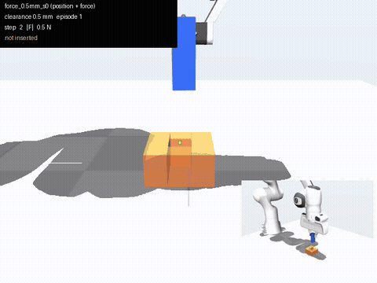
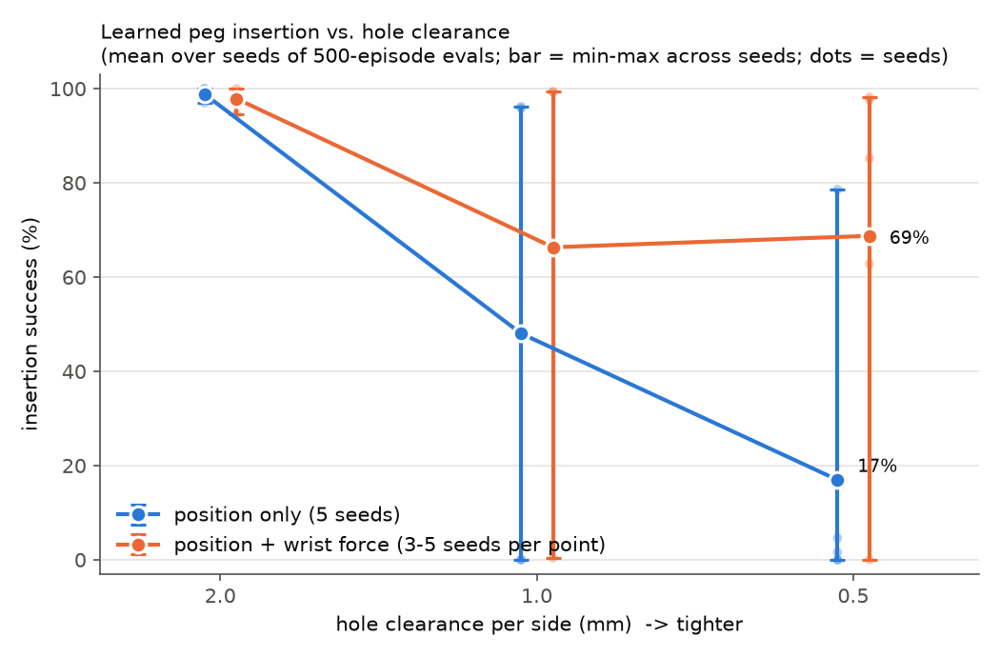
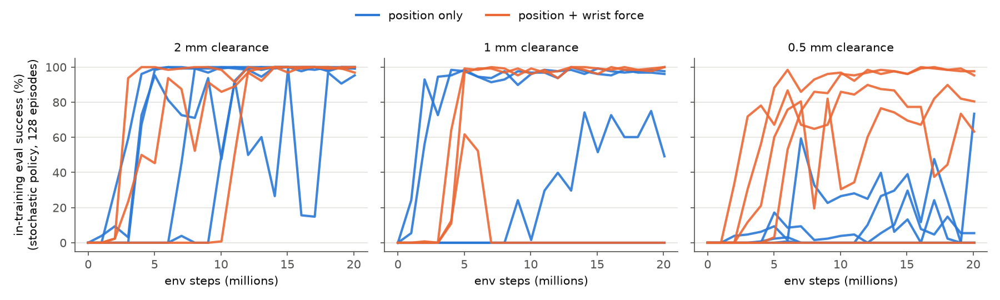

# Learning tight-tolerance peg insertion on a laptop GPU

A simulated Franka Panda arm learns, with reinforcement learning, to insert a held square peg into a square hole. The experiment measures how success falls as the gap shrinks from 2 mm to 0.5 mm, and whether a wrist force sensor brings it back.

<p align="center">
  <br>
  
</p>

## What this is

A peg-in-hole task built on [MuJoCo Playground](https://github.com/google-deepmind/mujoco_playground) (MJX physics on the GPU, Brax PPO), trained on an RTX 5070 Laptop GPU under WSL2. The robot sees a deliberately imperfect estimate of where the hole is, like a slightly miscalibrated camera, so at tight clearances it has to find the hole by feel. Each condition (clearance × sensing) was trained with 3 to 5 random seeds (26 training runs) and every run was evaluated on 500 fresh episodes.

## Why it matters

Pushing one part into another with sub-millimetre clearance (connectors, pins, bearings) is one of the most common steps in electronics and mechanical assembly, and one of the hardest to automate, because tiny position errors turn into jamming forces. Simulation is how robot learning for these tasks is developed today. NVIDIA's Isaac Lab includes peg-insertion tasks in its [Factory environment](https://github.com/isaac-sim/IsaacLab/blob/main/source/isaaclab_tasks/isaaclab_tasks/direct/factory/factory_env.py), and NVIDIA's developer blog post ["Newton adds contact-rich manipulation and locomotion capabilities for industrial robotics"](https://developer.nvidia.com/blog/newton-adds-contact-rich-manipulation-and-locomotion-capabilities-for-industrial-robotics) covers the physics-engine side of the same problem. This project is a small, fully reproducible version of that problem that runs on a laptop.

## Method

| Part | Choice | Why |
|---|---|---|
| Simulator | MuJoCo MJX, Warp backend, 1024 parallel environments | GPU-parallel physics; Warp was ~4× faster than the JAX backend in a short benchmark on this GPU |
| Robot | Franka Panda from MuJoCo Menagerie, gravity compensation on | Standard research arm; without gravity compensation its soft servos sagged ~2 cm |
| Peg / hole | 20 × 20 × 60 mm box peg rigidly held; hole made of 4 box walls, 30 mm deep, gap per side 2.0 / 1.0 / 0.5 mm | MJX collides boxes reliably; "already grasped" isolates the insertion problem |
| Control | Policy outputs a 3-D step for the peg tip (≤ 2 mm per axis per 20 ms); analytic inverse kinematics → joint targets; gripper fixed pointing down | Same scheme as Playground's Franka pick task; simple, stable |
| Observation (position only, 10 numbers) | Tip position relative to the *estimated* hole, tip velocity, previous action, depth | The hole estimate has a per-episode bias (0.75 mm std) plus 0.2 mm noise: at 0.5 mm clearance the bias is larger than the gap about half the time |
| Observation (+ force, 16 numbers) | The above plus wrist force (3) and torque (3) from a simulated force/torque sensor between hand and peg | Lets the policy feel contact with the hole edge |
| Reward | reach + align + insert depth + one-time success bonus − small penalties (jerky actions, forces > 15 N) | Dense shaping; episodes do not end on success so the policy learns to go in and stay in |
| Success | Tip ≥ 24 mm (80% of hole depth) inside the hole at any point in a 200-step (4 s) episode | A depth threshold is a simple, unambiguous test of insertion |
| Learning | PPO (Brax), 20M steps per run, learning rate 2e-4, otherwise Playground's tuned settings for this arm | Standard for massively parallel simulation |
| Domain randomization | Per environment: contact friction ±30%, peg mass ±20%, arm servo stiffness ±10% | So the policy cannot rely on one exact physics setting |

Every design decision and its reason is logged in [DECISIONS.md](DECISIONS.md). Two important ones: training was first unstable (runs collapsed after learning), which was fixed by a lower learning rate and a sharper alignment reward. Both changes were applied to all conditions, and every run was redone with the final setup (earlier results are kept in `results/archive/`).

**Physics sanity check.** Before any learning, a hand-written controller that knows the true hole position inserted the peg in 100% of 20 episodes at every clearance, and jammed (0%) when started 1.5 mm off-centre at 1.0 and 0.5 mm, as geometry says it should ([results/scripted_baseline.csv](results/scripted_baseline.csv)).

## Results

Each number is the mean over random seeds of the success rate on 500 fresh evaluation episodes per seed (deterministic policy, hole position, observation error and physics re-randomized every episode). "Steps to insert" counts 20 ms control steps in successful episodes. Full per-run numbers with 95% confidence intervals: [results/summary.csv](results/summary.csv).

| Sensing | Clearance | Seeds | Success (mean) | Per seed (%) | Steps to insert | Peak force (N) |
|---|---|---|---|---|---|---|
| position only | 2 mm | 5 | **98.8%** | 100 / 98 / 100 / 97 / 100 | 102 | 81 |
| position only | 1 mm | 5 | **48.0%** | 96 / 96 / 0 / 48 / 0 | 114 | 83 |
| position only | 0.5 mm | 5 | **17.0%** | 0 / 79 / 0 / 5 / 2 | 134 | 41 |
| position + force | 2 mm | 3 | **97.9%** | 99 / 95 / 100 | 95 | 101 |
| position + force | 1 mm | 3 | **66.3%** | 99 / 0 / 99 | 132 | 86 |
| position + force | 0.5 mm | 5 | **68.8%** | 98 / 0 / 63 / 98 / 85 | 150 | 68 |

**What this shows.** With position sensing only, success falls from 99% at 2 mm to 48% at 1 mm and 17% at 0.5 mm. Adding the wrist force sensor keeps 0.5 mm at 69%, an improvement of 52 percentage points (exact permutation test across the 5 vs 5 seeds, one-sided p = 0.044). The main effect is on whether training works at all: at 0.5 mm, 4 of 5 force-sensing runs learned to insert, against 1 of 5 position-only runs. The runs that failed (in both conditions) settled into hovering near the hole without pushing in, a local optimum of the shaped reward. The variation between seeds is large, which is itself a finding: at tight clearances a single training run says little.

**Extra checks.**
- *Observation error removed* (0.5 mm policies re-tested with a perfect hole estimate): runs that had failed still score 0%, so they never learned to insert. Successful runs improve (position-only seed 1: 79% → 100%; force seeds 2 and 4: 63% → 94%, 85% → 96%), so the deliberate error also costs some success.
- *Generalisation* (policies trained at 2 mm, tested on tighter holes without retraining): 60–84% at 1 mm and 25–47% at 0.5 mm (3 seeds). A 2 mm policy does better at 0.5 mm than position-only policies trained at 0.5 mm, which suggests a curriculum (start wide, then tighten) as a next step.
- *Physics validity*: in all 26 × 500 evaluation episodes, no peg passed through a wall (the tip never moved further off-axis inside the hole than the clearance plus 0.5 mm of contact compliance), and no simulation produced NaNs.



In-training evaluations (above) use the stochastic exploration policy, which at 0.5 mm can block insertion on its own, so the headline numbers come from the deterministic 500-episode evaluations. Videos of every run: [results/videos/](results/videos/).

## Reproduce

1. One-time setup (Windows + WSL2 Ubuntu 24.04, NVIDIA driver ≥ 580, `uv`): see "Day 0" in [PLAN.md](PLAN.md).
2. Environment (everything stays inside the project folder):
   ```bash
   source scripts/env.sh
   git clone --depth 1 https://github.com/google-deepmind/mujoco_playground.git third_party/mujoco_playground
   uv venv --python 3.12 .venv && source .venv/bin/activate
   uv pip install -e third_party/mujoco_playground "jax[cuda12]" mujoco-warp==3.15.0 tensorboardX PyOpenGL mediapy imageio imageio-ffmpeg pytest matplotlib pandas pyyaml pillow
   ```
3. Tests (scene geometry, sensor, scripted insertion): `pytest tests/`
4. Full experiment (trains, evaluates, renders and plots every condition; resumable):
   ```bash
   setsid nohup bash scripts/sweep.sh > logs/sweep.log 2>&1 < /dev/null &
   ```
   A single run: `bash scripts/train.sh pos_0.5mm_s0 --clearance_mm 0.5 --seed 0` (add `--use_force_obs` for the force condition).
5. Trained policies are in `results/policies/<run>/` (`params.pkl` + `network_config.json`), so you can evaluate or render without retraining:
   `python scripts/evaluate.py --run force_0.5mm_s0` · `python scripts/render.py --run force_0.5mm_s0`

## Project structure

```
peg_insertion/        the task: xml_builder.py (scene), env.py (MJX env, reward, randomization),
                      configs.py (PPO settings), rollout.py (evaluation), jax_compat.py
scripts/              train.py (from Playground's trainer), evaluate.py, render.py, plot.py,
                      scripted_insert.py, sweep.sh, train.sh, env.sh; dev/ = one-off probes
tests/                pytest: geometry, shapes, stability, randomization, force sensor, scripted insertion
results/              summary.csv, charts, videos, policies, per-run metrics, archive/ (superseded runs)
PROGRESS.md           dated log of everything that was done;  DECISIONS.md: every choice + reason
```

## Hardware

- Laptop: Intel Core Ultra 9 285H, 32 GB RAM, **NVIDIA GeForce RTX 5070 Laptop GPU (8 GB, Blackwell)**, Windows + WSL2 Ubuntu 24.04.
- Software: JAX 0.11.2 (CUDA 12), MuJoCo / MJX 3.15.0 with the Warp backend (mujoco-warp 3.15.0), Brax 0.14.2. Details and `pip freeze`: [results/environment.md](results/environment.md).
- One training run (20M environment steps, 1024 parallel environments): **about 5.5 minutes** (4.8 to 5.8 min) at **about 68,000 environment steps per second**, using under 1 GB of GPU memory. All 26 runs of the final experiment (520M steps) took 2.4 GPU-hours; evaluation and video rendering roughly doubled the wall time.
- Rendering uses software OpenGL (osmesa) because GPU rendering does not work under WSL2: about 0.3 s per frame.

## Limitations and next steps

- The peg is rigidly attached to the hand (no grasp, no slip) and the gripper cannot rotate, so the classic "tilt and slide" insertion strategy is not available.
- Square peg, square hole, no chamfer; one peg size.
- Contact forces are large (the policies press hard once inserted); the force penalty only starts at 15 N and is small. A real robot would need force limits.
- Simulation only: no sim-to-real test. The observation bias is a simple stand-in for perception error.
- Next: port to NVIDIA Isaac Lab with the Newton physics engine and compare with its Factory peg-insert task; add chamfers, round pegs and wrist rotation; test on a real arm with a force/torque sensor.

## Acknowledgements

Built on [MuJoCo](https://mujoco.org), [MuJoCo Playground](https://github.com/google-deepmind/mujoco_playground), [MuJoCo Menagerie](https://github.com/google-deepmind/mujoco_menagerie) (Franka Panda model) and [Brax](https://github.com/google/brax). `scripts/train.py` is adapted from Playground's PPO trainer (Apache-2.0; see NOTICE).

This project was built with AI assistance under Griffin's direction: the code, experiments and first drafts of the documentation were produced with Claude Code (Anthropic's AI coding assistant) following a written plan, with every decision logged in DECISIONS.md.

License: Apache-2.0.
