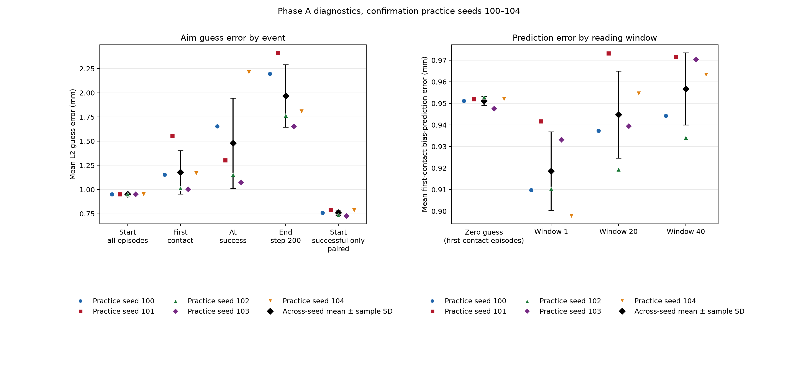
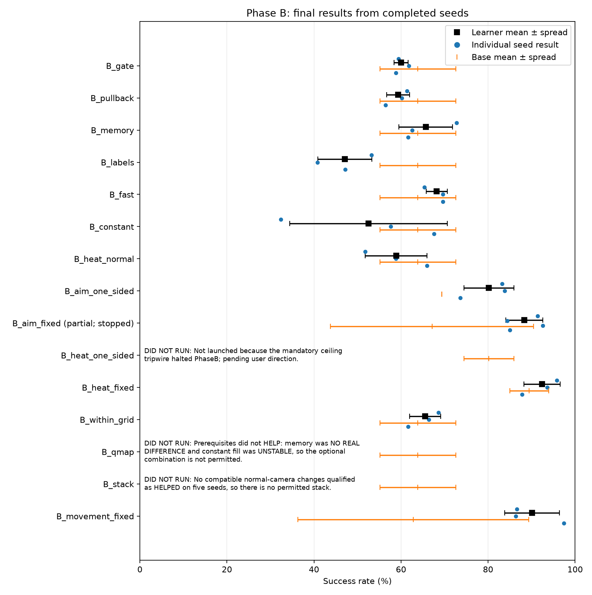

# Follow-up report

Work stopped in Phase B because the mandatory ceiling tripwire fired. On fixed-camera practice seed 4, plain aim scored 256/256 (100 percent) at 160 practice episodes, six percentage points above that condition's measured ceiling of 470/500 (94 percent). The rule in [CODEX_GOALS.md, When to stop](CODEX_GOALS.md#when-to-stop-the-only-stopping-rule) requires stopping when an aim-only learner exceeds its measured ceiling by more than five points. This is an unresolved sanity check, not a confirmed improvement. All experiment workers stopped; no retry or later phase has run.

No new normal-camera setting has qualified as HELPED. Success-derived labels HURT insertion success despite improving the guess on successful episodes; constant-offset fill was UNSTABLE. Plain aim with one-sided bias and plain movement with a fixed bias are PROMISING on three seeds only. The original 80.2 percent headline and every original result remain unchanged. The best existing normal-camera learning method is still plain movement: 83.36 percent with a 2.99-point spread on the development seeds, and 80.20 percent with a 6.52-point spread on the old confirmation seeds. Spread means the sample standard deviation across practice seeds. Fresh practice seeds 200 to 204 and test seed 1001 have not been used, so there is no fresh-seed comparison or follow-up headline.

The requested work was to diagnose and repair aim learning, retest the old tricks on movement, combine independently useful changes, then try touch and confirm the chosen learner on fresh seeds. Phase A is complete. Phase B is incomplete because of the required stop. Phases C to G have not run; the Phase C files contain preparation only. The complete partial scoreboard below retains all bad, unfinished and skipped settings.

## Phase A: why the aim guess failed

These are saved final tests from practice seeds 100 to 104, with 500 test-only episodes per seed at test seed 456. They are diagnostic evidence, not new choosing results. Distances below are the straight-line distance between the guess and the true camera error, in millimetres. The paired start column uses only the same episodes that subsequently succeeded.

| Practice seed | Successes / 500 | Start, all | First contact | At success | Start, successful only | End at step 200 | End closer than start | First contact step |
|---|---:|---:|---:|---:|---:|---:|---:|---:|
| 100 | 327 | 0.953 | 1.153 | 1.654 | 0.761 | 2.198 | 11.2% | 127.8 |
| 101 | 322 | 0.953 | 1.556 | 1.302 | 0.789 | 2.413 | 16.2% | 126.9 |
| 102 | 304 | 0.953 | 1.013 | 1.153 | 0.738 | 1.765 | 20.2% | 134.5 |
| 103 | 286 | 0.953 | 1.002 | 1.074 | 0.730 | 1.654 | 24.2% | 136.3 |
| 104 | 330 | 0.953 | 1.169 | 2.213 | 0.786 | 1.809 | 18.4% | 130.7 |

The outside check was mostly right: contact errors were 1.00 to 1.56 mm and end errors were 1.65 to 2.41 mm, against a mean true error of 0.953 mm. Only 11.2 to 24.2 percent ended closer, and contact occurred around steps 127 to 136. Each seed tended toward a different direction, but “whatever the true error” is too strong: the per-axis correlations between final guess and true error ranged from -0.37 to +0.52. Even at insertion, the guess was farther from the truth than its paired starting guess in every seed; continued motion after success exaggerates the end error but does not explain away the failure to find the camera error.

A fixed linear predictor, fitted only on each run's own saved 200 practice episodes, had mean first-contact errors of about 0.919, 0.945 and 0.956 mm for windows of 1, 20 and 40 readings; a zero guess was about 0.951 mm. These tests do not support a benefit from a longer linear history, but do not rule out a nonlinear learner using memory. The predictor was fixed before evaluation, and no test episode supplied a fitted parameter. The readings before control step 125 were barely predictive with any window. The full per-seed results, including prediction fit details, are in [the diagnostic data](results/takehome/followup/A/diagnosis.json) and [prediction table](results/takehome/followup/A/prediction_table.csv).

The saved original-policy diagnostic repeat succeeded in 86/99 episodes (86.9 percent) below 0.5 mm of bias, versus 8/67 (11.9 percent) above 1.5 mm. Those small groups support the importance of the camera error. This particular saved repeat totals 303/500 and does not replace the original 304/500 confirmation floor.

## Protocol and cautious readings

The initial [protocol](results/takehome/followup/protocol.json) and [time estimate](results/takehome/followup/time_estimate.json) were fixed before any new run. Successful insertion supplies an approximate label from observable camera readings, not an exact hidden hole centre. Paired success-error comparisons use the same episodes at start and success. A setting must beat the larger of its own and its matched base's sample spreads; three seeds are provisional, five are required for HELPED. A collapse below half its matched base takes priority as UNSTABLE. Normal-camera learning methods alone are eligible for the fresh choice; all Phase F methods are comparisons. Required integrated algorithms are tested as stated, while separable additions are isolated before optional combinations. Full traces, models and videos remain on disk only.

The limits are 14 new aim variants in Phase B and 90 new settings overall. The old report's bytes remain intact; only the requested final pointer paragraph will be appended in Phase G. Fresh practice seeds 200 to 204 and test seed 1001 remain locked until the choice is recorded. Existing repeatability limitations remain: the same seed can produce slightly different physical trajectories. See [the decisions log](TAKEHOME_DECISIONS.md) for each PLAN GAP and its cautious resolution.

## Phase B: what was learned before the stop

Twelve settings were attempted. Thirty-seven runs reached 200 practice episodes and their final 500-episode test at seed 123. One more run stopped at 160 practice episodes. All isolated normal-camera changes stayed within the declared comparison spread except the success labels, which were worse, and constant-offset fill, which collapsed on one seed. Faster post-contact nudges reached 68.20 percent on three seeds, but the 4.33-point gain over the matched old aim result was smaller than that base's 8.73-point spread. Memory reached 65.67 percent and did not qualify as an improvement. None of these results establishes a working aim corrector.

The labels did make the guess closer to the true camera error on successful episodes: the paired reduction was 0.308 mm. Yet insertion fell to 47.07 percent, versus the matched old aim result of 63.87 percent. Memory made the paired guess error worse by 1.004 mm. A better guess among the episodes that happened to succeed is not enough to show that a method improves overall insertion. Start and success errors appear for every aim setting in the scoreboard; [per-seed metrics](results/takehome/followup/setting_summaries.json) also include the paired starting error for successful episodes.

The fixed-camera heat map scored 92.40 percent on three seeds, compared with plain aim's matched 89.47 percent. That 2.93-point difference was inside the spread, so its verdict is NO REAL DIFFERENCE. Plain aim on the one-sided problem scored 80.20 percent against its own 69.40 percent floor, but still needs the two extra seeds before it could be called HELPED. Plain movement on the fixed problem similarly remains PROMISING. These are different camera problems and do not replace the normal-camera result. The one-sided heat map was waiting to run when the tripwire fired. The optional memory-plus-constant-fill combination and the general stack were not launched because their isolated prerequisites did not qualify.

## Why the work stopped

| Item | Recorded evidence |
|---|---|
| Setting and seeds | B_aim_fixed, practice seed 4, test seed 123 |
| Charged practice | 160 of 200 episodes, including 40 fill-up episodes |
| Triggering curve test | 256/256, 100 percent |
| Same-condition measured ceiling | 470/500, 94 percent |
| Difference and rule | 6 points; stopping threshold is more than 5 |
| Saved ceiling's first 256 episodes | 241/256, 94.14 percent |
| Triggering test's physical flags | 0 wall-passing flags, 0 invalid-number flags |
| Final 500-episode learner test for seed 4 | Not run |
| Latest saved checkpoint | 150 practice episodes; the charged batch through 160 is saved locally |

The trigger is a learning-curve result, not a final result to select. The reason for exceeding the measured ceiling has not been diagnosed, and these flags alone cannot establish that the behavior is valid. I did not change the threshold, seeds, test size, budget or success rule, and did not rerun the result. [The stop record](results/takehome/followup/B/tripwire.json), [test summary](results/takehome/followup/B/B_aim_fixed/seed_4/test_0160.json) and [worker log](results/takehome/followup/logs/b_wave3_B_aim_fixed.log) preserve the evidence. The fixed-aim scoreboard row uses DID NOT RUN to mark its unfinished five-seed setting; its displayed mean uses only the four completed final tests. Seed 4 is excluded from that mean and still consumes its 160 charged practice episodes.

## Full follow-up scoreboard

Every final seed result below is out of 500 test-only episodes at test seed 123. The fixed-aim row is explicitly partial. Aim distances are in millimetres, and smaller is better. The start column covers all episodes; the success column covers only successful episodes, so the paired values linked above are used to judge improvement in finding the error. Steps to insert are averaged over successful episodes. Peak force is the mean of each episode's peak, in newtons. Skipped settings consume no practice episodes. The machine-readable [CSV](results/takehome/followup/scoreboard.csv) contains the same rows.

<!-- FOLLOWUP_SCOREBOARD_START -->
| Phase | Name | Description | Base | Base result | Seed results | Mean (%) | Spread (pp) | Delta (pp) | Verdict | Aim start (mm) | Aim at success (mm) | Steps to insert | Peak force (N) | Practice episodes | Hand search | Hidden information | Camera condition | Reason | Base mean (%) | Base spread (pp) |
| --- | --- | --- | --- | --- | --- | --- | --- | --- | --- | --- | --- | --- | --- | --- | --- | --- | --- | --- | --- | --- |
| B | B_gate | Keep the guess zero until contact, then change it only while depth stalls. | aim | s0 365/500 (73.0%); s1 278/500 (55.6%); s2 315/500 (63.0%); mean 63.87% ± 8.73pp | 0: 297/500 (59.4%); 1: 309/500 (61.8%); 2: 294/500 (58.8%) | 60.00 | 1.59 | -3.87 | NO REAL DIFFERENCE | 0.939 | 0.740 | 167.9 | 84.5 | 600 | no | no | normal | n/a | 63.87 | 8.73 |
| B | B_pullback | Pull the running guess 1% toward zero each step. | aim | s0 365/500 (73.0%); s1 278/500 (55.6%); s2 315/500 (63.0%); mean 63.87% ± 8.73pp | 0: 307/500 (61.4%); 1: 301/500 (60.2%); 2: 282/500 (56.4%) | 59.33 | 2.61 | -4.53 | NO REAL DIFFERENCE | 0.939 | 1.680 | 170.3 | 83.1 | 600 | no | no | normal | n/a | 63.87 | 8.73 |
| B | B_memory | Give actor and critic a 20-reading mean and change summary. | aim | s0 365/500 (73.0%); s1 278/500 (55.6%); s2 315/500 (63.0%); mean 63.87% ± 8.73pp | 0: 364/500 (72.8%); 1: 313/500 (62.6%); 2: 308/500 (61.6%) | 65.67 | 6.20 | 1.80 | NO REAL DIFFERENCE | 0.939 | 1.770 | 167.2 | 86.1 | 600 | no | no | normal | n/a | 63.87 | 8.73 |
| B | B_labels | Train toward approximate camera-error labels from own successful practice. | aim | s0 365/500 (73.0%); s1 278/500 (55.6%); s2 315/500 (63.0%); mean 63.87% ± 8.73pp | 0: 266/500 (53.2%); 1: 204/500 (40.8%); 2: 236/500 (47.2%) | 47.07 | 6.20 | -16.80 | HURT | 0.939 | 0.508 | 171.0 | 80.8 | 600 | no | no | normal | n/a | 63.87 | 8.73 |
| B | B_fast | Double the aim nudge limit after contact. | aim | s0 365/500 (73.0%); s1 278/500 (55.6%); s2 315/500 (63.0%); mean 63.87% ± 8.73pp | 0: 327/500 (65.4%); 1: 348/500 (69.6%); 2: 348/500 (69.6%) | 68.20 | 2.42 | 4.33 | NO REAL DIFFERENCE | 0.939 | 1.730 | 167.7 | 86.7 | 600 | no | no | normal | n/a | 63.87 | 8.73 |
| B | B_constant | Try one constant random offset in each fill-up episode. | aim | s0 365/500 (73.0%); s1 278/500 (55.6%); s2 315/500 (63.0%); mean 63.87% ± 8.73pp | 0: 162/500 (32.4%); 1: 288/500 (57.6%); 2: 338/500 (67.6%) | 52.53 | 18.14 | -11.33 | UNSTABLE | 0.939 | 1.180 | 173.2 | 82.0 | 600 | no | no | normal | n/a | 63.87 | 8.73 |
| B | B_heat_normal | Start at the most successful offset from an own-practice heat map. | aim | s0 365/500 (73.0%); s1 278/500 (55.6%); s2 315/500 (63.0%); mean 63.87% ± 8.73pp | 0: 259/500 (51.8%); 1: 294/500 (58.8%); 2: 330/500 (66.0%) | 58.87 | 7.10 | -5.00 | NO REAL DIFFERENCE | 1.465 | 1.353 | 171.5 | 83.3 | 600 | no | no | normal | n/a | 63.87 | 8.73 |
| B | B_aim_one_sided | Run plain aim with one-sided camera bias. | floor | One shared test123 floor: 347/500 (69.4%); reused, not rerun per practice seed; mean 69.40% ± 0.00pp | 0: 416/500 (83.2%); 1: 419/500 (83.8%); 2: 368/500 (73.6%) | 80.20 | 5.72 | 10.80 | PROMISING | 0.939 | 1.167 | 165.9 | 90.1 | 600 | no | no | one-sided | n/a | 69.40 | 0.00 |
| B | B_aim_fixed | Run plain aim with one fixed camera bias per run. | floor | s0 206/500 (41.2%); s1 274/500 (54.8%); s2 462/500 (92.4%); s3 401/500 (80.2%); mean 67.15% ± 23.34pp | 0: 457/500 (91.4%); 1: 422/500 (84.4%); 2: 463/500 (92.6%); 3: 425/500 (85.0%) | 88.35 | 4.25 | 21.20 | DID NOT RUN | 1.010 | 2.082 | 168.0 | 94.2 | 960 | no | no | fixed for the whole run | Seed4 halted after160 charged practice episodes: curve test256/256 (100%) exceeded own470/500 (94%) ceiling by6 points. Seeds0–3 completed; mean/spread shown are partial, not a five-seed result. | 67.15 | 23.34 |
| B | B_heat_one_sided | Use the across-episode heat map with one-sided camera bias. | B_aim_one_sided | s0 416/500 (83.2%); s1 419/500 (83.8%); s2 368/500 (73.6%); mean 80.20% ± 5.72pp | n/a | n/a | n/a | n/a | DID NOT RUN | n/a | n/a | n/a | n/a | 0 | no | no | one-sided | Not launched because the mandatory ceiling tripwire halted PhaseB; pending user direction. | 80.20 | 5.72 |
| B | B_heat_fixed | Use the across-episode heat map with one fixed camera bias per run. | B_aim_fixed | s0 457/500 (91.4%); s1 422/500 (84.4%); s2 463/500 (92.6%); mean 89.47% ± 4.43pp | 0: 479/500 (95.8%); 1: 468/500 (93.6%); 2: 439/500 (87.8%) | 92.40 | 4.13 | 2.93 | NO REAL DIFFERENCE | 1.317 | 0.760 | 164.3 | 94.8 | 600 | no | no | fixed for the whole run | n/a | 89.47 | 4.43 |
| B | B_within_grid | Rule out stalled offsets within an episode and search nearby untried cells. | aim | s0 365/500 (73.0%); s1 278/500 (55.6%); s2 315/500 (63.0%); mean 63.87% ± 8.73pp | 0: 343/500 (68.6%); 1: 332/500 (66.4%); 2: 308/500 (61.6%) | 65.53 | 3.58 | 1.67 | NO REAL DIFFERENCE | 0.939 | 1.620 | 168.8 | 86.0 | 600 | yes | no | normal | n/a | 63.87 | 8.73 |
| B | B_qmap | Combine memory and constant-offset fill, then visualize the critic map. | aim | s0 365/500 (73.0%); s1 278/500 (55.6%); s2 315/500 (63.0%); mean 63.87% ± 8.73pp | n/a | n/a | n/a | n/a | DID NOT RUN | n/a | n/a | n/a | n/a | 0 | no | no | normal | Prerequisites did not HELP: memory was NO REAL DIFFERENCE and constant fill was UNSTABLE, so the optional combination is not permitted. | 63.87 | 8.73 |
| B | B_stack | Combine compatible changes that helped independently. | aim | s0 365/500 (73.0%); s1 278/500 (55.6%); s2 315/500 (63.0%); mean 63.87% ± 8.73pp | n/a | n/a | n/a | n/a | DID NOT RUN | n/a | n/a | n/a | n/a | 0 | no | no | normal | No compatible normal-camera changes qualified as HELPED on five seeds, so there is no permitted stack. | 63.87 | 8.73 |
| B | B_movement_fixed | Run plain movement with one fixed camera bias per run. | floor | s0 206/500 (41.2%); s1 274/500 (54.8%); s2 462/500 (92.4%); mean 62.80% ± 26.52pp | 0: 433/500 (86.6%); 1: 432/500 (86.4%); 2: 487/500 (97.4%) | 90.13 | 6.29 | 27.33 | PROMISING | n/a | n/a | 148.8 | 93.2 | 600 | no | no | fixed for the whole run | n/a | 62.80 | 26.52 |
<!-- FOLLOWUP_SCOREBOARD_END -->

## Checks and limits

The zero-correction check passed at 303/500 against the preserved 307/500 development floor. Two separately counted 10-episode code trials finished; the first checked an earlier label draft and the second checked the final direct-prediction version. All 37 synthetic control, data-origin, verdict and reporting checks passed. The broader Phase G test suite has not run. Practice counters, separation of practice from tests, frozen policy weights and fresh-seed restrictions passed the recorded checks. No test episode was learned from, and no experiment exceeded 200 practice episodes.

Movement is allowed to beat the measured ceiling under the standing rule, but requires extra physical checks. Sixteen such checks used 500 test-only episodes each at diagnostic seed 789. Their summaries recorded no wall-passing or invalid-number flags. Five saved episodes per check had control magnitudes at most 1.0 and maximum sideways distance while deeply inserted at most 0.667 mm. The unchanged wall check compares that distance with the episode's clearance plus 0.5 mm. This is a limited simulator sanity check, not proof of real-world validity. These 8,000 diagnostic episodes were excluded from selection. [The physical review](results/takehome/followup/B/ceiling_verification_review.json) lists every check.

After the halt, the preservation audit passed for all 9,071 protected files, including local original artifacts, code, policies and the original report. The old report has not received even the Phase G pointer because that phase was not reached. Large traces, model files and videos stay local and ignored by git. Full test traces were saved only for final 500-episode tests and the required physical checks. Existing simulator repeatability limitations remain. The interrupted phase and incomplete five-seed extensions prevent a final conclusion about the follow-up plan; this work has already had more tuning than the original study.

## Counts and handoff

| Count | This follow-up | Whole project |
|---|---:|---:|
| Attempted settings | 12 | 40 |
| Charged practice episodes | 7,580 | 36,590 |
| Full test-only episodes | 110,584 | 520,274 |
| Reset-only probes | 0 | 191 |

Practice includes 7,400 episodes in completed experiments, 160 in the interrupted run and 20 in code trials. The three unlaunched scoreboard rows are not counted as attempted settings. [Accounting](results/takehome/followup/accounting.json) has no validation errors and keeps reused old data separate from new episodes.

Work is halted pending Griffin's direction under the explicit tripwire rule. The registry and job launchers block new jobs while the halt is active. No automatic retry, fresh-seed run or later phase is scheduled. Any later authorized resumption must preserve the spent budget and reuse the saved batch through episode 160 rather than collect it again. Read this report first, then the scoreboard and stop record; the original finished report remains the source for the unchanged 80.2 percent result.
