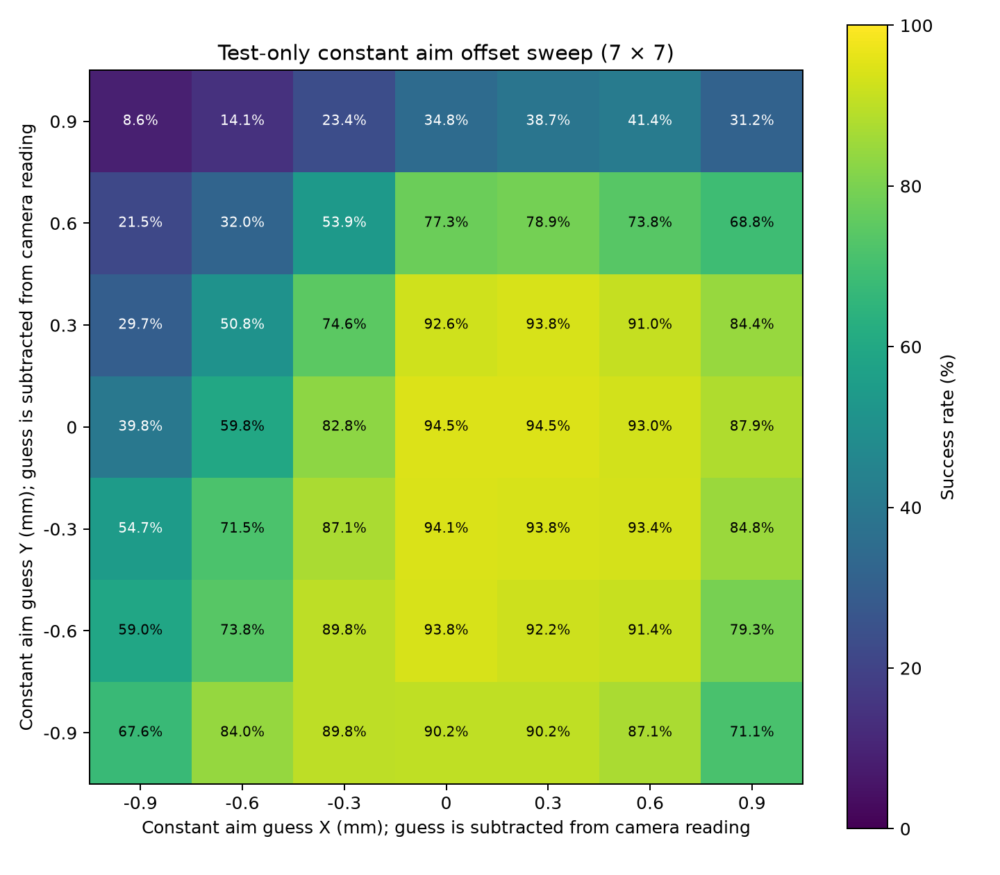
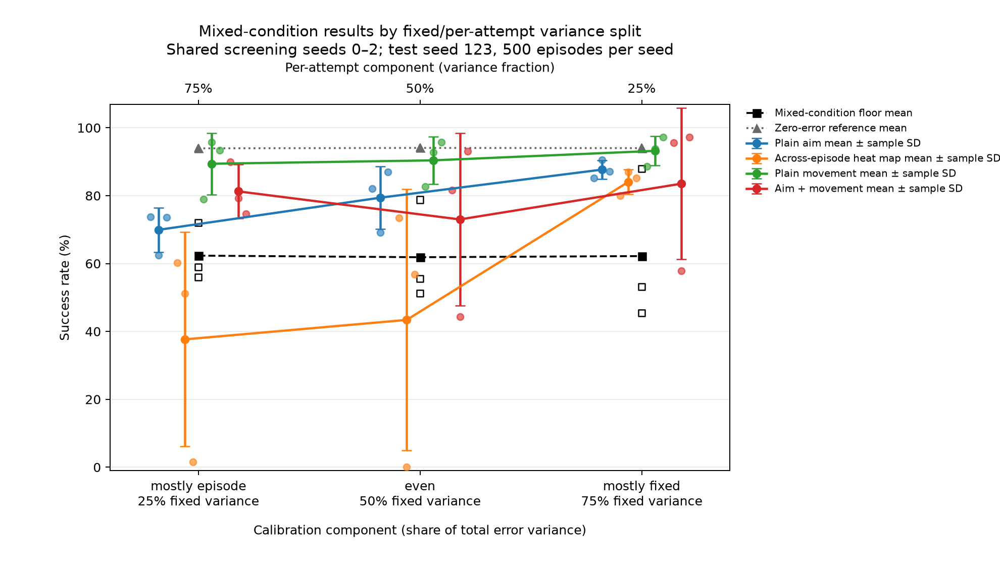
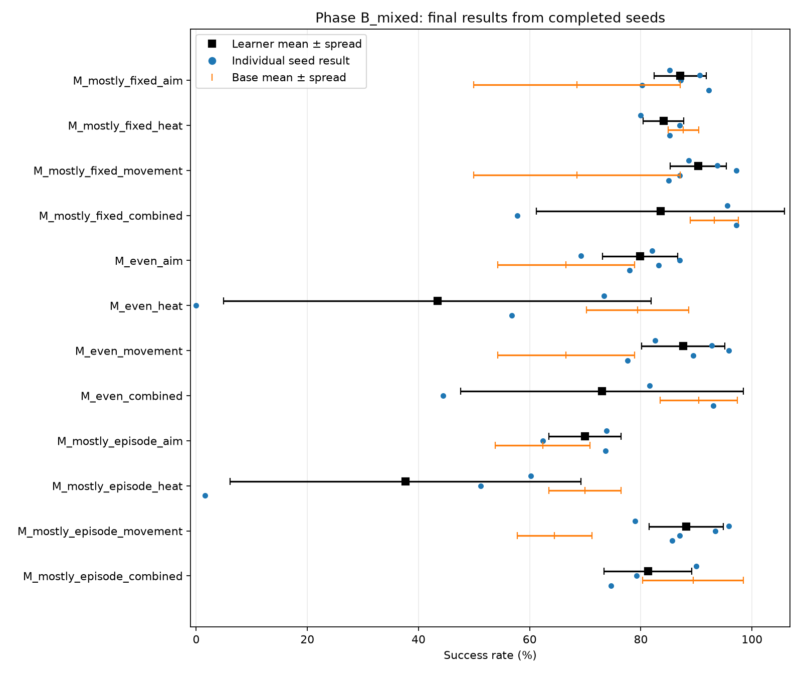
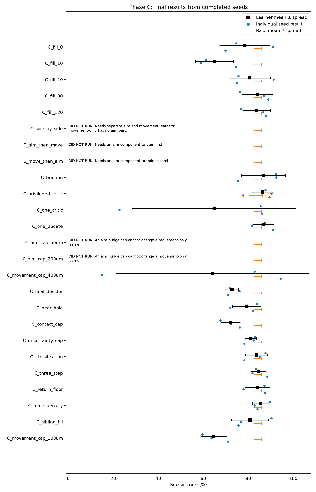
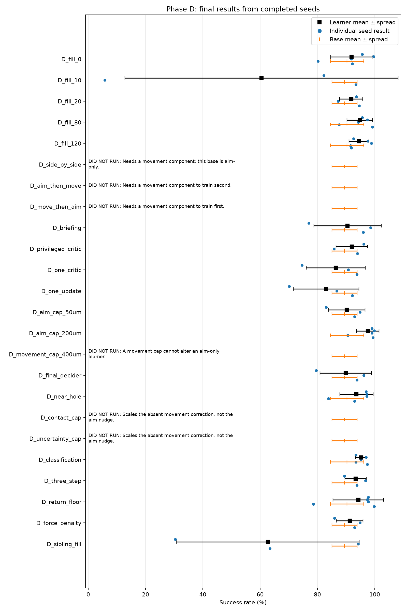
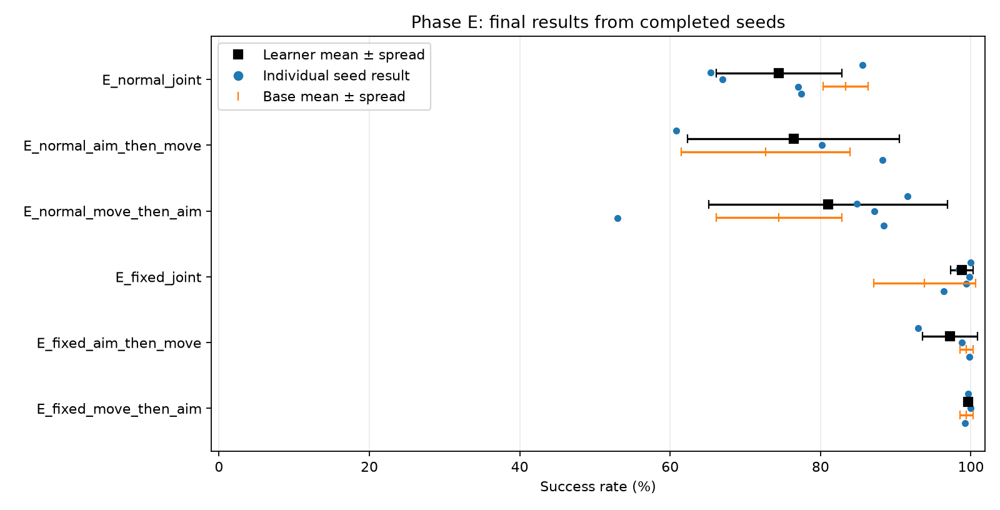

# Follow-up report

All phases are complete. Short version: nothing in the follow-up beat the plain movement corrector in the normal camera condition. On fresh seeds (200 to 204, test seed 1001) plain movement scored **84.2% +- 5.9 points**, against a floor of 61.4% and a zero-camera-error reference of 95.0%. No aim repair worked in the normal condition; none of the movement changes (Phase C) or fixed-camera aim changes (Phase D) HELPED on five seeds except a larger aim step in the fixed-camera condition (97.6% vs 90.4%), which does not apply to the normal condition. Learning aim and movement together HURT in the normal condition (74.5% vs 83.4%). A hand-written touch spiral did not help (62.2%). The original 80.2% headline is unchanged; the follow-up reproduced it rather than beating it. Mixed-camera plain movement and aim HELPED against the no-corrector floor, which is a different comparison. Dev numbers were selected over many settings and are optimistic; the fresh numbers are the headline.

The task is to repair aim learning, retest the old tricks on movement and fixed-camera aim, combine independently useful changes, compare touch methods, and confirm a learning method on fresh seeds. Phases A, B, the added mixed comparison and C are complete; D through G remain. Spread means the sample standard deviation across practice seeds. Fixed and mixed conditions model calibration error plus per-attempt error; none is designated the realistic condition. The more careful Phase A test found **no benefit from 20 or 40 readings over one**.

## Phase A: why the aim guess failed

These are saved final tests from practice seeds 100 to 104, with 500 test-only episodes per seed at test seed 456. They are diagnostic evidence, not new choosing results. Distances below are the straight-line distance between the guess and the true camera error, in millimetres. The paired start column uses only the same episodes that subsequently succeeded.

| Practice seed | Successes / 500 | Start, all | First contact | At success | Start, successful only | End at step 200 | End closer than start | First contact step |
|---|---:|---:|---:|---:|---:|---:|---:|---:|
| 100 | 327 | 0.953 | 1.153 | 1.654 | 0.761 | 2.198 | 11.2% | 127.8 |
| 101 | 322 | 0.953 | 1.556 | 1.302 | 0.789 | 2.413 | 16.2% | 126.9 |
| 102 | 304 | 0.953 | 1.013 | 1.153 | 0.738 | 1.765 | 20.2% | 134.5 |
| 103 | 286 | 0.953 | 1.002 | 1.074 | 0.730 | 1.654 | 24.2% | 136.3 |
| 104 | 330 | 0.953 | 1.169 | 2.213 | 0.786 | 1.809 | 18.4% | 130.7 |

The outside check was mostly right: contact errors were 1.00 to 1.56 mm and end errors were 1.65 to 2.41 mm, against a mean true error of 0.953 mm. Only 11.2 to 24.2 percent ended closer, and contact occurred around steps 127 to 136. Each seed tended toward a different direction, but “whatever the true error” is too strong: the per-axis correlations between final guess and true error ranged from -0.37 to +0.52. Even at insertion, the guess was farther from the truth than its paired starting guess in every seed; continued motion after success exaggerates the end error but does not explain away the failure to find the camera error.

A fixed linear predictor, fitted only on each run's own saved 200 practice episodes, had mean first-contact errors of about 0.919, 0.945 and 0.956 mm for windows of 1, 20 and 40 readings; a zero guess was about 0.951 mm. These tests do not support a benefit from a longer linear history, but do not rule out a nonlinear learner using memory. The predictor was fixed before evaluation, and no test episode supplied a fitted parameter. The readings before control step 125 were barely predictive with any window. The full per-seed results, including prediction fit details, are in [the diagnostic data](results/takehome/followup/A/diagnosis.json) and [prediction table](results/takehome/followup/A/prediction_table.csv).

The saved original-policy diagnostic repeat succeeded in 86/99 episodes (86.9 percent) below 0.5 mm of bias, versus 8/67 (11.9 percent) above 1.5 mm. Those small groups support the importance of the camera error. This particular saved repeat totals 303/500 and does not replace the original 304/500 confirmation floor.

## Constant-offset sweep and revised ceiling rule

The prescribed 7 by 7 sweep covered guesses from -0.9 to +0.9 mm in 0.3 mm steps, with zero camera error and 256 test-only episodes per cell at seed 123. The best score was **242/256 (94.53 percent)**, tied at **(0, 0) mm and (+0.3, 0) mm**. A positive guess is subtracted from the camera reading, so the second cell shifts that reading by (-0.3, 0) mm. No tested constant offset beat the centre. The sweep therefore does not establish a higher constant-offset ceiling; it is a finite-grid measurement, not a proven upper bound. All 12,544 tests had no wall-passing or invalid-number flags, and none was learned from.

Griffin revised the rule because the old policy's directional preference can allow a consistent offset to beat its zero-error reference. Above-reference aim results in fixed, one-sided and mixed conditions now receive an extra test and physical review instead of a halt. The normal-condition aim-only tripwire remains unchanged. The revised plans and reason were committed before continuation as b46779e. The observed sweep tie is retained even though it does not establish the proposed explanation for the earlier high result.

## Phase B: what helped and what did not

No isolated normal-condition change met the working-aim definition. Labels from successful practice improved paired success-time guess error by 0.308 mm, but reduced insertion to 47.07 percent versus 63.87 percent for matched old aim seeds: HURT. Constant-offset fill collapsed on one seed: UNSTABLE. Gate, pullback, memory, faster contact nudges, the normal heat map and within-episode search were NO REAL DIFFERENCE. Memory worsened paired guess error by 1.004 mm. The optional memory-plus-constant-fill rating map and general stack were not launched because their isolated prerequisites did not help; both remain scoreboard rows.

Plain aim on one-sided error qualified as **HELPED**, at 80.20 percent with 4.24 points of spread over five seeds, versus its 69.40 percent floor. This is a separate development result, not the original 80.2 percent confirmation headline. Its guess still did not find the true error: mean error at success was 1.310 mm versus 0.939 mm initially; the paired comparison worsened by 0.465 mm. The one-sided heat map scored 78.73 percent on three seeds, within its matched base's spread, so it was not extended. Its start/success errors were 1.715/1.054 mm.

Plain fixed-camera aim finished at 90.36 percent with 5.81 points of spread over five seeds; plain movement reached 93.84 percent with 6.76 points of spread. Their matched floor was 72.52 percent. Large variation between calibration seeds kept both verdicts at NO REAL DIFFERENCE under the predeclared conservative spread rule. The fixed heat map scored 92.40 percent on three seeds, also NO REAL DIFFERENCE against matched plain aim. High fixed-camera success does not establish that the guess identified the true error: plain fixed aim's start/success errors were 0.866/1.797 mm.

## Preserved halt and fresh restart

The original fixed-camera seed 4 attempt correctly stopped under the former rule after 160 charged practice episodes, at 256/256 curve-test successes against 470/500 for its reference. All 41 files in that directory remain unchanged. Its own DID NOT RUN row consumes 160 practice episodes, but is not an additional setting or a completed final seed. Success-time guess error is unavailable because its final 500-episode test did not run and full curve traces were deliberately not saved.

The authorized restart began from scratch in a separate directory with its own 200-episode ledger and finished at 492/500. The five-seed result includes that completed restart, not the partial curve score. The [original halt record](results/takehome/followup/B/tripwire.json) and [fresh result](results/takehome/followup/B/B_aim_fixed/seed_4_restart_1/result.json) preserve both outcomes.

## Mixed camera error: calibration plus per-attempt variation

These conditions model a calibration component that stays fixed for one run plus an independent component drawn for each attempt. The stated standard deviations are used exactly: fixed/per-attempt values of 0.65/0.375 mm, 0.53/0.53 mm, and 0.375/0.65 mm. The fixed-only condition isolates calibration error; none of these is designated the realistic condition. Each calibration seed has its own 500-test floor and zero-error reference. The unchanged within-episode camera jitter remains present.

| Model | Run-specific calibration spread, per axis | Per-attempt spread, per axis |
| --- | --- | --- |
| Normal | 0 mm | 0.75 mm |
| Fixed for the whole run | 0.75 mm | 0 mm |
| Mostly fixed | 0.65 mm | 0.375 mm |
| Even | 0.53 mm | 0.53 mm |
| Mostly per-attempt | 0.375 mm | 0.65 mm |

The run-specific draw is shared by that experiment's practice and test episodes. The per-attempt draw changes between episodes. All five models retain the original 0.2 mm noise on individual readings. The mixed values use the plan's rounded numbers exactly, without rescaling.

All 12 requested settings finished. Five three-seed gains qualified for extension, and all five retained HELPED: plain aim in the mostly-fixed and even splits, and plain movement in all three splits. No heat-map or joint addition qualified for extension. The mostly-fixed aim result clears its spread threshold by only 0.02 percentage points, so its HELPED label is especially sensitive to small result variation. The heat map collapsed on one seed in both the even and mostly-per-attempt splits; even-split joint learning also collapsed below half its matched movement base. These are UNSTABLE results, not missing runs.

| Split | Method | Seeds | Final mean ± spread | Verdict | Aim error at start / success (mm) | Paired change toward truth (mm) |
| --- | --- | --- | --- | --- | --- | --- |
| Mostly fixed | Plain aim | 5 | 87.08% ± 4.73 points | HELPED | 0.880 / 1.263 | -0.416 |
| Mostly fixed | Heat map | 3 | 84.07% ± 3.64 points | NO REAL DIFFERENCE | 1.553 / 0.745 | +0.787 |
| Mostly fixed | Plain movement | 5 | 90.32% ± 5.04 points | HELPED | n/a | n/a |
| Mostly fixed | Aim + movement | 3 | 83.53% ± 22.30 points | NO REAL DIFFERENCE | 0.897 / 1.189 | -0.334 |
| Even | Plain aim | 5 | 79.88% ± 6.78 points | HELPED | 0.895 / 1.160 | -0.346 |
| Even | Heat map | 3 | 43.40% ± 38.49 points | UNSTABLE | 1.388 / 1.797 | -0.179 |
| Even | Plain movement | 5 | 87.64% ± 7.46 points | HELPED | n/a | n/a |
| Even | Aim + movement | 3 | 73.00% ± 25.42 points | UNSTABLE | 0.904 / 1.177 | -0.374 |
| Mostly per-attempt | Plain aim | 3 | 69.93% ± 6.52 points | NO REAL DIFFERENCE | 0.922 / 1.291 | -0.516 |
| Mostly per-attempt | Heat map | 3 | 37.67% ± 31.56 points | UNSTABLE | 1.277 / 1.982 | -0.797 |
| Mostly per-attempt | Plain movement | 5 | 88.16% ± 6.66 points | HELPED | n/a | n/a |
| Mostly per-attempt | Aim + movement | 3 | 81.27% ± 7.91 points | NO REAL DIFFERENCE | 0.922 / 1.276 | -0.440 |

Plain aim's better insertion results do not establish that it found the camera error. Its paired success-time guess error became worse in all three mixed splits. The mostly-fixed heat map did bring the guess closer to the truth, but did not improve success over matched plain aim. Success-time errors exclude unsuccessful episodes; in even-split heat-map seed 1 there was no success, so that seed has no defined success-time error or insertion time. The paired column compares each successful episode with its own initial guess, and a positive value means closer.

Recovered lost success means (method success minus floor)/(zero-error reference minus floor). It can be negative or exceed 100%; it is not clipped. The following comparison uses the same initial three seeds for every method and split, so extending only promising methods does not change the group being compared. The accompanying CSV also gives every seed and the full three- or five-seed aggregates.

| Calibration share | Plain aim | Heat map | Plain movement | Aim + movement |
| --- | --- | --- | --- | --- |
| Mostly per-attempt | 24.1% | -78.1% | 85.7% | 59.9% |
| Even | 54.5% | -57.3% | 88.6% | 34.6% |
| Mostly fixed | 80.1% | 68.8% | 97.5% | 67.1% |

On these shared three seeds, aim learning recovers more of the lost success as the calibration component grows. Movement stays strong across all three splits. This is a small calibration sample: the full five-seed movement averages are 90.32%, 87.64% and 88.16% from mostly fixed to mostly per-attempt, so the full averages are not a strictly ordered trend. Heat-map and joint additions did not beat their matched plain bases.

[Recovery data, including every seed](results/takehome/followup/B_mixed/recovery.csv). Thirty-four additional 500-test checks on diagnostic seed 789 found no wall-passing or invalid-number flags; the 170 inspected examples had bounded controls. A saved five-episode trajectory plot shows descent into the opening without a flagged sideways passage. These checks do not prove physical realism and were never used to choose a method. The mixed comparison consumed 9,200 practice episodes across 46 independent experiments, with exactly 200 each.

## Phase C: movement changes

All 20 applicable settings completed; five aim-dependent settings are listed as DID NOT RUN with reasons. Every change used the original Goal 7 value, plus the requested 0.1 mm movement cap. The 40-episode fill baseline was reused. The complete table below shows every seed and every skip.

No setting HELPED. The scorekeeper given hidden camera-error information was the only three-seed PROMISING result: 438, 432 and 451 successes out of 500 (88.07%). Its two additional seeds scored 388 and 447, giving **86.24% ± 5.05 points**, against plain movement's **83.36% ± 2.99 points** on the same five practice seeds. That is NO REAL DIFFERENCE, and hidden-information methods are ineligible for the final choice in any case. No Phase C trick qualifies for a combination.

Three-seed screens used the matching first three baseline seeds, 425, 411 and 427 out of 500, or **84.20% ± 1.74 points**. The plan's 83.4% reference summarizes all five seeds; mixing three-seed methods with a five-seed base would change the comparison. This explains why the uncertainty-sized cap is HURT at 81.13% ± 2.55 points despite its smaller gap from the five-seed mean.

Ten fill-up episodes, the final decider, the contact-dependent movement cap and the smaller 0.1 mm cap also HURT. A single scorekeeper and the 0.4 mm cap were UNSTABLE: one seed fell below half its matched base. The remaining settings were NO REAL DIFFERENCE. A force penalty produced 85.47% success and 96.47 N average episode peak force, versus the matched base's 95.40 N; this test did not demonstrate a force reduction. Sibling fill used the declared frozen policies s0, s3 and s4 and scored 80.80%, with all sibling and main-policy hashes unchanged.

All 62 experiments used exactly 200 practice episodes and separate 500-episode final tests at seed 123. Screening and extension suites took 40.36 and 2.08 minutes respectively; four jobs ran together when enough independent work was available. No result required an above-reference diagnostic. [The preserved screening snapshot](results/takehome/followup/C/screening_snapshot.json) records the three-seed promotion decision before extension.

## Phase D: tricks on the fixed-camera aim corrector

Plain terms: "fixed camera" means one camera error is drawn per training run and stays the same for every episode, like one robot with its own crooked camera. "Aim corrector" means a small learned part that nudges where the robot thinks the hole is. The plain fixed-camera aim corrector scored 90.4% on seeds 0 to 2 and 89.5% to 91.4% on its matched bases.

Eighteen single changes were registered. Fifteen ran to the end. Six looked PROMISING on three seeds (less fill-up practice, more fill-up practice, a near-hole bonus, classification, a return-to-floor option, and a larger aim step), and each was rerun on five seeds. After five seeds, none of the first six HELPED: all were NO REAL DIFFERENCE inside the seed-to-seed spread (for example fill 80: 94.8 +- 4.4; classification 95.3 +- 1.9 against a base near 90). Two settings (10 fill-up episodes, sibling fill) were UNSTABLE, with at least one seed collapsing. Four settings were not run because they only make sense for combined aim and movement or were skipped by rule (see the scoreboard reasons).

One setting did HELPED: a larger aim step of 0.2 mm per step (`D_aim_cap_200um`) reached 97.6% on five seeds against 90.4% for plain fixed aim on the same five seeds (+7.2 points). It stalled once during the first round (a stuck process, not a failed result), and was resumed from its saved checkpoint without collecting any practice episode twice, then run on five seeds. This result only applies to the fixed-camera condition, so it cannot be the final choice, which must work in the normal condition.

Mechanism note (advisor consultation 1, supported by saved traces, not confirmed by replay): 94.5% is the best success any constant aim shift gave in the offset sweep (zero camera error). It is a reference for a constant shift, not a ceiling on every method: several fixed-camera runs beat it (plain fixed movement 93.8%, classification 95.3%, both together 98.8%) while their guess was no closer to the true error at success than at the start. The guess changes by about 0.1 mm on most steps and wanders back and forth after contact (path 2.5 to 3.9 mm, net movement under 1 mm). A hypothesis, untested, is that this sideways wiggle works as a small search that jiggles the peg into the hole, not that the learner estimates the camera error better. The test that would settle it (replaying the test episodes with the guess frozen, or with random jitter) was not run.

Because no single change beat its base on five seeds in either Phase C or Phase D (besides the fixed-only larger step), the Phase E trick stacks were skipped as the plan says.

Verdict rule in one line: HELPED needs a gain larger than the seed-to-seed spread on five seeds. Fixed-camera plain aim and movement are near the top of the scale (95 to 99.6%), so little can be told apart there, and the fixed and mixed floors themselves vary by 18 to 24 points between seeds, which makes verdicts against that floor weak.

## Phase E: combinations

Aim and movement learned together, and the two one-after-the-other orders, each tested on three seeds (then five for anything promising).

- Normal camera: learning both together HURT: 74.5% +- 8.3 against plain movement 83.4%. Aim first then movement was 76.4% (no real difference from joint). Movement first then aim was 81.0% +- 15.8 on five seeds, with one seed at 53%, so it is not reliable and not better than movement alone.
- Fixed camera: learning both together scored 98.8% +- 1.5 against plain fixed movement at 93.8%, a gap that is inside the spread on five seeds (NO REAL DIFFERENCE). Aim first then movement 97.2%; movement first then aim 99.6%, both no real difference from joint.

Plain statement: adding the aim part to movement does not help in the normal condition and may hurt. In the fixed condition both parts together reach very high numbers, but we cannot show they beat movement alone. Trick stacks were skipped because nothing HELPED in Phases C and D.

## Phase F: finding the hole by touch (comparison only)

Saved-data check (no new episodes): from saved poses, the wrist force and twist readings point to the correct side of the hole in about 87% of usable resting samples, but the direction is rough (median error 33 to 42 degrees) and the force readings are clipped (saturated) in about 41% of samples. So the cue is real but noisy.

Hand-written blind spiral (no learning, 500 test episodes, test seed 123): 311 of 500 succeeded (62.2%), against the 61.4% floor and the 94.5% zero-error ceiling. 189 episodes ran out of time. It moved the guess in a widening spiral of 0.5 mm spacing with 0.2 mm steps once the peg had stalled after contact; this is not a learning method and never a headline. It did not come within 10 points of the ceiling, so the touch-as-teacher experiments were not run. The torque-direction and four-sided probe methods were not implemented (advisor consultation 2 judged the extra effort not worth it until the spiral showed promise). Spiral behaviour to note: it restarts if the peg sits still inside the hole for ten readings.

## Phase G: final check on fresh seeds

The choice was written before any fresh run (`G/choice.json`; advisor consultation 3 agreed). Rule, fixed in advance: highest development average, then fewest changes within one spread. The winner is the **plain movement corrector** (83.36% +- 2.99 points on development seeds, test seed 123). Nothing from Phases B to F beat it in the normal camera condition on five seeds, so the follow-up chose the method of the original study. The hidden-information scorekeeper (86.2%) was ineligible and not clearly better anyway (+2.9 points, inside the spread).

Fresh seeds 200 to 204, test seed 1001, 500 test episodes each, never used before:

| Reference or method | Result |
|---|---|
| Floor: original policy, normal camera error | 307 / 500 = 61.4% |
| Plain movement corrector (chosen), per seed | 74.2, 89.0, 85.2, 84.4, 88.0 |
| Plain movement corrector, mean +- spread | **84.2% +- 5.9 points** |
| Zero camera error reference | 475 / 500 = 95.0% |

Because the chosen method is the plain movement corrector, the "chosen versus plain movement" comparison is the same thing run once, with a difference of zero by construction. The improvement over the floor is 22.8 points. Development numbers (83.4%) were picked as best out of roughly 50 settings on one test seed, so they are somewhat optimistic by construction; only the fresh numbers are headline-grade. The original study's 80.2% was on a different set of seeds (confirmation seeds 100 to 104, test seed 456), so 80.2% and 84.2% are two draws of the same method and differ by less than the seed spread. **The follow-up did not beat the original result; it reproduced it.** A person reading this should know that the follow-up involved far more tuning (about 70 additional settings) than the original and found no real gain.

Not run: E_normal_move_then_aim (81.0% +- 15.8 on development seeds, one seed collapsed to 53%) as a secondary fresh row, because the locked final procedure runs only the chosen method.

## Checks and limits

The zero-correction check passed at 303/500 against the preserved 307/500 floor. Two separately counted 10-episode code trials passed, followed by the follow-up control, reporting, resumption, sequencing, combination and selection contracts. Every completed mixed and Phase C learner passed its 200-episode budget, 500-test provenance, frozen-policy and no-test-learning checks. The final Phase G full test suite has not run yet.

Across B, the mixed comparison and C, 70 required extra 500-episode physical checks at diagnostic seed 789 recorded no wall-passing or invalid-number flags. These 35,000 episodes never selected a method or replaced a result. The previous full preservation audit passed all 9,071 original files; all 41 files from the halted seed remain preserved. Original code, policies, results and original-report text remain unchanged. Full traces, models and videos remain local and ignored; test traces are kept only for final evaluations and required physical checks.

Verdicts use the larger sample standard deviation of the method and its matched base, with the predeclared collapse rule taking precedence. This is a descriptive rule, not a statistical significance test. Spread whiskers can extend beyond 0 to 100 percent because they show a mean plus or minus a standard deviation, not possible success rates or confidence limits. The scoreboard's insertion-time column averages successes only, and its peak-force column is the average of each episode's maximum force. Success-time aim error is undefined without a success; paired changes in the phase text compare the same successful episodes at start and success.

The simulator retains its measured same-seed repeatability limitation. This follow-up has received substantially more tuning than the original study. Fresh practice seeds 200 to 204 and test seed 1001 remain unused, and no fresh-seed gain can yet be claimed. All touch methods remain unstarted and will be done after C through E.

## Episode and setting totals

Follow-up: 50,180 charged practice episodes, 807,684 completed full test-only episodes, and 69 attempted settings. Whole project: 79,190 practice episodes, 1,217,374 full test-only episodes, 191 reset-only probes, and 94 distinct settings. There are 3 deliberately repeated original settings in the follow-up attempt count; repeats occupy scheduling slots but are not new distinct configurations. The 49 non-learning sweep cells and the preserved partial attempt are accounted for separately from new learning configurations. [The accounting file](results/takehome/followup/accounting.json) has no validation errors.

Separately, 1 interrupted test request(s) covered 256 requested episodes but returned no completed count. They are retained in the accounting record and are not silently counted as completed tests. None was learned from.

## Full follow-up scoreboard

| Phase | Name | Description | Base | Base result | Seed results | Mean (%) | Spread (pp) | Delta (pp) | Verdict | Aim start (mm) | Aim at success (mm) | Steps to insert | Peak force (N) | Practice episodes | Hand search | Hidden information | Camera condition | Reason | Base mean (%) | Base spread (pp) |
| --- | --- | --- | --- | --- | --- | --- | --- | --- | --- | --- | --- | --- | --- | --- | --- | --- | --- | --- | --- | --- |
| B | B_gate | Keep the guess zero until contact, then change it only while depth stalls. | aim | s0 365/500 (73.0%); s1 278/500 (55.6%); s2 315/500 (63.0%); mean 63.87% ± 8.73pp | 0: 297/500 (59.4%); 1: 309/500 (61.8%); 2: 294/500 (58.8%) | 60.00 | 1.59 | -3.87 | NO REAL DIFFERENCE | 0.939 | 0.740 | 167.9 | 84.5 | 600 | no | no | normal | n/a | 63.87 | 8.73 |
| B | B_pullback | Pull the running guess 1% toward zero each step. | aim | s0 365/500 (73.0%); s1 278/500 (55.6%); s2 315/500 (63.0%); mean 63.87% ± 8.73pp | 0: 307/500 (61.4%); 1: 301/500 (60.2%); 2: 282/500 (56.4%) | 59.33 | 2.61 | -4.53 | NO REAL DIFFERENCE | 0.939 | 1.680 | 170.3 | 83.1 | 600 | no | no | normal | n/a | 63.87 | 8.73 |
| B | B_memory | Give actor and critic a 20-reading mean and change summary. | aim | s0 365/500 (73.0%); s1 278/500 (55.6%); s2 315/500 (63.0%); mean 63.87% ± 8.73pp | 0: 364/500 (72.8%); 1: 313/500 (62.6%); 2: 308/500 (61.6%) | 65.67 | 6.20 | 1.80 | NO REAL DIFFERENCE | 0.939 | 1.770 | 167.2 | 86.1 | 600 | no | no | normal | n/a | 63.87 | 8.73 |
| B | B_labels | Train toward approximate camera-error labels from own successful practice. | aim | s0 365/500 (73.0%); s1 278/500 (55.6%); s2 315/500 (63.0%); mean 63.87% ± 8.73pp | 0: 266/500 (53.2%); 1: 204/500 (40.8%); 2: 236/500 (47.2%) | 47.07 | 6.20 | -16.80 | HURT | 0.939 | 0.508 | 171.0 | 80.8 | 600 | no | no | normal | n/a | 63.87 | 8.73 |
| B | B_fast | Double the aim nudge limit after contact. | aim | s0 365/500 (73.0%); s1 278/500 (55.6%); s2 315/500 (63.0%); mean 63.87% ± 8.73pp | 0: 327/500 (65.4%); 1: 348/500 (69.6%); 2: 348/500 (69.6%) | 68.20 | 2.42 | 4.33 | NO REAL DIFFERENCE | 0.939 | 1.730 | 167.7 | 86.7 | 600 | no | no | normal | n/a | 63.87 | 8.73 |
| B | B_constant | Try one constant random offset in each fill-up episode. | aim | s0 365/500 (73.0%); s1 278/500 (55.6%); s2 315/500 (63.0%); mean 63.87% ± 8.73pp | 0: 162/500 (32.4%); 1: 288/500 (57.6%); 2: 338/500 (67.6%) | 52.53 | 18.14 | -11.33 | UNSTABLE | 0.939 | 1.180 | 173.2 | 82.0 | 600 | no | no | normal | n/a | 63.87 | 8.73 |
| B | B_heat_normal | Start at the most successful offset from an own-practice heat map. | aim | s0 365/500 (73.0%); s1 278/500 (55.6%); s2 315/500 (63.0%); mean 63.87% ± 8.73pp | 0: 259/500 (51.8%); 1: 294/500 (58.8%); 2: 330/500 (66.0%) | 58.87 | 7.10 | -5.00 | NO REAL DIFFERENCE | 1.465 | 1.353 | 171.5 | 83.3 | 600 | no | no | normal | n/a | 63.87 | 8.73 |
| B | B_aim_one_sided | Run plain aim with one-sided camera bias. | floor | One shared test123 floor: 347/500 (69.4%); reused, not rerun per practice seed; mean 69.40% ± 0.00pp | 0: 416/500 (83.2%); 1: 419/500 (83.8%); 2: 368/500 (73.6%); 3: 410/500 (82.0%); 4: 392/500 (78.4%) | 80.20 | 4.24 | 10.80 | HELPED | 0.939 | 1.310 | 166.2 | 90.3 | 1000 | no | no | one-sided | n/a | 69.40 | 0.00 |
| B | B_aim_fixed | Run plain aim with one fixed camera bias per run. | floor | s0 206/500 (41.2%); s1 274/500 (54.8%); s2 462/500 (92.4%); s3 401/500 (80.2%); s4 470/500 (94.0%); mean 72.52% ± 23.51pp | 0: 457/500 (91.4%); 1: 422/500 (84.4%); 2: 463/500 (92.6%); 3: 425/500 (85.0%); 4: 492/500 (98.4%) | 90.36 | 5.81 | 17.84 | NO REAL DIFFERENCE | 0.866 | 1.797 | 165.3 | 95.6 | 1000 | no | no | fixed for the whole run | Seed4 is an authorized fresh restart; the original halted attempt remains a separate row. | 72.52 | 23.51 |
| B | B_aim_fixed_seed4_halted | Preserved original seed4 attempt stopped under the earlier ceiling rule. | floor | s4 470/500 (94.0%); mean 94.00% ± 0.00pp | n/a | n/a | n/a | n/a | DID NOT RUN | 0.290 | n/a | n/a | n/a | 160 | no | no | fixed for the whole run | Seed4: 160 charged practice episodes; curve256/256 at160, no final500 test. Success-time aim error unavailable because curve traces were not saved. Preserved unchanged; not an additional setting. | 94.00 | 0.00 |
| B | B_heat_one_sided | Use the across-episode heat map with one-sided camera bias. | B_aim_one_sided | s0 416/500 (83.2%); s1 419/500 (83.8%); s2 368/500 (73.6%); mean 80.20% ± 5.72pp | 0: 392/500 (78.4%); 1: 403/500 (80.6%); 2: 386/500 (77.2%) | 78.73 | 1.72 | -1.47 | NO REAL DIFFERENCE | 1.715 | 1.054 | 166.9 | 91.4 | 600 | no | no | one-sided | n/a | 80.20 | 5.72 |
| B | B_heat_fixed | Use the across-episode heat map with one fixed camera bias per run. | B_aim_fixed | s0 457/500 (91.4%); s1 422/500 (84.4%); s2 463/500 (92.6%); mean 89.47% ± 4.43pp | 0: 479/500 (95.8%); 1: 468/500 (93.6%); 2: 439/500 (87.8%) | 92.40 | 4.13 | 2.93 | NO REAL DIFFERENCE | 1.317 | 0.760 | 164.3 | 94.8 | 600 | no | no | fixed for the whole run | n/a | 89.47 | 4.43 |
| B | B_within_grid | Rule out stalled offsets within an episode and search nearby untried cells. | aim | s0 365/500 (73.0%); s1 278/500 (55.6%); s2 315/500 (63.0%); mean 63.87% ± 8.73pp | 0: 343/500 (68.6%); 1: 332/500 (66.4%); 2: 308/500 (61.6%) | 65.53 | 3.58 | 1.67 | NO REAL DIFFERENCE | 0.939 | 1.620 | 168.8 | 86.0 | 600 | yes | no | normal | n/a | 63.87 | 8.73 |
| B | B_qmap | Combine memory and constant-offset fill, then visualize the critic map. | aim | s0 365/500 (73.0%); s1 278/500 (55.6%); s2 315/500 (63.0%); mean 63.87% ± 8.73pp | n/a | n/a | n/a | n/a | DID NOT RUN | n/a | n/a | n/a | n/a | 0 | no | no | normal | Prerequisites did not HELP: memory was NO REAL DIFFERENCE and constant fill was UNSTABLE, so the optional combination is not permitted. | 63.87 | 8.73 |
| B | B_stack | Combine compatible changes that helped independently. | aim | s0 365/500 (73.0%); s1 278/500 (55.6%); s2 315/500 (63.0%); mean 63.87% ± 8.73pp | n/a | n/a | n/a | n/a | DID NOT RUN | n/a | n/a | n/a | n/a | 0 | no | no | normal | No compatible normal-camera changes qualified as HELPED on five seeds, so there is no permitted stack. | 63.87 | 8.73 |
| B | B_movement_fixed | Run plain movement with one fixed camera bias per run. | floor | s0 206/500 (41.2%); s1 274/500 (54.8%); s2 462/500 (92.4%); s3 401/500 (80.2%); s4 470/500 (94.0%); mean 72.52% ± 23.51pp | 0: 433/500 (86.6%); 1: 432/500 (86.4%); 2: 487/500 (97.4%); 3: 495/500 (99.0%); 4: 499/500 (99.8%) | 93.84 | 6.76 | 21.32 | NO REAL DIFFERENCE | n/a | n/a | 142.1 | 95.4 | 1000 | no | no | fixed for the whole run | n/a | 72.52 | 23.51 |
| B_mixed | M_mostly_fixed_aim | Plain aim corrector. | floor | s0 227/500 (45.4%); s1 266/500 (53.2%); s2 440/500 (88.0%); s3 363/500 (72.6%); s4 416/500 (83.2%); mean 68.48% ± 18.58pp | 0: 426/500 (85.2%); 1: 453/500 (90.6%); 2: 436/500 (87.2%); 3: 401/500 (80.2%); 4: 461/500 (92.2%) | 87.08 | 4.73 | 18.60 | HELPED | 0.880 | 1.263 | 164.4 | 94.0 | 1000 | no | no | mixed: fixed 0.65 mm, per-attempt 0.375 mm | n/a | 68.48 | 18.58 |
| B_mixed | M_mostly_fixed_heat | Own-practice across-episode aim heat map. | M_mostly_fixed_aim | s0 426/500 (85.2%); s1 453/500 (90.6%); s2 436/500 (87.2%); mean 87.67% ± 2.73pp | 0: 400/500 (80.0%); 1: 435/500 (87.0%); 2: 426/500 (85.2%) | 84.07 | 3.64 | -3.60 | NO REAL DIFFERENCE | 1.553 | 0.745 | 165.2 | 92.3 | 600 | no | no | mixed: fixed 0.65 mm, per-attempt 0.375 mm | n/a | 87.67 | 2.73 |
| B_mixed | M_mostly_fixed_movement | Plain movement corrector. | floor | s0 227/500 (45.4%); s1 266/500 (53.2%); s2 440/500 (88.0%); s3 363/500 (72.6%); s4 416/500 (83.2%); mean 68.48% ± 18.58pp | 0: 443/500 (88.6%); 1: 469/500 (93.8%); 2: 486/500 (97.2%); 3: 435/500 (87.0%); 4: 425/500 (85.0%) | 90.32 | 5.04 | 21.84 | HELPED | n/a | n/a | 145.0 | 95.0 | 1000 | no | no | mixed: fixed 0.65 mm, per-attempt 0.375 mm | n/a | 68.48 | 18.58 |
| B_mixed | M_mostly_fixed_combined | Aim and movement learned together. | M_mostly_fixed_movement | s0 443/500 (88.6%); s1 469/500 (93.8%); s2 486/500 (97.2%); mean 93.20% ± 4.33pp | 0: 478/500 (95.6%); 1: 289/500 (57.8%); 2: 486/500 (97.2%) | 83.53 | 22.30 | -9.67 | NO REAL DIFFERENCE | 0.897 | 1.189 | 143.2 | 89.0 | 600 | no | no | mixed: fixed 0.65 mm, per-attempt 0.375 mm | n/a | 93.20 | 4.33 |
| B_mixed | M_even_aim | Plain aim corrector. | floor | s0 256/500 (51.2%); s1 278/500 (55.6%); s2 394/500 (78.8%); s3 363/500 (72.6%); s4 373/500 (74.6%); mean 66.56% ± 12.32pp | 0: 410/500 (82.0%); 1: 346/500 (69.2%); 2: 435/500 (87.0%); 3: 416/500 (83.2%); 4: 390/500 (78.0%) | 79.88 | 6.78 | 13.32 | HELPED | 0.895 | 1.160 | 165.4 | 91.1 | 1000 | no | no | mixed: fixed 0.53 mm, per-attempt 0.53 mm | n/a | 66.56 | 12.32 |
| B_mixed | M_even_heat | Own-practice across-episode aim heat map. | M_even_aim | s0 410/500 (82.0%); s1 346/500 (69.2%); s2 435/500 (87.0%); mean 79.40% ± 9.18pp | 0: 367/500 (73.4%); 1: 0/500 (0.0%); 2: 284/500 (56.8%) | 43.40 | 38.49 | -36.00 | UNSTABLE | 1.388 | 1.797 | 168.6 | 78.1 | 600 | no | no | mixed: fixed 0.53 mm, per-attempt 0.53 mm | Seed1 had no successes; its success-time aim error and insertion time are undefined. | 79.40 | 9.18 |
| B_mixed | M_even_movement | Plain movement corrector. | floor | s0 256/500 (51.2%); s1 278/500 (55.6%); s2 394/500 (78.8%); s3 363/500 (72.6%); s4 373/500 (74.6%); mean 66.56% ± 12.32pp | 0: 413/500 (82.6%); 1: 464/500 (92.8%); 2: 479/500 (95.8%); 3: 447/500 (89.4%); 4: 388/500 (77.6%) | 87.64 | 7.46 | 21.08 | HELPED | n/a | n/a | 144.5 | 95.3 | 1000 | no | no | mixed: fixed 0.53 mm, per-attempt 0.53 mm | n/a | 66.56 | 12.32 |
| B_mixed | M_even_combined | Aim and movement learned together. | M_even_movement | s0 413/500 (82.6%); s1 464/500 (92.8%); s2 479/500 (95.8%); mean 90.40% ± 6.92pp | 0: 408/500 (81.6%); 1: 222/500 (44.4%); 2: 465/500 (93.0%) | 73.00 | 25.42 | -17.40 | UNSTABLE | 0.904 | 1.177 | 166.9 | 87.4 | 600 | no | no | mixed: fixed 0.53 mm, per-attempt 0.53 mm | n/a | 90.40 | 6.92 |
| B_mixed | M_mostly_episode_aim | Plain aim corrector. | floor | s0 295/500 (59.0%); s1 280/500 (56.0%); s2 360/500 (72.0%); mean 62.33% ± 8.50pp | 0: 369/500 (73.8%); 1: 312/500 (62.4%); 2: 368/500 (73.6%) | 69.93 | 6.52 | 7.60 | NO REAL DIFFERENCE | 0.922 | 1.291 | 167.5 | 87.6 | 600 | no | no | mixed: fixed 0.375 mm, per-attempt 0.65 mm | n/a | 62.33 | 8.50 |
| B_mixed | M_mostly_episode_heat | Own-practice across-episode aim heat map. | M_mostly_episode_aim | s0 369/500 (73.8%); s1 312/500 (62.4%); s2 368/500 (73.6%); mean 69.93% ± 6.52pp | 0: 301/500 (60.2%); 1: 256/500 (51.2%); 2: 8/500 (1.6%) | 37.67 | 31.56 | -32.27 | UNSTABLE | 1.277 | 1.982 | 168.3 | 77.0 | 600 | no | no | mixed: fixed 0.375 mm, per-attempt 0.65 mm | n/a | 69.93 | 6.52 |
| B_mixed | M_mostly_episode_movement | Plain movement corrector. | floor | s0 295/500 (59.0%); s1 280/500 (56.0%); s2 360/500 (72.0%); s3 344/500 (68.8%); s4 333/500 (66.6%); mean 64.48% ± 6.74pp | 0: 395/500 (79.0%); 1: 479/500 (95.8%); 2: 467/500 (93.4%); 3: 435/500 (87.0%); 4: 428/500 (85.6%) | 88.16 | 6.66 | 23.68 | HELPED | n/a | n/a | 136.9 | 96.9 | 1000 | no | no | mixed: fixed 0.375 mm, per-attempt 0.65 mm | n/a | 64.48 | 6.74 |
| B_mixed | M_mostly_episode_combined | Aim and movement learned together. | M_mostly_episode_movement | s0 395/500 (79.0%); s1 479/500 (95.8%); s2 467/500 (93.4%); mean 89.40% ± 9.09pp | 0: 450/500 (90.0%); 1: 396/500 (79.2%); 2: 373/500 (74.6%) | 81.27 | 7.91 | -8.13 | NO REAL DIFFERENCE | 0.922 | 1.276 | 149.4 | 91.8 | 600 | no | no | mixed: fixed 0.375 mm, per-attempt 0.65 mm | n/a | 89.40 | 9.09 |
| C | C_fill_0 | Use 0 of 200 practice episodes for fill-up. | movement | s0 425/500 (85.0%); s1 411/500 (82.2%); s2 427/500 (85.4%); mean 84.20% ± 1.74pp | 0: 373/500 (74.6%); 1: 455/500 (91.0%); 2: 349/500 (69.8%) | 78.47 | 11.12 | -5.73 | NO REAL DIFFERENCE | n/a | n/a | 154.0 | 91.9 | 600 | no | no | normal | n/a | 84.20 | 1.74 |
| C | C_fill_10 | Use 10 of 200 practice episodes for fill-up. | movement | s0 425/500 (85.0%); s1 411/500 (82.2%); s2 427/500 (85.4%); mean 84.20% ± 1.74pp | 0: 306/500 (61.2%); 1: 295/500 (59.0%); 2: 373/500 (74.6%) | 64.93 | 8.44 | -19.27 | HURT | n/a | n/a | 160.5 | 84.9 | 600 | no | no | normal | n/a | 84.20 | 1.74 |
| C | C_fill_20 | Use 20 of 200 practice episodes for fill-up. | movement | s0 425/500 (85.0%); s1 411/500 (82.2%); s2 427/500 (85.4%); mean 84.20% ± 1.74pp | 0: 378/500 (75.6%); 1: 456/500 (91.2%); 2: 375/500 (75.0%) | 80.60 | 9.18 | -3.60 | NO REAL DIFFERENCE | n/a | n/a | 146.6 | 93.4 | 600 | no | no | normal | n/a | 84.20 | 1.74 |
| C | C_fill_80 | Use 80 of 200 practice episodes for fill-up. | movement | s0 425/500 (85.0%); s1 411/500 (82.2%); s2 427/500 (85.4%); mean 84.20% ± 1.74pp | 0: 381/500 (76.2%); 1: 435/500 (87.0%); 2: 444/500 (88.8%) | 84.00 | 6.81 | -0.20 | NO REAL DIFFERENCE | n/a | n/a | 142.8 | 95.8 | 600 | no | no | normal | n/a | 84.20 | 1.74 |
| C | C_fill_120 | Use 120 of 200 practice episodes for fill-up. | movement | s0 425/500 (85.0%); s1 411/500 (82.2%); s2 427/500 (85.4%); mean 84.20% ± 1.74pp | 0: 383/500 (76.6%); 1: 433/500 (86.6%); 2: 439/500 (87.8%) | 83.67 | 6.15 | -0.53 | NO REAL DIFFERENCE | n/a | n/a | 151.0 | 93.1 | 600 | no | no | normal | n/a | 84.20 | 1.74 |
| C | C_side_by_side | Train separate aim and movement parts in parallel. | movement | s0 425/500 (85.0%); s1 411/500 (82.2%); s2 427/500 (85.4%); mean 84.20% ± 1.74pp | n/a | n/a | n/a | n/a | DID NOT RUN | n/a | n/a | n/a | n/a | 0 | no | no | normal | Needs separate aim and movement learners; movement-only has no aim part. | 84.20 | 1.74 |
| C | C_aim_then_move | Train the aim part first and the movement part second. | movement | s0 425/500 (85.0%); s1 411/500 (82.2%); s2 427/500 (85.4%); mean 84.20% ± 1.74pp | n/a | n/a | n/a | n/a | DID NOT RUN | n/a | n/a | n/a | n/a | 0 | no | no | normal | Needs an aim component to train first. | 84.20 | 1.74 |
| C | C_move_then_aim | Train the movement part first and the aim part second. | movement | s0 425/500 (85.0%); s1 411/500 (82.2%); s2 427/500 (85.4%); mean 84.20% ± 1.74pp | n/a | n/a | n/a | n/a | DID NOT RUN | n/a | n/a | n/a | n/a | 0 | no | no | normal | Needs an aim component to train second. | 84.20 | 1.74 |
| C | C_briefing | Let the scorekeeper study its own fill-up data before the corrector learns. | movement | s0 425/500 (85.0%); s1 411/500 (82.2%); s2 427/500 (85.4%); mean 84.20% ± 1.74pp | 0: 461/500 (92.2%); 1: 462/500 (92.4%); 2: 377/500 (75.4%) | 86.67 | 9.76 | 2.47 | NO REAL DIFFERENCE | n/a | n/a | 137.0 | 96.0 | 600 | no | no | normal | n/a | 84.20 | 1.74 |
| C | C_privileged_critic | Give the scorekeeper the hidden camera error during practice only. | movement | s0 425/500 (85.0%); s1 411/500 (82.2%); s2 427/500 (85.4%); s3 428/500 (85.6%); s4 393/500 (78.6%); mean 83.36% ± 2.99pp | 0: 438/500 (87.6%); 1: 432/500 (86.4%); 2: 451/500 (90.2%); 3: 388/500 (77.6%); 4: 447/500 (89.4%) | 86.24 | 5.05 | 2.88 | NO REAL DIFFERENCE | n/a | n/a | 146.2 | 94.4 | 1000 | no | yes | normal | n/a | 83.36 | 2.99 |
| C | C_one_critic | Use one scorekeeper instead of four. | movement | s0 425/500 (85.0%); s1 411/500 (82.2%); s2 427/500 (85.4%); mean 84.20% ± 1.74pp | 0: 427/500 (85.4%); 1: 114/500 (22.8%); 2: 431/500 (86.2%) | 64.80 | 36.38 | -19.40 | UNSTABLE | n/a | n/a | 156.8 | 76.6 | 600 | no | no | normal | n/a | 84.20 | 1.74 |
| C | C_one_update | Study each new step once instead of four times. | movement | s0 425/500 (85.0%); s1 411/500 (82.2%); s2 427/500 (85.4%); mean 84.20% ± 1.74pp | 0: 437/500 (87.4%); 1: 408/500 (81.6%); 2: 454/500 (90.8%) | 86.60 | 4.65 | 2.40 | NO REAL DIFFERENCE | n/a | n/a | 147.5 | 97.3 | 600 | no | no | normal | n/a | 84.20 | 1.74 |
| C | C_aim_cap_50um | Limit an aim nudge to 0.05 mm per axis. | movement | s0 425/500 (85.0%); s1 411/500 (82.2%); s2 427/500 (85.4%); mean 84.20% ± 1.74pp | n/a | n/a | n/a | n/a | DID NOT RUN | n/a | n/a | n/a | n/a | 0 | no | no | normal | An aim nudge cap cannot change a movement-only learner. | 84.20 | 1.74 |
| C | C_aim_cap_200um | Allow an aim nudge up to 0.2 mm per axis. | movement | s0 425/500 (85.0%); s1 411/500 (82.2%); s2 427/500 (85.4%); mean 84.20% ± 1.74pp | n/a | n/a | n/a | n/a | DID NOT RUN | n/a | n/a | n/a | n/a | 0 | no | no | normal | An aim nudge cap cannot change a movement-only learner. | 84.20 | 1.74 |
| C | C_movement_cap_400um | Allow movement corrections up to 0.4 mm per axis. | movement | s0 425/500 (85.0%); s1 411/500 (82.2%); s2 427/500 (85.4%); mean 84.20% ± 1.74pp | 0: 414/500 (82.8%); 1: 75/500 (15.0%); 2: 472/500 (94.4%) | 64.07 | 42.89 | -20.13 | UNSTABLE | n/a | n/a | 155.5 | 76.1 | 600 | no | no | normal | n/a | 84.20 | 1.74 |
| C | C_final_decider | Let the learned scorekeeper choose among zero and scaled corrections. | movement | s0 425/500 (85.0%); s1 411/500 (82.2%); s2 427/500 (85.4%); mean 84.20% ± 1.74pp | 0: 358/500 (71.6%); 1: 380/500 (76.0%); 2: 354/500 (70.8%) | 72.80 | 2.80 | -11.40 | HURT | n/a | n/a | 151.6 | 90.2 | 600 | no | no | normal | n/a | 84.20 | 1.74 |
| C | C_near_hole | Allow correction only within 15 mm height and 10 mm sideways camera distance. | movement | s0 425/500 (85.0%); s1 411/500 (82.2%); s2 427/500 (85.4%); mean 84.20% ± 1.74pp | 0: 419/500 (83.8%); 1: 360/500 (72.0%); 2: 410/500 (82.0%) | 79.27 | 6.36 | -4.93 | NO REAL DIFFERENCE | n/a | n/a | 149.5 | 91.9 | 600 | no | no | normal | n/a | 84.20 | 1.74 |
| C | C_contact_cap | Halve the movement cap below 5 N contact and double it above 5 N. | movement | s0 425/500 (85.0%); s1 411/500 (82.2%); s2 427/500 (85.4%); mean 84.20% ± 1.74pp | 0: 338/500 (67.6%); 1: 362/500 (72.4%); 2: 381/500 (76.2%) | 72.07 | 4.31 | -12.13 | HURT | n/a | n/a | 163.9 | 89.7 | 600 | no | no | normal | n/a | 84.20 | 1.74 |
| C | C_uncertainty_cap | Scale the movement cap by the original policy action spread. | movement | s0 425/500 (85.0%); s1 411/500 (82.2%); s2 427/500 (85.4%); mean 84.20% ± 1.74pp | 0: 414/500 (82.8%); 1: 412/500 (82.4%); 2: 391/500 (78.2%) | 81.13 | 2.55 | -3.07 | HURT | n/a | n/a | 153.6 | 94.0 | 600 | no | no | normal | n/a | 84.20 | 1.74 |
| C | C_classification | Use a bounded 0-to-1 scorekeeper with a different error formula. | movement | s0 425/500 (85.0%); s1 411/500 (82.2%); s2 427/500 (85.4%); mean 84.20% ± 1.74pp | 0: 438/500 (87.6%); 1: 425/500 (85.0%); 2: 391/500 (78.2%) | 83.60 | 4.85 | -0.60 | NO REAL DIFFERENCE | n/a | n/a | 146.2 | 94.8 | 600 | no | no | normal | n/a | 84.20 | 1.74 |
| C | C_three_step | Combine three consecutive rewards before updating a rating. | movement | s0 425/500 (85.0%); s1 411/500 (82.2%); s2 427/500 (85.4%); mean 84.20% ± 1.74pp | 0: 417/500 (83.4%); 1: 409/500 (81.8%); 2: 442/500 (88.4%) | 84.53 | 3.44 | 0.33 | NO REAL DIFFERENCE | n/a | n/a | 142.1 | 96.4 | 600 | no | no | normal | n/a | 84.20 | 1.74 |
| C | C_return_floor | Keep a learning target at least as large as the return actually observed. | movement | s0 425/500 (85.0%); s1 411/500 (82.2%); s2 427/500 (85.4%); mean 84.20% ± 1.74pp | 0: 436/500 (87.2%); 1: 389/500 (77.8%); 2: 437/500 (87.4%) | 84.13 | 5.49 | -0.07 | NO REAL DIFFERENCE | n/a | n/a | 141.2 | 94.7 | 600 | no | no | normal | n/a | 84.20 | 1.74 |
| C | C_force_penalty | Penalize force above 15 N during practice using the fixed original cost. | movement | s0 425/500 (85.0%); s1 411/500 (82.2%); s2 427/500 (85.4%); mean 84.20% ± 1.74pp | 0: 448/500 (89.6%); 1: 414/500 (82.8%); 2: 420/500 (84.0%) | 85.47 | 3.63 | 1.27 | NO REAL DIFFERENCE | n/a | n/a | 145.2 | 96.5 | 600 | no | no | normal | n/a | 84.20 | 1.74 |
| C | C_sibling_fill | Collect fill-up data with the three specified sibling policies. | movement | s0 425/500 (85.0%); s1 411/500 (82.2%); s2 427/500 (85.4%); mean 84.20% ± 1.74pp | 0: 451/500 (90.2%); 1: 383/500 (76.6%); 2: 378/500 (75.6%) | 80.80 | 8.16 | -3.40 | NO REAL DIFFERENCE | n/a | n/a | 145.9 | 94.6 | 600 | no | no | normal | n/a | 84.20 | 1.74 |
| C | C_movement_cap_100um | Limit movement corrections to 0.1 mm per axis. | movement | s0 425/500 (85.0%); s1 411/500 (82.2%); s2 427/500 (85.4%); mean 84.20% ± 1.74pp | 0: 298/500 (59.6%); 1: 318/500 (63.6%); 2: 355/500 (71.0%) | 64.73 | 5.78 | -19.47 | HURT | n/a | n/a | 162.4 | 83.1 | 600 | no | no | normal | n/a | 84.20 | 1.74 |
| D | D_fill_0 | Use 0 of 200 practice episodes for fill-up. | B_aim_fixed | s0 457/500 (91.4%); s1 422/500 (84.4%); s2 463/500 (92.6%); s3 425/500 (85.0%); s4 492/500 (98.4%); mean 90.36% ± 5.81pp | 0: 478/500 (95.6%); 1: 498/500 (99.6%); 2: 459/500 (91.8%); 3: 401/500 (80.2%); 4: 461/500 (92.2%) | 91.88 | 7.25 | 1.52 | NO REAL DIFFERENCE | 0.866 | 1.477 | 163.9 | 97.5 | 1000 | no | no | fixed for the whole run | n/a | 90.36 | 5.81 |
| D | D_fill_10 | Use 10 of 200 practice episodes for fill-up. | B_aim_fixed | s0 457/500 (91.4%); s1 422/500 (84.4%); s2 463/500 (92.6%); mean 89.47% ± 4.43pp | 0: 411/500 (82.2%); 1: 29/500 (5.8%); 2: 467/500 (93.4%) | 60.47 | 47.67 | -29.00 | UNSTABLE | 0.909 | 1.478 | 170.3 | 85.7 | 600 | no | no | fixed for the whole run | n/a | 89.47 | 4.43 |
| D | D_fill_20 | Use 20 of 200 practice episodes for fill-up. | B_aim_fixed | s0 457/500 (91.4%); s1 422/500 (84.4%); s2 463/500 (92.6%); mean 89.47% ± 4.43pp | 0: 468/500 (93.6%); 1: 436/500 (87.2%); 2: 473/500 (94.6%) | 91.80 | 4.01 | 2.33 | NO REAL DIFFERENCE | 0.909 | 1.004 | 162.9 | 96.1 | 600 | no | no | fixed for the whole run | n/a | 89.47 | 4.43 |
| D | D_fill_80 | Use 80 of 200 practice episodes for fill-up. | B_aim_fixed | s0 457/500 (91.4%); s1 422/500 (84.4%); s2 463/500 (92.6%); s3 425/500 (85.0%); s4 492/500 (98.4%); mean 90.36% ± 5.81pp | 0: 478/500 (95.6%); 1: 487/500 (97.4%); 2: 471/500 (94.2%); 3: 438/500 (87.6%); 4: 496/500 (99.2%) | 94.80 | 4.44 | 4.44 | NO REAL DIFFERENCE | 0.866 | 1.843 | 161.0 | 97.8 | 1000 | no | no | fixed for the whole run | n/a | 90.36 | 5.81 |
| D | D_fill_120 | Use 120 of 200 practice episodes for fill-up. | B_aim_fixed | s0 457/500 (91.4%); s1 422/500 (84.4%); s2 463/500 (92.6%); s3 425/500 (85.0%); s4 492/500 (98.4%); mean 90.36% ± 5.81pp | 0: 463/500 (92.6%); 1: 488/500 (97.6%); 2: 494/500 (98.8%); 3: 458/500 (91.6%); 4: 459/500 (91.8%) | 94.48 | 3.44 | 4.12 | NO REAL DIFFERENCE | 0.866 | 1.886 | 162.7 | 95.0 | 1000 | no | no | fixed for the whole run | n/a | 90.36 | 5.81 |
| D | D_side_by_side | Train separate aim and movement parts in parallel. | B_aim_fixed | s0 457/500 (91.4%); s1 422/500 (84.4%); s2 463/500 (92.6%); mean 89.47% ± 4.43pp | n/a | n/a | n/a | n/a | DID NOT RUN | n/a | n/a | n/a | n/a | 0 | no | no | fixed for the whole run | Needs a movement component; this base is aim-only. | 89.47 | 4.43 |
| D | D_aim_then_move | Train the aim part first and the movement part second. | B_aim_fixed | s0 457/500 (91.4%); s1 422/500 (84.4%); s2 463/500 (92.6%); mean 89.47% ± 4.43pp | n/a | n/a | n/a | n/a | DID NOT RUN | n/a | n/a | n/a | n/a | 0 | no | no | fixed for the whole run | Needs a movement component to train second. | 89.47 | 4.43 |
| D | D_move_then_aim | Train the movement part first and the aim part second. | B_aim_fixed | s0 457/500 (91.4%); s1 422/500 (84.4%); s2 463/500 (92.6%); mean 89.47% ± 4.43pp | n/a | n/a | n/a | n/a | DID NOT RUN | n/a | n/a | n/a | n/a | 0 | no | no | fixed for the whole run | Needs a movement component to train first. | 89.47 | 4.43 |
| D | D_briefing | Let the scorekeeper study its own fill-up data before the corrector learns. | B_aim_fixed | s0 457/500 (91.4%); s1 422/500 (84.4%); s2 463/500 (92.6%); mean 89.47% ± 4.43pp | 0: 385/500 (77.0%); 1: 493/500 (98.6%); 2: 480/500 (96.0%) | 90.53 | 11.79 | 1.07 | NO REAL DIFFERENCE | 0.909 | 1.414 | 162.9 | 95.8 | 600 | no | no | fixed for the whole run | n/a | 89.47 | 4.43 |
| D | D_privileged_critic | Give the scorekeeper the hidden camera error during practice only. | B_aim_fixed | s0 457/500 (91.4%); s1 422/500 (84.4%); s2 463/500 (92.6%); mean 89.47% ± 4.43pp | 0: 481/500 (96.2%); 1: 429/500 (85.8%); 2: 470/500 (94.0%) | 92.00 | 5.48 | 2.53 | NO REAL DIFFERENCE | 0.909 | 1.476 | 161.9 | 97.1 | 600 | no | yes | fixed for the whole run | n/a | 89.47 | 4.43 |
| D | D_one_critic | Use one scorekeeper instead of four. | B_aim_fixed | s0 457/500 (91.4%); s1 422/500 (84.4%); s2 463/500 (92.6%); mean 89.47% ± 4.43pp | 0: 373/500 (74.6%); 1: 454/500 (90.8%); 2: 469/500 (93.8%) | 86.40 | 10.33 | -3.07 | NO REAL DIFFERENCE | 0.909 | 1.620 | 168.8 | 91.6 | 600 | no | no | fixed for the whole run | n/a | 89.47 | 4.43 |
| D | D_one_update | Study each new step once instead of four times. | B_aim_fixed | s0 457/500 (91.4%); s1 422/500 (84.4%); s2 463/500 (92.6%); mean 89.47% ± 4.43pp | 0: 351/500 (70.2%); 1: 434/500 (86.8%); 2: 461/500 (92.2%) | 83.07 | 11.47 | -6.40 | NO REAL DIFFERENCE | 0.909 | 1.821 | 162.2 | 91.0 | 600 | no | no | fixed for the whole run | n/a | 89.47 | 4.43 |
| D | D_aim_cap_50um | Limit each aim nudge to 0.05 mm. | B_aim_fixed | s0 457/500 (91.4%); s1 422/500 (84.4%); s2 463/500 (92.6%); mean 89.47% ± 4.43pp | 0: 415/500 (83.0%); 1: 474/500 (94.8%); 2: 465/500 (93.0%) | 90.27 | 6.36 | 0.80 | NO REAL DIFFERENCE | 0.909 | 0.547 | 160.9 | 94.8 | 600 | no | no | fixed for the whole run | n/a | 89.47 | 4.43 |
| D | D_aim_cap_200um | Allow each aim nudge up to 0.2 mm. | B_aim_fixed | s0 457/500 (91.4%); s1 422/500 (84.4%); s2 463/500 (92.6%); s3 425/500 (85.0%); s4 492/500 (98.4%); mean 90.36% ± 5.81pp | 0: 495/500 (99.0%); 1: 499/500 (99.8%); 2: 495/500 (99.0%); 3: 453/500 (90.6%); 4: 497/500 (99.4%) | 97.56 | 3.90 | 7.20 | HELPED | 0.866 | 2.412 | 160.3 | 95.9 | 1000 | no | no | fixed for the whole run | Resumed by takeover after stall; seed1 checkpoint 90, ledger 100. | 90.36 | 5.81 |
| D | D_movement_cap_400um | Allow movement corrections up to 0.4 mm per axis. | B_aim_fixed | s0 457/500 (91.4%); s1 422/500 (84.4%); s2 463/500 (92.6%); mean 89.47% ± 4.43pp | n/a | n/a | n/a | n/a | DID NOT RUN | n/a | n/a | n/a | n/a | 0 | no | no | fixed for the whole run | A movement cap cannot alter an aim-only learner. | 89.47 | 4.43 |
| D | D_final_decider | Let the learned scorekeeper choose among zero and scaled corrections. | B_aim_fixed | s0 457/500 (91.4%); s1 422/500 (84.4%); s2 463/500 (92.6%); mean 89.47% ± 4.43pp | 0: 398/500 (79.6%); 1: 481/500 (96.2%); 2: 469/500 (93.8%) | 89.87 | 8.97 | 0.40 | NO REAL DIFFERENCE | 0.909 | 1.025 | 162.9 | 95.3 | 600 | no | no | fixed for the whole run | n/a | 89.47 | 4.43 |
| D | D_near_hole | Allow correction only within 15 mm height and 10 mm sideways camera distance. | B_aim_fixed | s0 457/500 (91.4%); s1 422/500 (84.4%); s2 463/500 (92.6%); s3 425/500 (85.0%); s4 492/500 (98.4%); mean 90.36% ± 5.81pp | 0: 485/500 (97.0%); 1: 486/500 (97.2%); 2: 486/500 (97.2%); 3: 419/500 (83.8%); 4: 465/500 (93.0%) | 93.64 | 5.79 | 3.28 | NO REAL DIFFERENCE | 0.866 | 0.866 | 159.3 | 96.3 | 1000 | no | no | fixed for the whole run | n/a | 90.36 | 5.81 |
| D | D_contact_cap | Halve the movement cap below 5 N contact and double it above 5 N. | B_aim_fixed | s0 457/500 (91.4%); s1 422/500 (84.4%); s2 463/500 (92.6%); mean 89.47% ± 4.43pp | n/a | n/a | n/a | n/a | DID NOT RUN | n/a | n/a | n/a | n/a | 0 | no | no | fixed for the whole run | Scales the absent movement correction, not the aim nudge. | 89.47 | 4.43 |
| D | D_uncertainty_cap | Scale the movement cap by the original policy action spread. | B_aim_fixed | s0 457/500 (91.4%); s1 422/500 (84.4%); s2 463/500 (92.6%); mean 89.47% ± 4.43pp | n/a | n/a | n/a | n/a | DID NOT RUN | n/a | n/a | n/a | n/a | 0 | no | no | fixed for the whole run | Scales the absent movement correction, not the aim nudge. | 89.47 | 4.43 |
| D | D_classification | Use a bounded 0-to-1 scorekeeper with a different error formula. | B_aim_fixed | s0 457/500 (91.4%); s1 422/500 (84.4%); s2 463/500 (92.6%); s3 425/500 (85.0%); s4 492/500 (98.4%); mean 90.36% ± 5.81pp | 0: 467/500 (93.4%); 1: 485/500 (97.0%); 2: 476/500 (95.2%); 3: 467/500 (93.4%); 4: 487/500 (97.4%) | 95.28 | 1.91 | 4.92 | NO REAL DIFFERENCE | 0.866 | 1.041 | 161.7 | 98.1 | 1000 | no | no | fixed for the whole run | n/a | 90.36 | 5.81 |
| D | D_three_step | Combine three consecutive rewards before updating a rating. | B_aim_fixed | s0 457/500 (91.4%); s1 422/500 (84.4%); s2 463/500 (92.6%); mean 89.47% ± 4.43pp | 0: 447/500 (89.4%); 1: 484/500 (96.8%); 2: 469/500 (93.8%) | 93.33 | 3.72 | 3.87 | NO REAL DIFFERENCE | 0.909 | 1.237 | 162.7 | 96.1 | 600 | no | no | fixed for the whole run | n/a | 89.47 | 4.43 |
| D | D_return_floor | Keep a learning target at least as large as the return actually observed. | B_aim_fixed | s0 457/500 (91.4%); s1 422/500 (84.4%); s2 463/500 (92.6%); s3 425/500 (85.0%); s4 492/500 (98.4%); mean 90.36% ± 5.81pp | 0: 489/500 (97.8%); 1: 487/500 (97.4%); 2: 489/500 (97.8%); 3: 393/500 (78.6%); 4: 499/500 (99.8%) | 94.28 | 8.82 | 3.92 | NO REAL DIFFERENCE | 0.866 | 1.078 | 158.6 | 97.8 | 1000 | no | no | fixed for the whole run | n/a | 90.36 | 5.81 |
| D | D_force_penalty | Penalize force above 15 N during practice using the fixed original cost. | B_aim_fixed | s0 457/500 (91.4%); s1 422/500 (84.4%); s2 463/500 (92.6%); mean 89.47% ± 4.43pp | 0: 430/500 (86.0%); 1: 474/500 (94.8%); 2: 465/500 (93.0%) | 91.27 | 4.65 | 1.80 | NO REAL DIFFERENCE | 0.909 | 1.916 | 165.3 | 95.5 | 600 | no | no | fixed for the whole run | n/a | 89.47 | 4.43 |
| D | D_sibling_fill | Collect fill-up data with the three specified sibling policies. | B_aim_fixed | s0 457/500 (91.4%); s1 422/500 (84.4%); s2 463/500 (92.6%); mean 89.47% ± 4.43pp | 0: 152/500 (30.4%); 1: 471/500 (94.2%); 2: 317/500 (63.4%) | 62.67 | 31.91 | -26.80 | UNSTABLE | 0.909 | 1.821 | 172.6 | 85.6 | 600 | no | no | fixed for the whole run | n/a | 89.47 | 4.43 |
| E | E_normal_joint | Learn aim and movement together with one scorekeeper. | movement | s0 425/500 (85.0%); s1 411/500 (82.2%); s2 427/500 (85.4%); s3 428/500 (85.6%); s4 393/500 (78.6%); mean 83.36% ± 2.99pp | 0: 428/500 (85.6%); 1: 327/500 (65.4%); 2: 335/500 (67.0%); 3: 385/500 (77.0%); 4: 387/500 (77.4%) | 74.48 | 8.32 | -8.88 | HURT | 0.939 | 1.473 | 157.5 | 89.8 | 1000 | no | no | normal | n/a | 83.36 | 2.99 |
| E | E_normal_aim_then_move | Learn aim for80 episodes, then movement for80 while aim stays frozen. | E_normal_joint | s0 428/500 (85.6%); s1 327/500 (65.4%); s2 335/500 (67.0%); mean 72.67% ± 11.23pp | 0: 304/500 (60.8%); 1: 401/500 (80.2%); 2: 441/500 (88.2%) | 76.40 | 14.09 | 3.73 | NO REAL DIFFERENCE | 0.939 | 1.882 | 145.1 | 93.3 | 600 | no | no | normal | n/a | 72.67 | 11.23 |
| E | E_normal_move_then_aim | Learn movement for80 episodes, then aim for80 while movement stays frozen. | E_normal_joint | s0 428/500 (85.6%); s1 327/500 (65.4%); s2 335/500 (67.0%); s3 385/500 (77.0%); s4 387/500 (77.4%); mean 74.48% ± 8.32pp | 0: 458/500 (91.6%); 1: 424/500 (84.8%); 2: 436/500 (87.2%); 3: 265/500 (53.0%); 4: 442/500 (88.4%) | 81.00 | 15.84 | 6.52 | NO REAL DIFFERENCE | 0.939 | 1.875 | 149.5 | 95.4 | 1000 | no | no | normal | n/a | 74.48 | 8.32 |
| E | E_fixed_joint | Learn aim and movement together with one scorekeeper. | B_movement_fixed | s0 433/500 (86.6%); s1 432/500 (86.4%); s2 487/500 (97.4%); s3 495/500 (99.0%); s4 499/500 (99.8%); mean 93.84% ± 6.76pp | 0: 500/500 (100.0%); 1: 492/500 (98.4%); 2: 499/500 (99.8%); 3: 497/500 (99.4%); 4: 482/500 (96.4%) | 98.80 | 1.48 | 4.96 | NO REAL DIFFERENCE | 0.866 | 1.739 | 146.8 | 99.4 | 1000 | no | no | fixed for the whole run | n/a | 93.84 | 6.76 |
| E | E_fixed_aim_then_move | Learn aim for80 episodes, then movement for80 while aim stays frozen. | E_fixed_joint | s0 500/500 (100.0%); s1 492/500 (98.4%); s2 499/500 (99.8%); mean 99.40% ± 0.87pp | 0: 465/500 (93.0%); 1: 494/500 (98.8%); 2: 499/500 (99.8%) | 97.20 | 3.67 | -2.20 | NO REAL DIFFERENCE | 0.909 | 0.696 | 135.1 | 99.1 | 600 | no | no | fixed for the whole run | n/a | 99.40 | 0.87 |
| E | E_fixed_move_then_aim | Learn movement for80 episodes, then aim for80 while movement stays frozen. | E_fixed_joint | s0 500/500 (100.0%); s1 492/500 (98.4%); s2 499/500 (99.8%); mean 99.40% ± 0.87pp | 0: 498/500 (99.6%); 1: 500/500 (100.0%); 2: 496/500 (99.2%) | 99.60 | 0.40 | 0.20 | NO REAL DIFFERENCE | 0.909 | 1.708 | 135.0 | 101.4 | 600 | no | no | fixed for the whole run | n/a | 99.40 | 0.87 |

