# Improving a frozen peg-insertion policy with 200 practice episodes

The selected method corrects the robot's hand movements. On the fresh confirmation test it achieved **80.20%** success, with a sample standard deviation of **6.52 percentage points** across five practice seeds. The original policy scored 60.8%; removing its constant camera bias gave 92.6%. Each learner used exactly 200 new practice episodes, including fill-up. The chosen method had the benefit of a 28-setting search. [Confirmation results](results/takehome/goal7/confirmation/confirmation_summary.json).

The original idea was to learn the camera error and correct the policy's aim. That mechanism works when given the true error, but the learned aim corrector did not establish a clear gain at this budget. Direct movement correction was stronger. This is a simulation result with noticeable variation between runs, not evidence of reliable real-robot performance.

## Question and experimental contract

Can a small learner improve a frozen, partly successful peg-insertion policy within 200 practice episodes? The starting checkpoint is `force_0.5mm_s2`. A frozen policy keeps the same network weights throughout; a new network supplies bounded corrections around it. The old policy, simulator, original results and tests remain unchanged.

The budget counts every episode used for learning, including the first 40 episodes used to fill the memory bank. The remaining 160 episodes use the learner. A persistent counter reserves batches of 10 before collection and refuses episode 201. Test episodes are labelled separately and never enter the memory bank. Practice and tests use the same original randomization of friction, mass and controller gains. Each experiment has its own budget; the entire search is much larger than 200 episodes.

Success uses the original environment rule: the peg ever reaches 24 mm depth in a 30 mm hole, while meeting the original 10.5 mm radial in-hole threshold. The test also retains the original wall-passage diagnostic. A task episode lasts at most 200 control steps of 20 ms each. These operational rules are kept unchanged; the radial success threshold is not a newly imposed tighter geometric tolerance.

Development uses practice seeds 0-4 and test seed 123; screening and transfer use practice seeds 0-2. Final tests have 500 episodes per seed. Learning curves show the original policy at zero practice, then 256 test episodes every 20 practice episodes after fill-up, and the full 500 at 200. Confirmation uses practice seeds 100-104 and test seed 456, only after the final choice was written. Its original-policy and no-bias references are measured afresh. Per the logged reading of the definitions, intermediate confirmation curves still use 256 tests at seed 123; their endpoints use 500 at 456.

Spread means sample standard deviation across practice seeds. A difference smaller than the larger matched spread is labelled unproven. This is the predeclared descriptive rule, not a formal significance test or a confidence interval. All results use the final 200-episode checkpoint, including bad runs.

[Exact protocol, units, seeds and success rule](results/takehome/protocol.json)

## Method and reasons

An actor is the network that proposes a correction. A critic, also called the scorekeeper or Q-function, predicts discounted future reward for that choice. A replay buffer is the memory bank of past practice steps. This is an off-policy actor-critic method: it learns from stored behavior, including earlier versions of itself. XY denotes sideways position and Z denotes height.

The main learner has two 64-unit hidden layers in its actor and in each of four critics. Layer normalization rescales internal activations in each critic to help keep training stable. Critics learn with squared error; the actor increases the mean critic rating. Four critic updates are made per valid new learner step, and the actor updates every fourth critic update. The target uses the smaller rating from two randomly selected target critics. Target networks are slowly updated copies, mixed at rate 0.005 to make training targets less abrupt. Adam, a training rule that adapts the step size for each network weight, uses learning rate 0.0003. The combined size of the learning gradients is capped at 10; discount is 0.99. Discounting values earlier success more than later success. These choices adapt repeated replay and critic-ensemble ideas from [REDQ](https://arxiv.org/abs/2101.05982) and equal-source replay with normalized critics from [RLPD](https://proceedings.mlr.press/v202/ball23a.html). This implementation uses a deterministic actor and is not an exact implementation of either paper; its fill-up is charged to the budget.

Whenever both fill-up and learner data exist, each 128-step study batch contains exactly 64 of each. If only one source exists, all 128 come from it. The old policy's input normalization is reused; corrections and the running guess are divided by their physical caps before entering the critic. Gaussian (bell-shaped) practice noise has normalized standard deviation 0.5 during fill-up and 0.2 thereafter, clipped to the action bounds. Test actions contain no added exploration noise. Each actor's output layer starts at exactly zero.

The aim learner adds a capped XY nudge to a running guess and subtracts that guess from the camera reading. Its nudge cap is 0.1 mm per axis and its guess cap is 3 mm per axis. The movement learner adds up to 0.2 mm per axis to the old policy's movement command before the original action bounds are applied. The original action scale is 2 mm. Combined control has two aim outputs and three movement outputs. The final method uses only the three movement outputs, so its camera guess stays zero.

The selected movement method has this control flow. Dashed arrows are learning updates, not extra information available during testing.

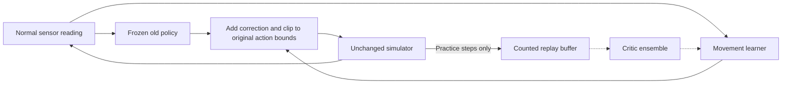

Reward is one at the first original-environment success and zero otherwise. Success ends the learner's episode. A time limit is stored separately and retains the critic's continuation target. The memory bank retains episode and step IDs, fill/learner source, old policy action, termination and truncation, and true camera bias for analysis. That true bias is excluded from normal actor and critic inputs. Only the explicitly labelled privileged-critic and supervised-reference experiments may use it. Tests never train either the learner or the later confidence predictor.

[Method parameters](results/takehome/protocol.json); [Primary paper references](results/takehome/method_sources.json)

| Method | Learned outputs | Information available | Practice budget |
| --- | --- | --- | --- |
| Aim only | Two XY nudges to the running camera-error guess | Normal sensors and own guess | 40 fill + 160 learner episodes |
| Movement only (selected) | Three XYZ additions to the old movement command | Normal sensors; aim guess stays zero | 40 fill + 160 learner episodes |
| Combined | Two aim nudges and three movement additions | Normal sensors and own guess | 40 fill + 160 learner episodes |
| Supervised reference (cheats on information) | Two aim nudges trained against the true error | True camera-error labels during learning | Same counted 200 episodes |

## Starting line and mechanism checks

| Check | Successes / tests | Test seed |
| --- | --- | --- |
| Original policy | 307/500 (61.4%) | 123 |
| No constant camera bias | 472/500 (94.4%) | 123 |
| Zero correction | 302/500 (60.4%) | 123 |
| True-error oracle (cheats on information) | 471/500 (94.2%) | 123 |

The zero-correction and true-error checks passed their written tolerances. This supports the wrapper and the usefulness of correct aim, but does not show that a small learner can infer that error from its observations. The normal camera has fixed XY bias with standard deviation 0.75 mm per episode and stepwise white noise with standard deviation 0.2 mm. Removing constant bias retains white noise. [baseline.json](results/takehome/baseline.json); [mechanism_check.json](results/takehome/mechanism_check.json); [protocol.json](results/takehome/protocol.json).

## Development results, including all seeds

| Method | Seed 0 | Seed 1 | Seed 2 | Seed 3 | Seed 4 | Seeds | Mean ± sample SD |
| --- | --- | --- | --- | --- | --- | --- | --- |
| Aim only | 365/500 (73.0%) | 278/500 (55.6%) | 315/500 (63.0%) | 305/500 (61.0%) | 366/500 (73.2%) | 5 | 65.2% ± 7.7% |
| Movement only | 425/500 (85.0%) | 411/500 (82.2%) | 427/500 (85.4%) | 428/500 (85.6%) | 393/500 (78.6%) | 5 | 83.4% ± 3.0% |
| Aim and movement | 421/500 (84.2%) | 378/500 (75.6%) | 363/500 (72.6%) | 407/500 (81.4%) | 396/500 (79.2%) | 5 | 78.6% ± 4.6% |
| Supervised reference (cheats: true labels) | 325/500 (65.0%) | 349/500 (69.8%) | 328/500 (65.6%) | 327/500 (65.4%) | 325/500 (65.0%) | 5 | 66.2% ± 2.1% |

All counts above use 500 tests at seed 123. Aim-only averaged 65.16%, a 3.76-point gain over the 61.4% floor, smaller than its 7.74-point seed spread. Movement averaged 83.36% and combined averaged 78.60%. Movement was best; adding aim did not improve it. The supervised reference uses true camera-error labels on the same counted practice and is explicitly a reference that cheats on information. It is not the perfect-error oracle and is not a guaranteed upper bound. [goal6/goal6_aggregate.json](results/takehome/goal6/goal6_aggregate.json).


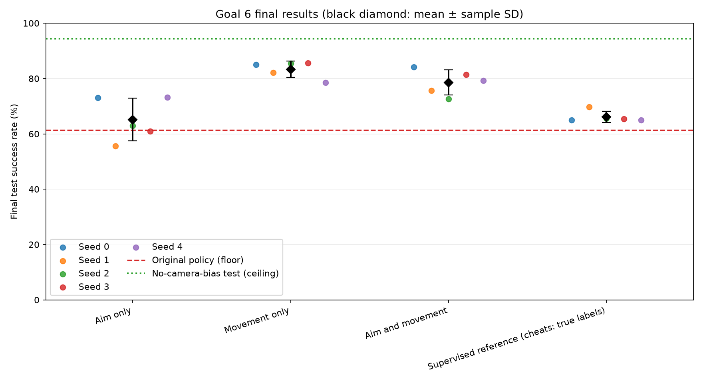


## Exploration and choice before confirmation

The study considered 28 settings: the four earlier methods, including the ineligible supervised reference, plus 24 new screening settings. All requested exploration families were covered. Each new setting changed one feature from aim-only, or from combined control when the feature needed movement. The 40-fill case reused the main result. The table keeps all seeds, peak forces and differences smaller than the matched spread. Seeds 3 and 4 are marked not run for the three-seed screen, as specified in advance.

| Setting | Seed 0 | Seed 1 | Seed 2 | Seed 3 | Seed 4 | Seeds | Mean ± sample SD | Difference from relevant base | Mean peak force by seed |
| --- | --- | --- | --- | --- | --- | --- | --- | --- | --- |
| Aim only | 365/500 (73.0%) | 278/500 (55.6%) | 315/500 (63.0%) | 305/500 (61.0%) | 366/500 (73.2%) | 5 | 65.2% ± 7.7% | difference below spread, unproven | s0:88.26 N; s1:81.7 N; s2:86.69 N; s3:84.08 N; s4:87.4 N |
| Movement only | 425/500 (85.0%) | 411/500 (82.2%) | 427/500 (85.4%) | 428/500 (85.6%) | 393/500 (78.6%) | 5 | 83.4% ± 3.0% | gain beyond spread | s0:98.43 N; s1:92.79 N; s2:94.98 N; s3:96.6 N; s4:91.65 N |
| Aim and movement | 421/500 (84.2%) | 378/500 (75.6%) | 363/500 (72.6%) | 407/500 (81.4%) | 396/500 (79.2%) | 5 | 78.6% ± 4.6% | gain beyond spread | s0:96.2 N; s1:94.8 N; s2:84.37 N; s3:95.82 N; s4:95.12 N |
| Supervised reference (cheats: true labels) | 325/500 (65.0%) | 349/500 (69.8%) | 328/500 (65.6%) | 327/500 (65.4%) | 325/500 (65.0%) | 5 | 66.2% ± 2.1% | difference below spread, unproven | s0:83.82 N; s1:88.71 N; s2:84.12 N; s3:85.72 N; s4:84.54 N |
| Fill 0 episodes | 306/500 (61.2%) | 313/500 (62.6%) | 316/500 (63.2%) | not run | not run | 3 | 62.3% ± 1.0% | difference below spread, unproven | s0:83.33 N; s1:86.48 N; s2:83.25 N |
| Fill 10 episodes | 319/500 (63.8%) | 303/500 (60.6%) | 350/500 (70.0%) | not run | not run | 3 | 64.8% ± 4.8% | difference below spread, unproven | s0:86.15 N; s1:83.32 N; s2:89.73 N |
| Fill 20 episodes | 362/500 (72.4%) | 308/500 (61.6%) | 307/500 (61.4%) | not run | not run | 3 | 65.1% ± 6.3% | difference below spread, unproven | s0:87.92 N; s1:80.13 N; s2:81.72 N |
| Fill 80 episodes | 243/500 (48.6%) | 332/500 (66.4%) | 375/500 (75.0%) | not run | not run | 3 | 63.3% ± 13.5% | difference below spread, unproven | s0:81.76 N; s1:86.52 N; s2:88.23 N |
| Fill 120 episodes | 306/500 (61.2%) | 326/500 (65.2%) | 82/500 (16.4%) | not run | not run | 3 | 47.6% ± 27.1% | difference below spread, unproven | s0:84.35 N; s1:84.95 N; s2:70.28 N |
| side by side | 222/500 (44.4%) | 331/500 (66.2%) | 390/500 (78.0%) | not run | not run | 3 | 62.9% ± 17.0% | difference below spread, unproven | s0:72.52 N; s1:86.32 N; s2:96.6 N |
| aim then move | 264/500 (52.8%) | 420/500 (84.0%) | 466/500 (93.2%) | not run | not run | 3 | 76.7% ± 21.2% | difference below spread, unproven | s0:82.8 N; s1:94.52 N; s2:100.6 N |
| move then aim | 373/500 (74.6%) | 358/500 (71.6%) | 440/500 (88.0%) | not run | not run | 3 | 78.1% ± 8.7% | difference below spread, unproven | s0:85.94 N; s1:95.78 N; s2:102.7 N |
| Critic briefing on own fill | 293/500 (58.6%) | 344/500 (68.8%) | 356/500 (71.2%) | not run | not run | 3 | 66.2% ± 6.7% | difference below spread, unproven | s0:83.66 N; s1:84.47 N; s2:87.75 N |
| True bias to critic during training | 337/500 (67.4%) | 324/500 (64.8%) | 324/500 (64.8%) | not run | not run | 3 | 65.7% ± 1.5% | difference below spread, unproven | s0:84.28 N; s1:83.77 N; s2:80.59 N |
| One critic | 351/500 (70.2%) | 332/500 (66.4%) | 323/500 (64.6%) | not run | not run | 3 | 67.1% ± 2.9% | difference below spread, unproven | s0:89.32 N; s1:88.36 N; s2:80.94 N |
| One update per new step | 348/500 (69.6%) | 292/500 (58.4%) | 63/500 (12.6%) | not run | not run | 3 | 46.9% ± 30.2% | difference below spread, unproven | s0:87.3 N; s1:81.83 N; s2:67.61 N |
| Aim cap 0.05 mm | 317/500 (63.4%) | 2/500 (0.4%) | 345/500 (69.0%) | not run | not run | 3 | 44.3% ± 38.1% | difference below spread, unproven | s0:82.26 N; s1:68.49 N; s2:88.39 N |
| Aim cap 0.2 mm | 383/500 (76.6%) | 322/500 (64.4%) | 315/500 (63.0%) | not run | not run | 3 | 68.0% ± 7.5% | difference below spread, unproven | s0:91.89 N; s1:84.19 N; s2:85.33 N |
| Movement cap 0.4 mm | 461/500 (92.2%) | 276/500 (55.2%) | 427/500 (85.4%) | not run | not run | 3 | 77.6% ± 19.7% | difference below spread, unproven | s0:100.4 N; s1:86.86 N; s2:97.53 N |
| Final critic decider | 255/500 (51.0%) | 392/500 (78.4%) | 326/500 (65.2%) | not run | not run | 3 | 64.9% ± 13.7% | difference below spread, unproven | s0:82.4 N; s1:91.03 N; s2:87.69 N |
| Hand over near hole | 318/500 (63.6%) | 327/500 (65.4%) | 321/500 (64.2%) | not run | not run | 3 | 64.4% ± 0.9% | difference below spread, unproven | s0:83.21 N; s1:84.59 N; s2:87.78 N |
| Contact-dependent movement cap | 360/500 (72.0%) | 395/500 (79.0%) | 234/500 (46.8%) | not run | not run | 3 | 65.9% ± 16.9% | difference below spread, unproven | s0:87.59 N; s1:90.89 N; s2:73.02 N |
| Old-policy uncertainty cap | 408/500 (81.6%) | 403/500 (80.6%) | 359/500 (71.8%) | not run | not run | 3 | 78.0% ± 5.4% | difference below spread, unproven | s0:87.63 N; s1:93.52 N; s2:90.46 N |
| Classification critic loss | 351/500 (70.2%) | 328/500 (65.6%) | 280/500 (56.0%) | not run | not run | 3 | 63.9% ± 7.2% | difference below spread, unproven | s0:87.87 N; s1:87 N; s2:82.47 N |
| Three-step credit | 360/500 (72.0%) | 304/500 (60.8%) | 387/500 (77.4%) | not run | not run | 3 | 70.1% ± 8.5% | difference below spread, unproven | s0:91.31 N; s1:86.8 N; s2:91.2 N |
| Observed return floor | 340/500 (68.0%) | 331/500 (66.2%) | 330/500 (66.0%) | not run | not run | 3 | 66.7% ± 1.1% | difference below spread, unproven | s0:88.41 N; s1:87.85 N; s2:81.57 N |
| Force penalty (peak force reported) | 359/500 (71.8%) | 399/500 (79.8%) | 254/500 (50.8%) | not run | not run | 3 | 67.5% ± 15.0% | difference below spread, unproven | s0:93.02 N; s1:95.39 N; s2:76.07 N |
| Sibling-policy fill-up | 314/500 (62.8%) | 318/500 (63.6%) | 290/500 (58.0%) | not run | not run | 3 | 61.5% ± 3.0% | difference below spread, unproven | s0:82.96 N; s1:84.92 N; s2:84 N |

No new trick beat its relevant base beyond both matched sample spreads. Therefore no trick qualified for extension or combination, and round 2 had no jobs. This is the written eligibility rule, not an omitted experiment for time. Some movement-capable methods did beat main aim, so the separate fallback that would force aim-only did not apply. The fixed rule selected the highest mean, then the simplest method within one spread of that top mean. Plain movement was the only eligible method in that band. The choice was written before any confirmation reference or learner ran. [goal7_choice.json](results/takehome/goal7_choice.json); [goal7_round2_manifest.json](results/takehome/goal7_round2_manifest.json); [goal7_checks.json](results/takehome/goal7_checks.json).

The force-penalty screen reduced the matched mean peak force from 91.79 N to 88.16 N, while mean success fell from 77.47% to 67.47%. Both differences are smaller than the corresponding seed spread; neither is established as a reliable effect. [goal7/force_penalty_comparison.json](results/takehome/goal7/force_penalty_comparison.json).

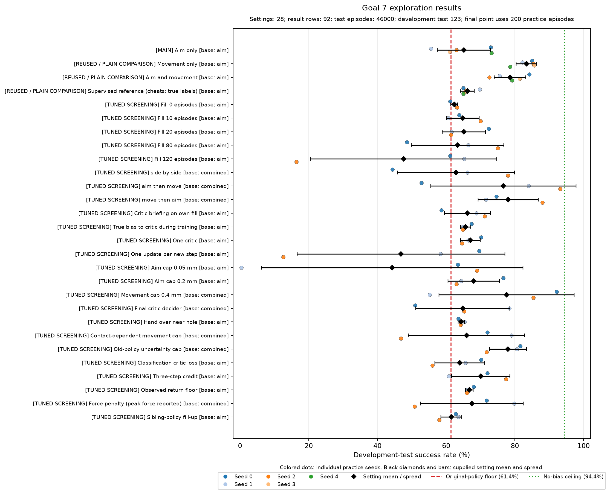

## Fresh confirmation: the headline

| Method and selection advantage | Seed 100 | Seed 101 | Seed 102 | Seed 103 | Seed 104 | Seeds | Mean ± sample SD |
| --- | --- | --- | --- | --- | --- | --- | --- |
| Plain aim; 1 settings tried | 327/500 (65.4%) | 322/500 (64.4%) | 304/500 (60.8%) | 286/500 (57.2%) | 330/500 (66.0%) | 5 | 62.8% ± 3.7% |
| Plain movement [final method]; 28 settings tried | 380/500 (76.0%) | 402/500 (80.4%) | 420/500 (84.0%) | 360/500 (72.0%) | 443/500 (88.6%) | 5 | 80.2% ± 6.5% |
| Plain aim and movement; 1 settings tried | 289/500 (57.8%) | 422/500 (84.4%) | 274/500 (54.8%) | 381/500 (76.2%) | 326/500 (65.2%) | 5 | 67.7% ± 12.5% |

The final movement result is 80.20%, 19.40 percentage points above the fresh original-policy reference. Its five runs span 72.0%-88.6%. It is below its development average, and remains the headline. Aim-only's 1.96-point and combined's 6.88-point gains over the floor are below their respective spreads. The final method benefited from selection across 28 settings; the other two plain comparisons each used one untuned setting. All use their final checkpoint, not their best learning-curve point. The early aim/combined collapses and recovery remain visible; these observations do not identify a cause. [goal7/confirmation/confirmation_summary.json](results/takehome/goal7/confirmation/confirmation_summary.json); [confirmation_baseline.json](results/takehome/confirmation_baseline.json).


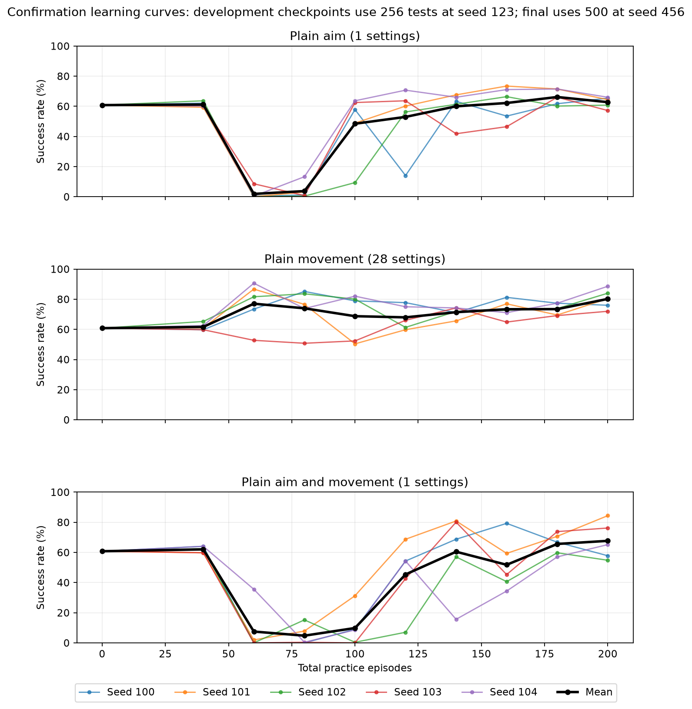

## Can confidence be trusted?

Raw Q is not an episode-success probability: it discounts later success and uses an estimated continuation value at a time limit. A separate logistic predictor was fitted on each run's own counted practice, using normal observations, proposed action and remaining time. Logistic regression maps a weighted combination of those inputs to a probability. It uses no true bias, raw Q or test labels, and adds no practice. All 45 fixed fits converged. Intermediate diagnostics need full test traces, so those local traces are the explicit later-analysis exception to final-only storage.

The final predictor is underconfident on average by 5.23 percentage points. It predicts 69.54% against 74.77% observed over 392,329 valid steps from the 2,500 confirmation episodes. Only steps up to learner termination are valid. These are step-weighted statistics: longer failures contribute more steps. They must not be substituted for the 80.20% episode-level headline. Expected calibration error, the weighted absolute gap across ten probability bins, is 6.32 points. The Brier score, mean squared probability error with zero as perfect, is 0.15235.

Of 495 failed episodes, 355 contain a prediction of at least 80%. Only 15 show the predeclared drop of at least 25 points between adjacent five-step averages. These are counts of selected moments, not an alarm precision estimate. Missing drops are explicitly null. The raw-Q plot has no probability-identity line and is not monotonic against eventual success after pooling states and times.

| Seed/group | Episode result | Valid steps | Mean prediction | Observed step-weighted rate | Calibration error | Brier | Signed bias |
| --- | --- | --- | --- | --- | --- | --- | --- |
| Seed 100 | 380/500 (76.0%) | 79052 | 71.2% | 69.6% | 0.0341 | 0.16503 | 0.015652 |
| Seed 101 | 402/500 (80.4%) | 79227 | 68.8% | 75.3% | 0.075728 | 0.15471 | -0.064179 |
| Seed 102 | 420/500 (84.0%) | 76358 | 69.2% | 79.0% | 0.10543 | 0.1434 | -0.09866 |
| Seed 103 | 360/500 (72.0%) | 83648 | 62.2% | 66.5% | 0.058384 | 0.18465 | -0.043648 |
| Seed 104 | 443/500 (88.6%) | 74044 | 77.2% | 84.6% | 0.079742 | 0.10904 | -0.073931 |
| Pooled (5 seeds) | 2005/2500 (80.2%) | 392329 | 69.5% | 74.8% | 0.063186 | 0.15235 | -0.052268 |

[goal8/summary.json](results/takehome/goal8/summary.json); [goal8_checks.json](results/takehome/goal8_checks.json); [Confident failed moments](results/takehome/goal8/confident_failed.csv); [Confidence drops](results/takehome/goal8/confidence_drops.csv)


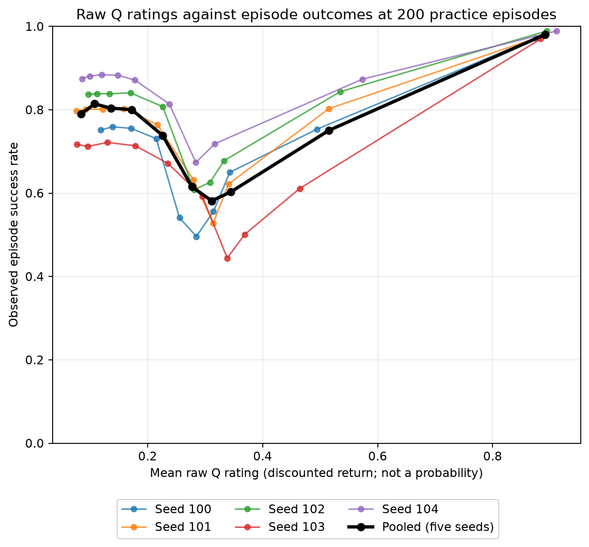

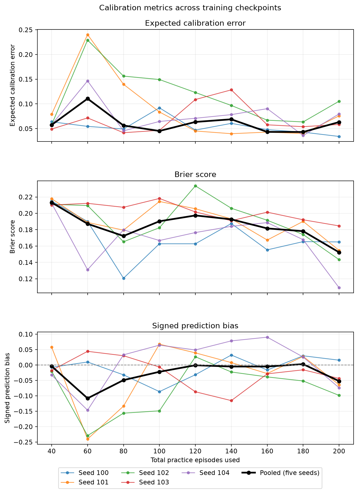

## Failure cases

| Group | Practice seed | Successes / tests | never_near_hole_contact | wrong_way_correction | stuck_on_rim | timeout | other |
| --- | --- | --- | --- | --- | --- | --- | --- |
| Before | unlearned repeat | 303/500 (60.6%) | 7 | 0 | 22 | 168 | 0 |
| After | seed 100 | 380/500 (76.0%) | 0 | 90 | 11 | 19 | 0 |
| After | seed 101 | 402/500 (80.4%) | 0 | 21 | 22 | 55 | 0 |
| After | seed 102 | 420/500 (84.0%) | 0 | 26 | 10 | 44 | 0 |
| After | seed 103 | 360/500 (72.0%) | 1 | 50 | 8 | 81 | 0 |
| After | seed 104 | 443/500 (88.6%) | 0 | 29 | 17 | 11 | 0 |
| After pooled | seeds 100–104 | 2005/2500 (80.2%) | 1 | 216 | 68 | 210 | 0 |

The before trace is a separate 303/500 original-policy repeat at seed 456, not a replacement for the 304/500 headline reference. After counts use the original final confirmation traces. The rules below apply in order, and the first match wins. A residual timeout excludes failures assigned an earlier pattern; other remains available even when its count is zero.

1. **never near hole contact**: No valid step has XY error <=5mm, absolute tip height <=3mm and force >=5N.
2. **wrong way correction**: At the last valid step, aim-guess error exceeds the zero-guess error by >0.25mm with a nonzero >0.25mm guess, OR the net commanded movement correction points radially outward by >1mm summed over valid near-hole steps.
3. **stuck on rim**: At least20 of the last40 valid steps meet the near-hole contact rule and their insertion-depth range is <1mm.
4. **timeout**: Final recorded learner-truncated flag is true and learner-terminated flag is false.
5. **other**: Any remaining failed episode.

These are operational patterns, not proven causes. The near-contact proxy requires distance and force together; it does not mean the peg never approached the hole. Wrong-way correction cannot occur without a correction, so its increase from zero is not a controlled estimate of harm. Its outward-direction calculation retains camera white noise.

Thirteen illustrative videos cover every type that occurred: six before and seven after, with one example for the single rare after near-contact failure and no invented examples for zero-case types. They replay recorded poses through the existing video code. All have readable guess/true-error overlays and passed metadata and decoded-frame checks. The movement-only guess correctly remains zero. Separate pose repeats score 303/500 before and 382,391,419,349/500 for after practice seeds 100-103; these outcomes stay separate from the headline. All ending previews and temporal samples of two representative videos were reviewed. No gross wall passage was visible in those samples; the saved physical diagnostics report none. This does not prove perfect simulator fidelity.

[goal9/failures.json](results/takehome/goal9/failures.json); [goal9/video_manifest.json](results/takehome/goal9/video_manifest.json); [goal9/video_audit.json](results/takehome/goal9/video_audit.json); [goal9_checks.json](results/takehome/goal9_checks.json)

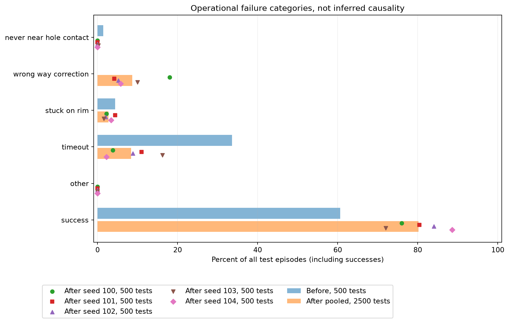

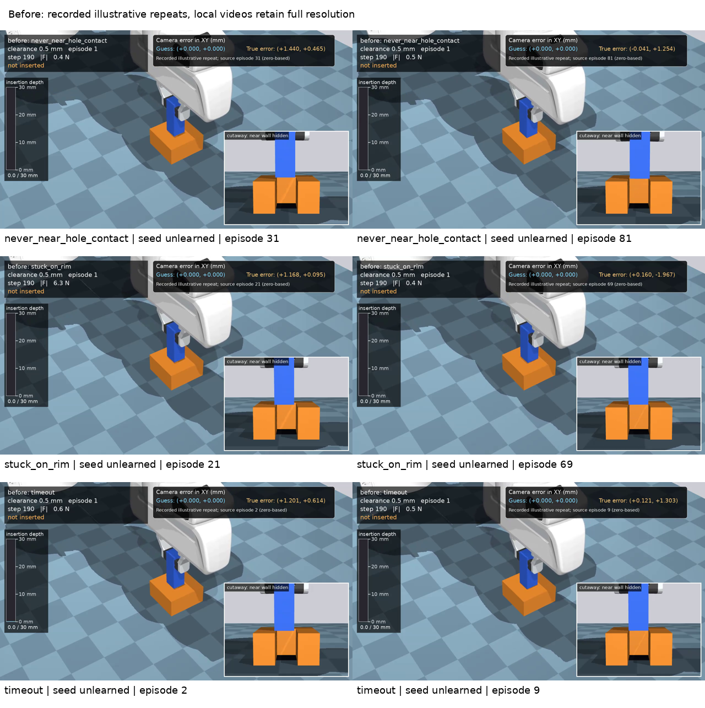

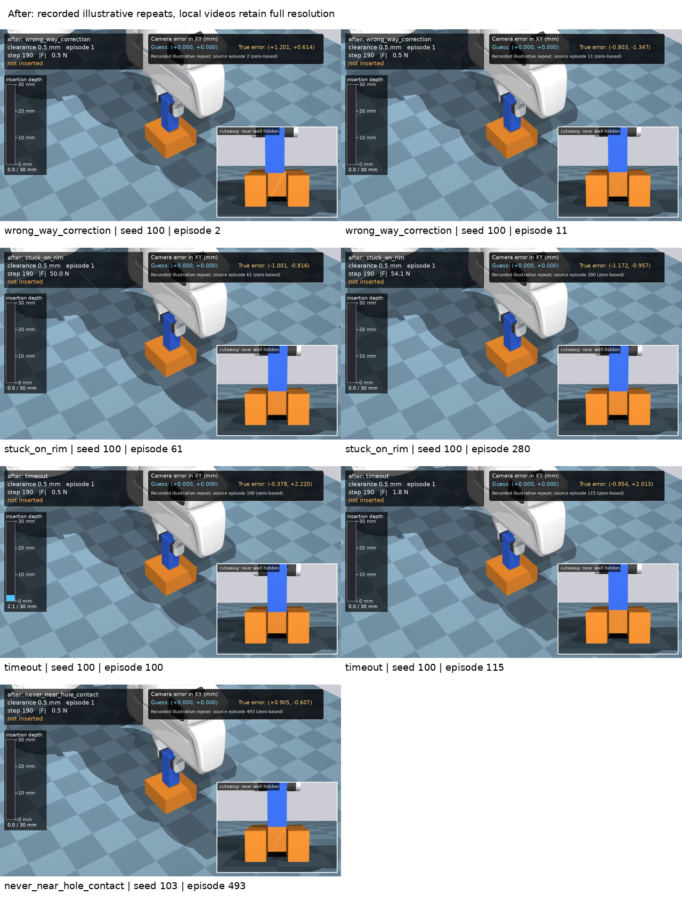

## Other policies, with the final recipe unchanged

| Policy | Seed 0 | Seed 1 | Seed 2 | Seeds | Mean ± sample SD | Own floor | Own ceiling |
| --- | --- | --- | --- | --- | --- | --- | --- |
| force_0.5mm_s4 | 464/500 (92.8%) | 442/500 (88.4%) | 459/500 (91.8%) | 3 | 91.0% ± 2.3% | 84.0% | 97.6% |
| pos_0.5mm_s1 | 408/500 (81.6%) | 403/500 (80.6%) | 444/500 (88.8%) | 3 | 83.7% ± 4.5% | 80.4% | 100.0% |
| force_0.5mm_s1 | 0/500 (0.0%) | 0/500 (0.0%) | 0/500 (0.0%) | 3 | 0.0% ± 0.0% | 0.0% | 0.0% |

Each policy has its own references measured first, and each fresh practice seed has its own 200-episode budget. Position-only input has 10 original sensor numbers instead of 16; the same wrapper accepts both. These are fresh training runs with the same recipe, not zero-practice transfer of the main policy's learner weights.

On force_0.5mm_s4, the unchanged recipe averaged 91.00% with a 2.31-point sample spread, against its own 84.0% floor and 97.6% no-bias reference. The 7.00-point gain exceeds the seed spread. This supports a gain on another already competent policy, with room still below its reference.

On pos_0.5mm_s1, the recipe averaged 83.67% with a 4.47-point spread, against an 80.4% floor and 100% no-bias reference. Its 3.27-point gain is smaller than the spread, so improvement is unproven. The position-only checkpoint did not start poorly, contrary to the plan's expectation; this experiment does not isolate the effect of removing force sensing because the checkpoints differ.

On the hovering force_0.5mm_s1 policy, all three final tests scored 0/500, matching both zero-success references. None of its three 200-episode practice runs produced a success, and mean final insertion depth remained zero. Removing camera bias alone did not help this checkpoint, and this sparse-reward, bounded movement recipe learned no successful behavior from the available practice. The written identical-outcome exemption applies because both references are zero.

[goal10/transfer_summary.json](results/takehome/goal10/transfer_summary.json); [goal10_interpretation.json](results/takehome/goal10_interpretation.json)

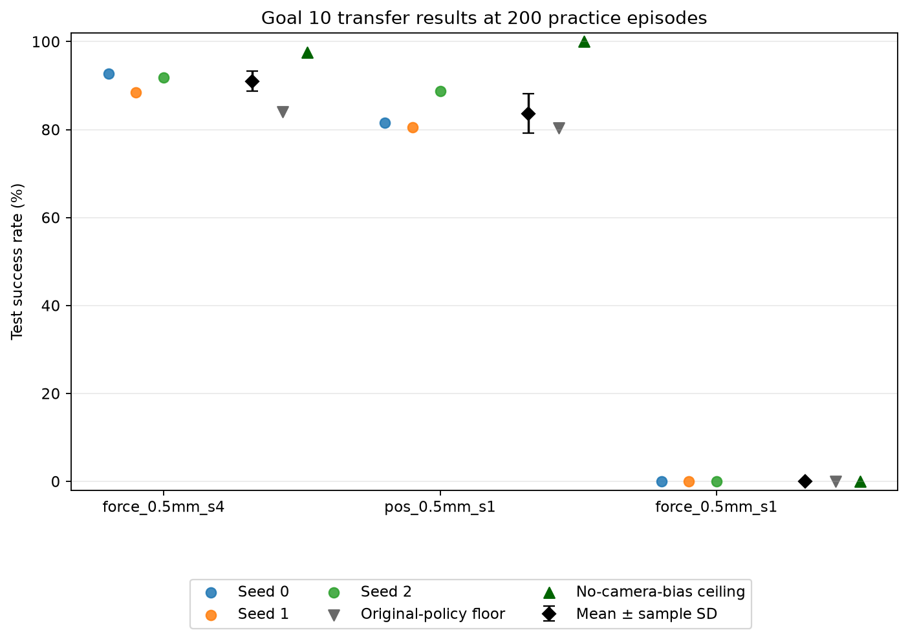

## Different camera problems

The unchanged final method was tested under eight predeclared conditions. Transfer reuses normal-condition models from practice seeds 0-2 with no new learning. Retrain starts fresh under that condition with 200 own practice episodes per seed. The floor is the original policy under the new problem; the ceiling reuses Goal 1's no-bias, no-added-problem test. Each true-error oracle cheats on information and corrects the actual XY error at that moment; it cannot directly repair a Z error. Every displayed final score uses 500 tests at seed 123.

For larger offsets, the aim nudge and guess caps scale with the offset in both transfer and retrain, as required. The final movement-only method does not use those aim outputs; its 0.2 mm movement cap stays unchanged. Height error remains included with all three movement outputs. The expectation that height must fail applied to aim-only control and is not imposed on the selected method.

r is the true tip-to-hole vector; b is the per-episode XY Gaussian bias with normal standard deviation 0.75 mm; epsilon is the original 0.2 mm per-step position noise; eta is independent added jitter. Proprioception means the robot's current body and joint readings.

| Condition | Predeclared formula and caps |
| --- | --- |
| bias_2x | r + 2*b + epsilon; b_xy ~ N(0,0.75mm); nudge/guess caps times2; aim nudge cap 0.2 mm/axis; guess cap 6 mm/axis; movement cap 0.2 mm/axis |
| bias_4x | r + 4*b + epsilon; b_xy ~ N(0,0.75mm); nudge/guess caps times4; aim nudge cap 0.4 mm/axis; guess cap 12 mm/axis; movement cap 0.2 mm/axis |
| one_sided | r_xy + abs(b_xy) + epsilon_xy; Z unchanged; aim nudge cap 0.1 mm/axis; guess cap 3 mm/axis; movement cap 0.2 mm/axis |
| drift | r_xy + b_xy + (step/200)*[1mm,-1mm] + epsilon_xy; Z unchanged; aim nudge cap 0.1 mm/axis; guess cap 3 mm/axis; movement cap 0.2 mm/axis |
| jitter | r_xy + b_xy + epsilon_xy + eta_xy, eta ~ N(0,(0.6mm)^2 I); Z unchanged; aim nudge cap 0.1 mm/axis; guess cap 3 mm/axis; movement cap 0.2 mm/axis |
| rotation | R(10 degrees)*r_xy + b_xy + epsilon_xy; Z unchanged; aim nudge cap 0.1 mm/axis; guess cap 3 mm/axis; movement cap 0.2 mm/axis |
| delay | r(max(step-3,0)) + b + epsilon; 60ms geometry delay, present proprioception; aim nudge cap 0.1 mm/axis; guess cap 3 mm/axis; movement cap 0.2 mm/axis |
| height | r + b + epsilon + [0,0,2mm]; aim nudge cap 0.1 mm/axis; guess cap 3 mm/axis; movement cap 0.2 mm/axis |

| Condition | Floor | Ceiling | Oracle (cheats) | Transfer s0 | Transfer s1 | Transfer s2 | Transfer mean ± SD | Retrain s0 | Retrain s1 | Retrain s2 | Retrain mean ± SD |
| --- | --- | --- | --- | --- | --- | --- | --- | --- | --- | --- | --- |
| bias_2x | Policy floor: 153/500 (30.6%) | No-bias ceiling: 472/500 (94.4%) | Oracle (cheats: true error): 470/500 (94.0%) | 244/500 (48.8%) | 235/500 (47.0%) | 248/500 (49.6%) | 48.5% ± 1.3% | 172/500 (34.4%) | 239/500 (47.8%) | 191/500 (38.2%) | 40.1% ± 6.9% |
| bias_4x | Policy floor: 42/500 (8.4%) | No-bias ceiling: 472/500 (94.4%) | Oracle (cheats: true error): 470/500 (94.0%) | 103/500 (20.6%) | 77/500 (15.4%) | 106/500 (21.2%) | 19.1% ± 3.2% | 68/500 (13.6%) | 49/500 (9.8%) | 88/500 (17.6%) | 13.7% ± 3.9% |
| one_sided | Policy floor: 340/500 (68.0%) | No-bias ceiling: 472/500 (94.4%) | Oracle (cheats: true error): 471/500 (94.2%) | 475/500 (95.0%) | 385/500 (77.0%) | 454/500 (90.8%) | 87.6% ± 9.4% | 446/500 (89.2%) | 468/500 (93.6%) | 450/500 (90.0%) | 90.9% ± 2.3% |
| drift | Policy floor: 145/500 (29.0%) | No-bias ceiling: 472/500 (94.4%) | Oracle (cheats: true error): 469/500 (93.8%) | 352/500 (70.4%) | 270/500 (54.0%) | 293/500 (58.6%) | 61.0% ± 8.5% | 359/500 (71.8%) | 276/500 (55.2%) | 357/500 (71.4%) | 66.1% ± 9.5% |
| jitter | Policy floor: 339/500 (67.8%) | No-bias ceiling: 472/500 (94.4%) | Oracle (cheats: true error): 470/500 (94.0%) | 424/500 (84.8%) | 418/500 (83.6%) | 431/500 (86.2%) | 84.9% ± 1.3% | 394/500 (78.8%) | 358/500 (71.6%) | 385/500 (77.0%) | 75.8% ± 3.7% |
| rotation | Policy floor: 327/500 (65.4%) | No-bias ceiling: 472/500 (94.4%) | Oracle (cheats: true error): 470/500 (94.0%) | 434/500 (86.8%) | 418/500 (83.6%) | 434/500 (86.8%) | 85.7% ± 1.8% | 449/500 (89.8%) | 416/500 (83.2%) | 422/500 (84.4%) | 85.8% ± 3.5% |
| delay | Policy floor: 239/500 (47.8%) | No-bias ceiling: 472/500 (94.4%) | Oracle (cheats: true error): 435/500 (87.0%) | 420/500 (84.0%) | 379/500 (75.8%) | 424/500 (84.8%) | 81.5% ± 5.0% | 405/500 (81.0%) | 369/500 (73.8%) | 239/500 (47.8%) | 67.5% ± 17.5% |
| height | Policy floor: 373/500 (74.6%) | No-bias ceiling: 472/500 (94.4%) | Oracle (cheats: true error): 488/500 (97.6%) | 465/500 (93.0%) | 414/500 (82.8%) | 414/500 (82.8%) | 86.2% ± 5.9% | 375/500 (75.0%) | 410/500 (82.0%) | 429/500 (85.8%) | 80.9% ± 5.5% |

The selected movement method partly handled every specified condition, but it did not restore the no-bias reference across all of them. All retrain means exceeded their own floors by more than their own sample spread under the predeclared descriptive rule. This is not a formal significance test, and the three-seed comparisons retain substantial uncertainty.

At twice the normal constant bias, transfer scored 48.47% and retraining 40.13% against a 30.6% floor. At four times the bias, transfer scored 19.07% and retraining 13.67% against 8.4%. The true-error oracle scored 94.0% in both cases, so good aim remains possible in principle, but the unchanged movement recipe could not recover it within 200 practice episodes. The larger aim caps are unused by the selected movement-only actor; its movement cap was not tuned upward.

The one-sided offset was handled best: retraining reached 90.93% against a 68.0% floor and 94.4% no-added-error reference. Transfer averaged 87.60%, with much larger variation across its three models. The 3.33-point retraining advantage is below that variation and is not established by the spread rule. The positive improvement over the floor does not mean all errors were eliminated.

Slow drift was partly handled: transfer averaged 61.00% and retraining 66.13%, compared with the 29.0% floor. The 93.8% true-error oracle leaves a large remaining gap. The 5.13-point retraining advantage is below its 9.47-point spread, so these runs do not establish a benefit from retraining over using the normal-error learner.

Extra jitter was partly handled, with 84.87% transfer and 75.80% retraining against 67.8% for the original policy. Retraining did worse than transfer by more than either seed spread in this sample. These measurements do not identify why learning under the jitter was weaker. Rotation was also partly handled: 85.73% transfer and 85.80% retraining against 65.4%, with no clear difference between those two learned results.

The 60 ms delayed geometry was partly handled by transfer at 81.53% against a 47.8% floor. Retraining averaged 67.53%, with a 17.46-point spread and one seed exactly back at the floor. The difference from transfer is smaller than that spread. The XY true-error oracle reached 87.0%; it still receives delayed vertical geometry, unlike the 94.4% no-added-error reference, so this diagnostic does not remove the whole delayed-reading problem.

The +2 mm height error did not cause the predicted failure: the original policy already scored 74.6%, transfer 86.20%, retraining 80.93%, and the XY true-error oracle 97.6%. This particular error direction is therefore not an unfixable case in these measurements. The selected method also has a vertical movement output, unlike the original aim-only proposal. The transfer-versus-retrain difference is below the larger spread, and the tests do not establish why this height shift helped the original checkpoint.

Four one-sided movement results exceeded the no-bias reference during transfer or learning-curve evaluation. Their independent 500-episode seed-789 checks scored 477, 481, 473 and 478 successes. Each had zero flagged wall-passage or invalid-number episodes. Three complete successful trajectories per check were visually reviewed for depth, lateral error and bounded commands, with no gross physical anomaly seen. These additional tests never selected or replaced a reported result.

[goal11/camera_summary.json](results/takehome/goal11/camera_summary.json); [goal11_interpretation.json](results/takehome/goal11_interpretation.json); [goal11_manifest.json](results/takehome/goal11_manifest.json)

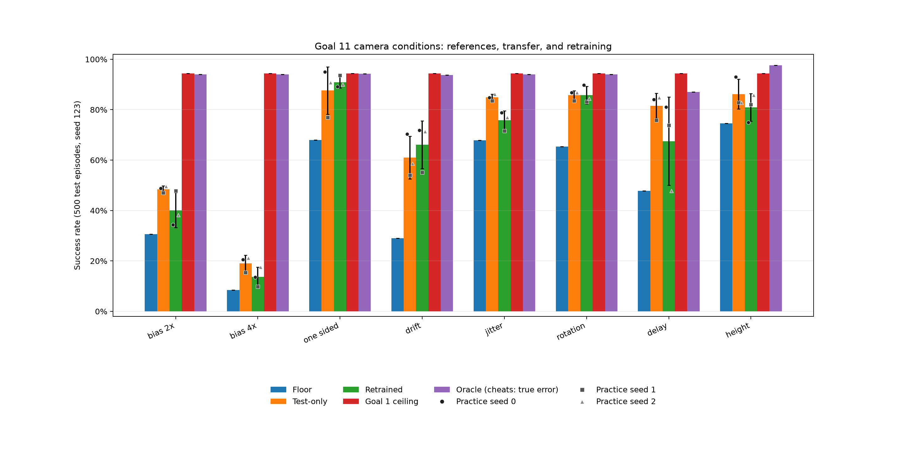

## Repeatability, full accounting and limits

The authorized repeatability investigation lasted 26 minutes 51 seconds before Goal 6. Even the original evaluator, before learning, produced 303,309,307 successes on three identical 500-episode seed-123 runs. Deterministic GPU atomic modes made captured resets agree but did not make full contact trajectories repeat; the lowest-capacity mode also produced overflow warnings and was rejected. No safe complete fix was established within the time box. Production execution, tests, seeds and budgets were left unchanged, and work continued under Griffin's explicit instruction. [repeatability_conclusion.json](results/takehome/repeatability_conclusion.json); [Detailed diagnosis](results/takehome/repeatability_findings.md).

Across the study so far, the ledger contains **29,010 practice episodes** in 146 experiment ledgers and **409,690 full test-only episodes**. Reset-only probes total 191; shorter physics probes are listed separately in the final test inventory. There are 28 searched settings. Other-policy and camera experiments reuse the chosen recipe and are listed as new conditions, not additional tuning settings. Reused references and traces are counted once. [episode_accounting.json](results/takehome/episode_accounting.json).

The result is simulation-only, uses one laptop GPU, and has few practice seeds. Reusing a development test for many choices creates selection advantage, which is why the independent confirmation headline and number of tried settings are shown. The spread rule does not correct for multiple comparisons or provide a formal statistical guarantee. A single no-bias reference is a useful comparison, not a hard upper bound for methods that change hand movements. Confidence models learn from changing practice behavior; their errors need not transfer to a new robot or camera. Failure labels are descriptive and depend on thresholds. There is no evidence here of hardware safety or real-world transfer.

## Runtime and every additional run

| Benchmark | Processes | Runs | Total seconds | Seconds per run |
| --- | --- | --- | --- | --- |
| solo | 1 | 1 | 116.03 | 116.03 |
| parallel2 | 2 | 2 | 132.05 | 66.02 |
| parallel4 | 4 | 4 | 232.04 | 58.01 |
| one_process_two_seeds | 1 | 2 | 156.03 | 78.01 |

Four concurrent GPU processes gave the best measured throughput, so suites use up to four independent workers and reuse one process across seeds of a setting. Helpers shorten routine code, tables, plots and checking; they do not create more GPU capacity. Startup and compilation are included in the benchmark. [benchmark_timings.json](results/takehome/benchmark_timings.json)

The timing repeats below are retained separately and never replace the designated main runs.

| Timing group | Practice seed | Practice episodes | Final test result | Source |
| --- | --- | --- | --- | --- |
| one_process_two_seeds | 0 | 200 | 314/500 (62.8%) | [results/takehome/benchmark/one_process_two_seeds/seed_0/result.json](results/takehome/benchmark/one_process_two_seeds/seed_0/result.json) |
| one_process_two_seeds | 1 | 200 | 312/500 (62.4%) | [results/takehome/benchmark/one_process_two_seeds/seed_1/result.json](results/takehome/benchmark/one_process_two_seeds/seed_1/result.json) |
| parallel4 | 0 | 200 | 318/500 (63.6%) | [results/takehome/benchmark/parallel4/seed_0/result.json](results/takehome/benchmark/parallel4/seed_0/result.json) |
| parallel4 | 1 | 200 | 282/500 (56.4%) | [results/takehome/benchmark/parallel4/seed_1/result.json](results/takehome/benchmark/parallel4/seed_1/result.json) |

The code trial used practice seed 999, 10 practice episodes and 0/8 test successes. It was a code check, not a searched setting. Diagnostic repeatability outcomes, including bad runs, are all below. They use no learning; the small probes are intentionally separate from the main 500-episode test. [goal4_trial/seed_999/result.json](results/takehome/goal4_trial/seed_999/result.json); [repeatability_conclusion.json](results/takehome/repeatability_conclusion.json).

| Diagnostic | Full test episodes | Success counts by repeat | Reset-only probes |
| --- | --- | --- | --- |
| a | 30 | 8, 7, 7 | 30 |
| execution_flags | 30 | 7, 6, 7 | 30 |
| original_evaluator | 1500 | 303, 309, 307 | 0 |
| warp_deterministic | 30 | 7, 8, 8 | 30 |
| warp_records64 | 30 | 8, 7, 7 | 30 |
| warp_strict | 30 | 7, 6, 8 | 30 |

Every independent ceiling-exceedance check is retained below. These extra seed-789 tests and physical diagnostics verify a movement-capable result; they do not replace or select a score.

| Check file | Successes / tests | Test seed | Flagged wall-passage episodes | Used for selection |
| --- | --- | --- | --- | --- |
| goal11/one_sided/extra_ceiling_transfer_seed_0.json | 477/500 (95.4%) | 789 | 0 | False |
| goal11/one_sided/trained/seed_1/extra_ceiling_0140.json | 481/500 (96.2%) | 789 | 0 | False |
| goal11/one_sided/trained/seed_1/extra_ceiling_0160.json | 473/500 (94.6%) | 789 | 0 | False |
| goal11/one_sided/trained/seed_2/extra_ceiling_0160.json | 478/500 (95.6%) | 789 | 0 | False |

[Recorded-trajectory physical reviews](results/takehome/ceiling_reviews/summary.json). Rebuild the inspection charts from local traces with `source scripts/env.sh && python -B takehome/plot_ceiling_checks.py`.

All phase reports, preflight results and passed/failed implementation checks remain in [TAKEHOME_PROGRESS.md](TAKEHOME_PROGRESS.md). The synthetic failure-rule fixture was corrected once to represent its intended timeout; no experimental rule or outcome changed. No exploration family was dropped for time.

## Rebuild the figures and preserve local artifacts

Run from the project root inside WSL. Every command starts with the project environment. Statistical figures rebuild from committed small summaries. Full videos, full traces, replay arrays and model checkpoints remain on disk only and are ignored by git. Video previews therefore require the local videos; video rendering requires the local pose traces. A fresh clone can reproduce a new independent final-method run with its own ledger using:

```bash
source scripts/env.sh && python -B takehome/reproduce.py --seed 100 --output results/takehome/reproductions/local_check
```

Reusing that output directory resumes or skips the same run; choose a new directory for another fresh experiment. It does not replace an earlier result. The final artifact manifest records which inputs are local-only.

| PNG / summary output family | One-command rebuild from project root | Required inputs |
|---|---|---|
| `goal5_learning_curves.png` | `source scripts/env.sh && python -B takehome/plot_goal5.py` | Committed small JSON manifest, baseline, and designated result summaries; JSON-only plot rebuild. |
| `goal6/comparison.png; goal6/learning_curves.png` | `source scripts/env.sh && python -B takehome/plot_goal6.py` | Committed small manifest, baseline, and result summaries; JSON-only plot rebuild. |
| `goal7/exploration.png` | `source scripts/env.sh && python -B takehome/plot_exploration.py` | Committed small `goal7_summary.json`; JSON-only plot rebuild. |
| `goal7/confirmation/confirmation.png; goal7/confirmation/confirmation_learning_curves.png` | `source scripts/env.sh && python -B takehome/plot_confirmation.py` | Committed small choice, manifest, baseline, and result JSONs; JSON-only plot rebuild. |
| `goal8/reliability_final.png; goal8/raw_q_final.png; goal8/calibration_over_training.png` | `source scripts/env.sh && python -B takehome/plot_calibration.py` | Committed small `goal8/summary.json`; JSON-only plot rebuild (upstream analysis uses local test traces). |
| `goal9/failure_counts.png` | `source scripts/env.sh && python -B takehome/plot_failures.py` | Committed small `goal9/failures.json`; JSON-only plot rebuild. |
| `goal10/transfer.png` | `source scripts/env.sh && python -B takehome/plot_transfer.py` | Goal 10 manifest, baselines, and result JSONs; JSON-only plot rebuild. |
| `goal11/camera_comparison.png` | `source scripts/env.sh && python -B takehome/plot_camera.py` | READY: camera summary, eight condition JSONs and 24 retrained result JSONs are present; JSON-only plot rebuild. |
| `goal9/before_examples.png; goal9/after_examples.png` | `source scripts/env.sh && python -B takehome/video_contact_sheet.py` | Video manifest/metadata plus local MP4 binaries; MP4s required, NPZ traces are not reread. |
| `goal9/motion_review.png` | `source scripts/env.sh && python -B takehome/video_motion_review.py` | Motion source list plus local MP4 binaries; MP4s required. |
| `ceiling_reviews/*.png; ceiling_reviews/summary.json` | `source scripts/env.sh && python -B takehome/plot_ceiling_checks.py` | Discovered extra-ceiling JSON summaries plus local NPZ traces. NPZ required for depth, radial-error, and action inspection charts. |

The environment and installed versions are recorded in [environment.json](results/takehome/environment.json). Detached jobs survive a closed terminal but not a WSL shutdown. Account rate limits were unavailable and no fixed session deadline was visible; uninterrupted execution cannot be guaranteed. Preflight evidence is in [preflight_verification.json](results/takehome/preflight_verification.json).

## Final validation and remaining questions

Read the headline and fresh-confirmation table first, then the method and the repeatability limits. The policy and camera sections show where the gain does and does not carry over. The full decision appendix and dated progress log preserve the implementation choices and every fallback for review.

All 70 original and new tests passed in 327.06 seconds, with one dependency deprecation warning. The original code, tests, policies and results are unchanged relative to main outside results/takehome. The fresh run used its own 200 practice episodes and passed its budget, provenance and finite-number audit. Its final success rate is within the reported seed spread; exact trajectory repeatability remains a limitation. The validation artifacts were committed and pushed to origin takehome, with matching local and remote commit hashes and a clean worktree verified. The final handoff record is saved on the same branch. [Test log](results/takehome/goal13_tests.log); [test episode accounting](results/takehome/goal13_test_episode_accounting.json); [repository audit](results/takehome/goal13_repository_audit.json); [fresh-run audit](results/takehome/goal13/fresh_audit.json).

Fresh practice seed 100 scored 378/500 (75.60%), compared with confirmation mean 80.20% and spread 6.52 points. Within one spread: **yes**. The original confirmation files were unchanged. [goal13/rerun_comparison.json](results/takehome/goal13/rerun_comparison.json)

The continuation fallback used was Griffin's explicit instruction to log unresolved repeatability and carry on. The written search eligibility rule left no qualifying combinations, so round 2 had no jobs; no exploration family was cut for time. The hovering policy's identical zero outcomes used the explicit zero-floor-and-ceiling exemption. Movement results above the no-bias reference used the required extra test and physical inspection. The mechanism-check fallback was not needed. Goal 9 showed the one available example of its rare failure type and no examples for types with zero cases, with those limits reported rather than inventing footage. The exact 50/50 sampling rule uses its authorized single-buffer exceptions when the other buffer is empty.

Open questions are why aim-only learning collapses early despite a strong true-error oracle, which simulator operations still prevent exact repetition, whether the movement gain survives more independent seeds and real hardware, and whether an episode-probability model can give useful early failure warnings. These are not answered by the present experiments. No further tuning was done after selection.

AI assistance was used throughout. The lead Codex agent designed the learner and protocol implementation, diagnosed problems, interpreted results, reviewed helper code and wrote this report. Cheaper helper agents performed narrow routine implementation, experiment execution, aggregation, plotting, rendering and audits. They did not choose the winner, change seeds or budgets, or edit the decision log. Griffin supplied and revised the plan, resolved the sampling exceptions and authorized continuation with the repeatability limitation. Griffin should review and be able to explain the report before submitting it.

## Complete decision log and plan gaps

The dated entries below include historical choices and their reasons, including every PLAN GAP. Later explicit decisions supersede earlier planning assumptions; historical counts are not the final cumulative totals. Exact source text and line numbers are captured in [report_choice_inventory.json](results/takehome/report_choice_inventory.json).

- 2026-11-15: Routine helpers use gpt-6-luna with low reasoning, explicitly selected on each spawn from takehome/routine_helper.toml; runtime session records verified the requested model and effort.
- 2026-11-15: Preflight used eight test-only episodes at seed 123; none were learned from, so practice usage and experimental settings tried remain zero.
- 2026-11-15: Baseline evaluation retains the existing evaluator's batch size 256, contact capacity 20 * 256, domain randomization, and deterministic policy to reproduce the recorded numbers without changing the test.
- 2026-11-15: The no-camera-error comparison removes the constant sideways bias only and retains step-to-step noise, matching the existing 94.0% reference; reports will call this the no-camera-bias ceiling precisely.
- 2026-11-15: Python runs use -B and redirect generated caches under results/takehome/; reuse the preflight cache to avoid repeating compilation and preserve existing project files.
- 2026-11-15: Initial aim correction uses a maximum 0.1 mm nudge per axis per step and a 3 mm running-guess cap per axis; gradual corrections can cover four standard deviations of the specified bias.
- 2026-11-15: Implement the wrapper as a subclass in takehome/, because the existing domain-randomization wrapper calls the unwrapped environment directly and would bypass ordinary composition.
- 2026-11-15: Keep physics running for fixed-length evaluation while recording a sticky learner terminal flag and excluding subsequent transitions from learning; preserve the original test's full-episode measurement and end the learner at first success.
- 2026-11-15: Reserve and persist practice episodes before collection, counting unfinished reservations conservatively; process interruption must not free previously allocated practice budget.
- 2026-11-15: Do not resolve the conflicting universal 50/50 sampling requirement and empty-buffer experiments without Griffin's answer, as AGENTS.md rule 8 explicitly requires asking about an impossible plan requirement.
- 2026-11-15: The previous sampling pause is resolved by Griffin and the revised instructions: exactly 50/50 when both buffers contain data, otherwise sample the nonempty source; follow only the revised When to stop rule going forward.
- 2026-11-15: Keep the old requirements extraction as historical evidence and write goal4_requirements_revised.json for the smaller current scope; no later-goal tricks will be built during Goal 4.
- PLAN GAP 2026-11-15: Use a deterministic off-policy actor-critic, with four layer-normalized critics and the minimum of two randomly selected target critics; the plan specifies the ingredients but not the algorithm details, and this is a small implementation of that recipe rather than an exact SAC/REDQ reproduction.
- PLAN GAP 2026-11-15: Use two 64-unit hidden layers, Adam at 0.0003, batch size 128, four critic updates per valid new learner transition, and one actor update per four critic updates; choose a modest main configuration before seeing any learning result.
- PLAN GAP 2026-11-15: Use discount 0.99 and target-network averaging rate 0.005; stop the backup on true termination but retain it at a time limit, matching the revised definition that raw Q is not a success probability.
- PLAN GAP 2026-11-15: Fill-up nudges use independent Gaussian noise with normalized standard deviation 0.5, learner exploration uses 0.2, and both are clipped to [-1,1]; with a 0.1 mm step cap this gives small exploration while preserving zero network output at initialization.
- PLAN GAP 2026-11-15: Store proposed corrections in metres and divide by their caps at the critic input; scale the running guess by its 3 mm cap, and normalize the original sensor vector with the frozen checkpoint's exact statistics.
- PLAN GAP 2026-11-15: Run the ten-episode code trial at practice seed 999 with zero fill-up and eight test-only episodes at seed 123; a single ten-episode batch can exercise the learner while unit tests separately verify mixed-source sampling, without touching confirmation seeds.
- PLAN GAP 2026-11-15: Include a 256-test-episode point at the end of fill-up (40), then at 60 through 180, and 500 at 200; point zero reuses the original-policy baseline, and all evaluations use test seed 123.
- PLAN GAP 2026-11-15: Output dimensions 2/3/5 are supported and zero-initialization-tested in the network; movement environment adapters and all other Goal 6/7 features are deferred as explicitly required by the reduced Goal 4 scope.
- PLAN GAP 2026-11-15: The required 1/2/4-process and multi-seed-process speed tests need more than five runs; predeclare nine independent 200-episode runs of one setting, report every run, and use only the first designated run for each practice seed in the main result, with four repeats used solely for timing and reproducibility.
- PLAN GAP 2026-11-15: Benchmark schedule is one process/seed 0; two concurrent processes/seeds 1 and 2; four concurrent processes/seeds 3, 4, 0 and 1; then one process running seeds 0 and 1 sequentially. The first appearances of 0–4 are the headline runs; repeats never replace them based on success.
- 2026-11-15: Use four concurrent GPU processes for future batches because the measured throughput was fastest at 58.01 seconds per completed experiment, versus 66.02 for two, 78.01 for two seeds in one process, and 116.03 solo; treat the small benchmark as provisional for more complex methods.
- 2026-11-15: Keep all designated results despite same-seed timing repeats differing, because replacing a main run after seeing its score would bias the result; first-fill traces already differ before learning and the cause remains unresolved.
- PLAN GAP 2026-11-15: Forecast Goal 7 with 24 new screening settings, four combinations, extra seeds for three promising single changes, and up to four confirmation methods; these counts are explicit time-estimate assumptions, not a commitment to run combinations if the written skip rule applies.
- PLAN GAP 2026-11-15: Forecast future complex training at 1.25 times measured solo cost, extra 500-episode tests at 0.50 minutes, 20 videos at 1.5 CPU minutes each, and helper savings of 25% of implementation overhead; use twice solo cost without GPU concurrency and twice non-training work for a conservative worst-case allowance because those workloads have not been measured.
- 2026-11-15: Keep proposed cuts unapplied and stop after Goal 5 as requested; one setting has been tried, using 1810 total practice episodes across the ten-episode code trial and nine separate 200-episode experiments.
- 2026-11-15: Griffin approved continuation through Goal 13 with no cuts and up to 30 minutes of repeatability diagnosis first; preserve tests, seeds and per-experiment budgets, and carry unresolved repeatability forward as a limitation.
- 2026-11-15: At Griffin's request, keep NPZ traces/replay, binary model checkpoints and videos on disk only, untrack existing artifacts without deleting them, and ignore them inside results/takehome; keep committing code and small summaries, tables, charts and logs, with no history rewrite.
- 2026-11-15: At Griffin's request, save full test traces only for each run's final 500-episode evaluation; retain intermediate summaries and per-episode outcomes, and save additional traces only when a later analysis explicitly needs them. Practice replay needed for learning/resumption remains local and excluded from git.
- 2026-11-15: End repeatability diagnosis after 26m51s: original evaluator varies at fixed seed123, generic execution flags fail, and Warp deterministic modes make resets exact but not contact trajectories; keep production settings unchanged and carry this measured limitation through Goal13 under Griffin's explicit continuation instruction.
- 2026-11-15: Reject Warp RUN_TO_RUN with its default record bound because it emits 884 counter overflows; reject the overflow-free 64-record RUN_TO_RUN and GPU_TO_GPU candidates because full traces differ. Diagnostic episodes are test-only, never replay training, and do not replace earlier reported results.
- PLAN GAP 2026-11-15: Goal 6 movement corrections are capped at 0.2 mm per axis per step (one tenth of the old 2 mm action scale), added after the frozen policy and clipped to its original control range; combined control uses the unchanged 0.1 mm aim nudges and 3 mm guess cap.
- PLAN GAP 2026-11-15: The supervised cheating reference predicts the two true bias labels from its own observations using squared error, then approaches that estimate through the same bounded aim nudges; it uses only its own counted 40 fill-up and 160 learner episodes and keeps the main optimizer/update recipe.
- PLAN GAP 2026-11-15: Goal 6 predeclares three new settings, each at practice seeds 0 to 4 and test seed 123, and reuses the five designated Goal 5 aim runs; run the six two/three-seed jobs with at most four GPU processes, using the measured fastest concurrency.
- PLAN GAP 2026-11-15: If a movement-capable learner exceeds its ceiling at any curve point, use 500 additional test-only episodes at fixed seed 789, preserve the extra traces for the required physical inspection, and never use this extra result for selection.
- PLAN GAP 2026-11-15: Predeclare the full 24-setting Goal 7 screen in takehome/goal7_design.md before screening, using simple half/double numeric alternatives and one explicit implementation per named trick, with all three coordination alternatives and all required fill counts; count the four earlier settings against the 45 limit conservatively.
- PLAN GAP 2026-11-15: For Goal 7 screening, compare matched development practice seeds 0 to 2 and require gains larger than both sample standard deviations; include reused plain movement and combined methods as candidates, exclude the supervised cheating reference, and consider at most four compatible combinations of the best three clear improvements before the written final selection rule.
- PLAN GAP 2026-11-15: Use separate aim/movement trunks, critic ensembles, targets and optimizer states for coordination variants, sharing only the counted replay; freeze the inactive component during each 80-episode sequential half to make the comparison literal.
- PLAN GAP 2026-11-15: Brief critics for four updates per valid transition of their own fill-up data while freezing actors, matching the main critic study rate without collecting extra episodes.
- PLAN GAP 2026-11-15: For the privileged-critic switch, append true XY bias normalized by the 3 mm guess cap only to critic inputs; keep actor inputs unchanged and label privileged diagnostic ratings.
- PLAN GAP 2026-11-15: Screen one critic versus four and one critic update per new step versus four, retaining one actor update per new step so each is a small isolated change.
- PLAN GAP 2026-11-15: Screen aim nudge caps 0.05 and 0.2 mm against 0.1 mm while holding the 3 mm total guess cap, and movement cap 0.4 mm against 0.2 mm, as symmetric half/double alternatives rather than fitted values.
- PLAN GAP 2026-11-15: The final decider rates zero, aim, movement, both, half both, clipped 1.5 times both, half aim plus movement, and aim plus half movement; multiplicative variations preserve exactly zero control at initialization.
- PLAN GAP 2026-11-15: Hand over only when observed absolute height is below 15 mm and observed XY distance below 10 mm; use available camera readings and set the guess to zero outside this gate so the original policy handles the approach.
- PLAN GAP 2026-11-15: For contact-dependent movement caps, use half the nominal cap below 5 N and twice the cap at or above 5 N, a bounded response to the measured force sensor without privileged geometry.
- PLAN GAP 2026-11-15: For uncertainty-sized movement caps, multiply each axis by clip(2 times the frozen policy pre-tanh standard deviation,0.5,2), using the saved distribution deterministically without extra random draws.
- PLAN GAP 2026-11-15: For classification-style critic learning, use sigmoid outputs and binary cross entropy on the same bounded discounted target; the raw rating still does not mean finite-episode success probability.
- PLAN GAP 2026-11-15: Use three-step credit cut at each episode boundary with true-termination stopping and timeout bootstrapping, a short predeclared horizon that cannot borrow data from another episode.
- PLAN GAP 2026-11-15: For the return-floor switch, floor Bellman targets at the discounted observed reward through the end of the same counted practice episode; never use test outcomes or another experiment.
- PLAN GAP 2026-11-15: For the force-penalty switch, subtract 0.001 times max(force minus 15 N,0) times the fixed 0.02-second control interval from training reward only; reuse the original force threshold, retain the success test, and report peak force.
- PLAN GAP 2026-11-15: For sibling fill-up, collect four batches round-robin from force_0.5mm_s0,s3,s4,s0 for counts20/10/10, since each original recorded policy sometimes succeeds; all40 episodes are newly counted inside that experiment.
- PLAN GAP 2026-11-15: Skip combinations of independent component critics with the final decider, which requires joint action ratings, and sequential coordination with fill10, whose 95/95 learner halves cannot be represented by the required ten-episode batches; retain all explicitly required single changes.
- PLAN GAP 2026-11-15: Keep intermediate learning-curve tests at the explicitly fixed seed123/256 episodes, including during confirmation; only confirmation point0 references and the final500 evaluation use seed456. No curve point or final confirmation result will be used to retune the written choice.
- PLAN GAP 2026-11-15: Goal 8 will fit a separate logistic episode-success predictor at each saved checkpoint using only that run's own counted replay up to that point, observations, proposed controls and remaining time; exclude true bias and raw Q from predictor inputs so it remains usable even when a training-only privileged critic wins.
- PLAN GAP 2026-11-15: Fix the confidence predictor before analysis: standardize features using its own practice data, use mean binary log loss plus 0.0005 times squared non-intercept weights, and at most200 deterministic L-BFGS iterations; use ten equal-width probability bins and call mean errors within3 percentage points about right on average while also reporting bin error.
- PLAN GAP 2026-11-15: For Goal 8 list each failed episode's highest predicted chance if at least80%, and the first fall of at least25 percentage points between adjacent five-step averages (null if none); compare raw-Q quantile bins separately without treating Q as probability.
- 2026-11-15: Goal 8 needs additional intermediate256-test traces to measure confidence over training; save those analysis traces locally only at the unchanged seed123, reuse each final500 trace, and learn nothing from any test. This uses Griffin's explicit later-analysis exception to the final-trace-only storage rule.
- PLAN GAP 2026-11-15: Fix Goal 9 failure order and rules before classifying results: never near-hole contact (5 mm XY,3 mm height,5 N force), wrong-way correction (>0.25 mm excess aim error or >1 mm summed outward movement command near the hole), stuck rim (20 of last40 steps in contact and <1 mm depth range), timeout, then other; these are operational patterns, not proven causes.
- PLAN GAP 2026-11-15: Goal 9 outward-command direction uses recorded camera XY minus true bias and still contains white noise; disclose that approximation instead of claiming an exact counterfactual cause of failure.
- PLAN GAP 2026-11-15: Because old baseline summaries lack full traces and GPU repeats differ, Goal 9 will collect a labelled500-episode before trace at fixed confirmation test seed456 and illustrative pose-recorded repeats for videos; retain all measured outcomes and never substitute rerendered scores for the original headline tests.
- 2026-11-15: The synthetic Goal 9 partition test initially used too little recent depth change to represent a timeout rather than a stuck rim; corrected that invented fixture once, keeping all failure thresholds and experimental tests unchanged, and the ordering/exhaustiveness check passed.
- PLAN GAP 2026-11-15: Predeclare Goal 11 bigger offsets as constant XY bias standard deviations1.5 and3.0 mm, with the selected method's guess and nudge caps multiplied by2 and4 in transfer and retraining; preserve movement caps and all other algorithm settings.
- PLAN GAP 2026-11-15: Predeclare one-sided camera error as componentwise abs of the original sampled XY bias, and drift as b_xy+(step/200)*[1,-1] mm; these change direction and time dependence without tuning on outcomes.
- PLAN GAP 2026-11-15: Predeclare extra independent XY jitter with0.6 mm standard deviation using fold_in of the existing observation key, retaining baseline0.2 mm white noise; true-error oracle removes the added jitter and constant bias but retains baseline white noise.
- PLAN GAP 2026-11-15: Predeclare a10-degree rotation of true relative XY position before adding unchanged bias/white noise, a three-step60ms delay of relative XYZ geometry with present proprioception, and a+2 mm height error with derived observed depth updated consistently; use modest fixed distortions rather than search for failures.
- PLAN GAP 2026-11-15: For Goal 11 the oracle supplies instantaneous effective XY camera error inside the same wrapper; it cannot remove height error or the Z part of delayed geometry, and is reported as an information-cheating test-only reference.
- PLAN GAP 2026-11-15: The Goal 11 height-error rationale assumes sideways-only aim correction, but the Definitions require the chosen final method unchanged; if it includes3D movement, retain allthree outputs and report whether height is still a limit rather than disabling a capability to force the expected failure.
- 2026-11-15: Check prepared Goal 11 camera formulas on synthetic CPU arrays while four GPU experiments run; defer actual camera episode probes until a GPU slot is free, so unit checks do not change experiment throughput or use any practice episodes.
- PLAN GAP 2026-11-15: Goal 8 calibration bins pool valid step predictions and their eventual episode labels, so longer episodes contribute more observations; report this step weighting explicitly and keep it distinct from the final per-episode success rate. The predictor is trained on historical practice behavior, so testing its calibration under the final policy also measures that distribution shift.
- 2026-11-15: Run the final original/new test suite through takehome/run_tests.py so allowed cache paths are set before importing JAX or pytest; scripts/env.sh alone points caches outside the authorized takehome outputs. All original test files remain unchanged.
- PLAN GAP 2026-11-15: Fix the Goal 13 fresh rerun to confirmation practice seed100 and test seed456 before any confirmation scores exist; compare its final500 rate with the five-seed confirmation mean using that sample spread, keep a separate200-episode ledger, and use Griffin's explicit repeatability-limitation fallback if the difference exceeds one spread.
- PLAN GAP 2026-11-15: Add small contact-sheet previews from the existing local failure videos so the committed report can show every illustrated type while full videos and traces remain local; frames are extracted near3.8 seconds with no new simulation or changed score.
- PLAN GAP 2026-11-15 (implementation review): Sequential coordination freezes the inactive actor, critic, targets and optimizer, while retaining the same Gaussian practice noise on both output parts as the joint baseline; this isolates update order and keeps exploration unchanged. The inactive actor starts at zero, and the first trained actor continues acting in the second half.
- 2026-11-15: All24 Goal7 screening settings completed on72 own200-episode runs; preserve the original three-seed screen in goal7_screening_summary.json. No new setting beat its matched relevant base beyond both sample spreads, so no single change qualifies for extension or combination. Plain movement and some movement-capable settings beat main aim, so the separate fallback that would force main aim does not apply; round2 has zero eligible jobs and the total remains28 settings.
- 2026-11-15: Final method chosen and written before any confirmation work: movement with unchanged40 fill-up/160 learner episodes and0.2 mm movement cap; development mean83.36% and sample spread2.99 percentage points. It is the highest-mean setting and the only eligible method within one spread of that top mean. Selection considered28 settings; confirmation will report seeds100-104/test456 even if lower, with plain aim and combined comparisons.
- 2026-11-15: Apply the existing ceiling-exceedance rule to later calibration repeats, illustrative pose repeats and camera transfer tests as well as training curves; reuse a prior seed789 verification of the exact same saved model when available, otherwise add the predeclared500 test-only episodes and physical evidence. This closes a diagnostic coverage gap without changing any learner, test, seed or budget.
- 2026-11-15: After all Goal7 training finished and its87 core hashes were audited, add a passive trace-extension hook for Goal9 pose recording; the default hook returns no fields and changes no control or physics. Keep pytest scratch directories local and ignored, including the synthetic ceiling-helper fixtures.
- PLAN GAP 2026-11-15: Review representative before-rim and after-outward-command videos at0,1,2 and3.8 seconds to inspect approach, contact and ending; save the frame-source manifest and a rebuild command, without new simulation or outcome substitution.
- 2026-11-15: Give zero and perfect-result markers a small plotting margin beyond0 and100 percent so every seed stays visible; use percentage labels without changing any measured rate.
- 2026-11-15: For the required ceiling-exceedance inspection, plot depth, true radial error and executed-command bounds for the firstthree recorded successful verification episodes; keep this diagnostic out of selection and preserve the independent seed789 score.
- 2026-11-15: Goal11 audit initially rejected all24 point-zero records solely because their camera-specific display label differed from the generic label; compare the label with the declared baseline label (default original_policy), keep every numerical/provenance check unchanged, preserve the first audit, and rerun once. The corrected audit passes with zero failures; no experiment, seed, budget or success rule changed.
