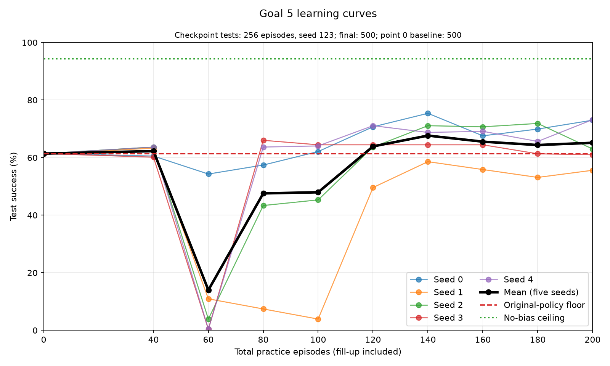
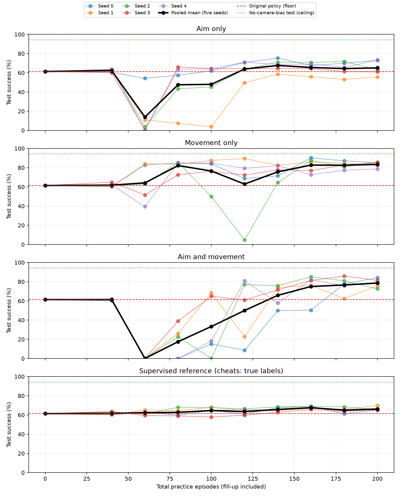
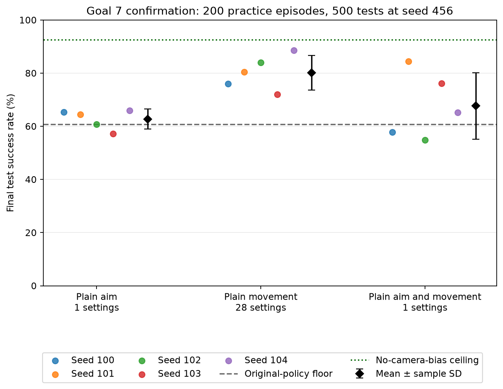
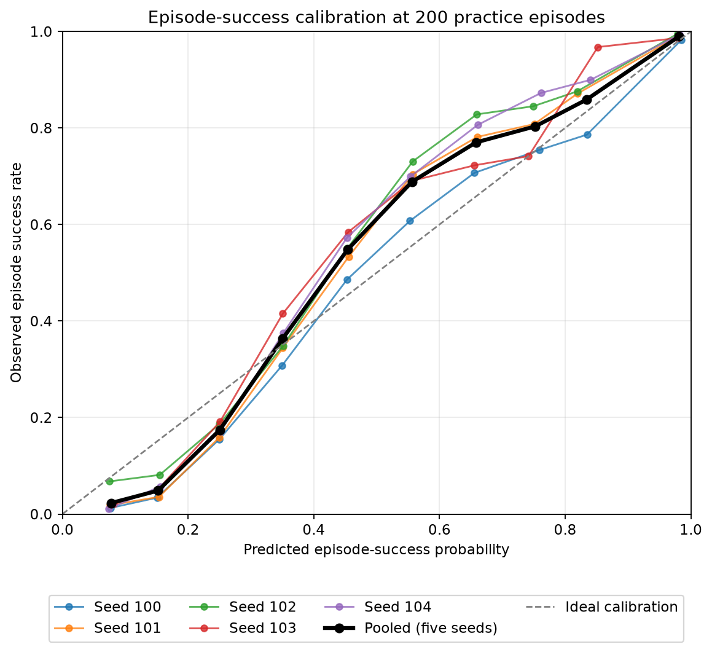

# Goal 5 check-in, 2026-11-15

Goals 1 through 6 are complete. This interim report preserves the Goal 5 check-in and adds Goal 6; it is not yet the Goal 12 final write-up. Griffin subsequently approved continuation through Goal 13 with no cuts. A 26m51s repeatability investigation identified variability in the original GPU simulator but no validated full-run fix; see [the findings](results/takehome/repeatability_findings.md). Execution stays unchanged and the limitation is carried forward. Binary traces and checkpoints now remain on disk only; new full test traces are saved only at final 500-episode tests unless later analysis needs them.

The main learner's average success is 65.16%, compared with 61.4% for the original policy. The measured gain is 3.76 percentage points, smaller than the 7.74-point spread across practice seeds. This is a small average improvement with mixed runs, not evidence of reliable improvement. The no-camera-bias ceiling is 94.4%, so most of the available improvement remains unrealized.

## Revised instructions and Goal 4

I reread AGENTS.md, CODEX_GOALS.md and TAKEHOME_PLAN.md in full. The existing mismatch was the obsolete sampling pause and broad Goal 4 checklist; I superseded both, added local cache ignores, and committed and pushed the earlier work. No original code, baseline, test seed or success rule needed changing. Goals 1–3 were saved in commits ac61f01 and 794195c, and Goal 4 in 6bd34c6.

The learner studies a memory bank of past practice steps. Its scorekeeper is an ensemble, meaning four networks estimating the future discounted reward of a proposed correction. The corrector learns to choose corrections with high ratings. A batch contains exactly 64 fill-up and 64 learner transitions when both exist, and all 128 transitions come from the nonempty source otherwise. Sensor scaling comes from the frozen policy; correction inputs are divided by their caps. The true camera error is saved for analysis and excluded from learning inputs. The scorekeeper's raw rating is not a calibrated chance of success.

Eleven contract tests passed. The ten-episode code trial completed with finite values and an unchanged original policy; its separate test scored 0/8, retained without tuning. The counter refused episode 201. Only the main learner was built: output dimensions 2, 3 and 5 are network-ready and start at exactly zero, while movement adapters and later tricks remain deferred. Details and fixed algorithm choices are in [TAKEHOME_PROGRESS.md](TAKEHOME_PROGRESS.md), [TAKEHOME_DECISIONS.md](TAKEHOME_DECISIONS.md) and [takehome/README.md](takehome/README.md).

## Main result and mechanism checks

Each reported practice seed used exactly 40 fill-up and 160 learner episodes, collected ten at a time. Every final result used 500 test-only episodes at test seed 123. Spread means the sample standard deviation of the five final success rates, not a confidence interval. The reported point is always episode 200, never the best earlier point.

| Practice seed | Successful tests / 500 | Final success |
|---|---:|---:|
| 0 | 365 | 73.0% |
| 1 | 278 | 55.6% |
| 2 | 315 | 63.0% |
| 3 | 305 | 61.0% |
| 4 | 366 | 73.2% |
| Mean | | 65.16% |
| Spread | | 7.74 percentage points |

Source: [goal5_per_seed.csv](results/takehome/goal5_per_seed.csv), [goal5_aggregate.json](results/takehome/goal5_aggregate.json), and the five result files named there. All five runs were designated in [benchmark_manifest.json](results/takehome/benchmark_manifest.json) before observing results.

| Reference | Successful tests / 500 | Success | Check |
|---|---:|---:|---|
| Original policy, normal camera bias | 307 | 61.4% | Goal 1 passed |
| Original policy, constant camera bias removed | 472 | 94.4% | Goal 1 passed |
| Wrapper with zero correction | 302 | 60.4% | Within 3 points of floor |
| Wrapper given the true bias | 471 | 94.2% | Within 5 points of ceiling |

These use test seed 123. Removing the constant camera bias retains step-to-step noise. Supplying the true bias is a test-only reference that cheats on information; it establishes that correcting the reading can help, not that the learner can infer that correction. Sources: [baseline.json](results/takehome/baseline.json) and [mechanism_check.json](results/takehome/mechanism_check.json).



Point 0 is the original policy. Points 40, 60, 80, 100, 120, 140, 160 and 180 use 256 test episodes; point 200 uses 500, always seed 123. The curves show a sharp early deterioration in several seeds followed by recovery. No earlier peak replaces the final score. The black line is the five-seed average, not an uncertainty band.

Rebuild this figure without collecting episodes:

```bash
source scripts/env.sh && python -B takehome/plot_goal5.py
```

## Every timing repeat, including poor results

The required timing comparison needed nine independent experiments. The first designated run for each seed supplies the main result; four repeats measure timing and repeatability and never replace a main run.

| Execution group | Seed | Role | Successful tests / 500 | Success |
|---|---:|---|---:|---:|
| One process | 0 | Main | 365 | 73.0% |
| Two processes | 1 | Main | 278 | 55.6% |
| Two processes | 2 | Main | 315 | 63.0% |
| Four processes | 3 | Main | 305 | 61.0% |
| Four processes | 4 | Main | 366 | 73.2% |
| Four processes | 0 | Timing repeat | 318 | 63.6% |
| Four processes | 1 | Timing repeat | 282 | 56.4% |
| Two seeds in one process | 0 | Timing repeat | 314 | 62.8% |
| Two seeds in one process | 1 | Timing repeat | 312 | 62.4% |

Source: [goal5_all_runs.csv](results/takehome/goal5_all_runs.csv). Each row has its own 200-episode counter and saved actor, scorekeeper and step traces. Across all nine runs, the core training code hashes match. All budgets and test labels passed audit, losses and saved final arrays were finite, and final tests detected zero through-wall episodes. The frozen policy was unchanged. The five learned runs do not have identical per-episode outcomes. No tripwire fired.

Repeatability remains unresolved: repeated seeds produced different results, including seed 0 ranging from 62.8% to 73.0%. Saved first fill-up batches already differ in sensor readings and contact forces before any learning, although their sampled biases, proposed random nudges and running guesses match exactly. This narrows the discrepancy to a stage before learner updates but does not establish its cause. Do not claim deterministic replay or attribute all variability solely to practice seeds. The earlier zero-wrapper check also passed its agreed tolerance without matching every baseline success bit. Evidence: [goal5_repeatability.json](results/takehome/goal5_repeatability.json), [goal5_source_audit.json](results/takehome/goal5_source_audit.json), [goal5_run_audit.json](results/takehome/goal5_run_audit.json), and [goal5_checks.json](results/takehome/goal5_checks.json).

## Measured speed

| Setup | Completed 200-episode runs | Total wall time | Effective seconds per run |
|---|---:|---:|---:|
| One GPU process | 1 | 116.03 s | 116.03 s |
| Two GPU processes together | 2 | 132.05 s | 66.02 s |
| Four GPU processes together | 4 | 232.04 s | 58.01 s |
| Two seeds sequentially in one process | 2 | 156.03 s | 78.01 s |

A standalone run took 1.93 minutes including startup and its curve tests, or 91.12 seconds after imports/environment construction. Four processes gave the fastest observed throughput: about one completed experiment per 58 seconds, while an individual job took longer. This is a small benchmark with different seeds, not a precise controlled estimate for every future method. Future batches will provisionally use four processes; several seeds can still share a process when useful, but a combined four-process/multiple-seed schedule has not been measured. The full detached benchmark took 637.02 seconds and exited successfully. Source: [benchmark_timings.json](results/takehome/benchmark_timings.json), [goal5_benchmark.exit.json](results/takehome/goal5_benchmark.exit.json).

## Time to finish the remaining goals

These are planning estimates for laptop-awake time, not promises. They include writing, reviewing and testing code as well as simulation. Training times include the prescribed curve tests. Extra 500-episode evaluations are estimated at 0.50 minutes each. The measured main run is 1.93 minutes; complex future methods are provisionally estimated at 2.42 minutes serial. Analysis-only rows have no training runtime.

| Goal | New training runs | Extra 500-episode tests | Minutes per training run | Hours serial | Hours with four processes and helpers |
|---|---:|---:|---:|---:|---:|
| 6: budget-matched comparisons | 15 | 0 | 1.93 | 0.98 | 0.60 |
| 7: screening, combinations, confirmation | 118 likely; up to 235 | 2 | 2.42 | 6.44 | 3.60 |
| 8: scorekeeper calibration | 0; five saved-data analyses | 0 likely | n/a | 0.50 | 0.33 |
| 9: failure counts and videos | 0; about 20 videos | 1 | n/a | 1.01 | 0.55 |
| 10: three other policies | 9 | 6 | 2.42 | 0.66 | 0.40 |
| 11: eight camera conditions | 24 | 40 | 2.42 | 2.47 | 1.65 |
| 12: write-up | 0 | 0 | n/a | 0.92 | 0.65 |
| 13: final rerun and checks | 1 | 0 | 2.42 | 0.62 | 0.37 |

Likely total: **8.1 hours** with the fastest measured setup and helpers, versus **13.6 hours** serial. Conservative worst-case planning allowance: **32.5 hours**. The worst case uses the larger exploration count, twice current solo training cost, no GPU concurrency advantage, and twice estimated code/analysis time. It is not a bound on interruptions or unforeseen debugging.

The likely Goal 7 count assumes 24 new single-change settings on three seeds (72 runs), four combinations on five seeds plus two extra seeds for three promising singles (26 runs), and up to four methods on five confirmation seeds (20 runs). The conservative 235-run scenario allows up to 43 new configurations on five seeds plus 20 confirmation runs, treating two configurations as already available references. These are forecasting assumptions, not a decision to exhaust the setting cap. The written fallback can skip combinations if no change clearly helps.

Helpers can shorten routine coding, tests, tables, charts and CPU rendering while the lead designs, reviews and interprets. The estimate assumes a 25% reduction in implementation overhead, two CPU analysis workers and three rendering workers. Helpers cannot add GPU capacity; the measured GPU concurrency already accounts for sharing the one GPU. Extra test work is conservatively left serial. No confirmation seeds have been touched.

Full assumptions and reproducible calculations: [time_estimate.md](results/takehome/time_estimate.md), [time_estimate.json](results/takehome/time_estimate.json). Recompute with:

```bash
source scripts/env.sh && python -B takehome/estimate_time.py
```

## Proposed cuts, in order

None of these cuts has been applied. Savings use the faster setup and are approximate, not fully additive.

1. Skip Goal 7 combinations: about 0.90 hours saved. The existing fallback already does this if screening finds no clear winner.
2. Screen 12 new settings instead of 24: about 1.29 hours saved; Griffin would need to approve the reduced experiment list.
3. Retrain on four camera conditions instead of eight: about 0.81 hours saved, dropping the corresponding condition evaluations as well.
4. Drop the position-only and hovering-policy extensions: about 0.23 hours saved.
5. Render one example per failure type per side instead of two: about 0.15 hours saved.

## Budget, usage and resuming

One learning setting has been tried. Practice use is 1810 episodes: 1000 in the five main runs, 800 in four independent timing repeats, and 10 in the code trial. Every experiment stayed within its own budget. There have been 24,956 complete test-only episodes across preflight and Goals 1–5, plus 16 reset-only probes; none was learned from. All runs, including poor ones, are retained.

The account usage allowance is not visible: the runtime reports `rate_limits: null`, so no percentage used or remaining can be stated. Cumulative token counters include repeated/cached context and are not allowance percentages. The visible context window is 258,400 tokens; four agents can be active including the lead. No fixed session deadline is exposed. Detached processes survive the launching terminal, but not a sleeping/shut-down laptop or WSL shutdown. Progress logs, separate episode ledgers and checkpoints support resumption. Source: [goal5_usage_snapshot.json](results/takehome/goal5_usage_snapshot.json).

The lead designed and reviewed the learner, interpreted results, wrote this report and made every experimental choice. Two gpt-6-luna/low helpers handled narrow plotting and data-audit tasks in separate files; their outputs were reviewed. No fallback or success-driven tuning was used through Goal 5. PLAN GAP choices remain listed in TAKEHOME_DECISIONS.md.

**Check-in resolved:** Griffin approved continuation through Goal 13 with no cuts. Repeatability remains a documented limitation after the bounded investigation; tests, seeds and reported results are unchanged. See TAKEHOME_PROGRESS.md for the current phase.

## Goal 6: same-budget comparisons

Original-policy floor: 307/500 (61.4%). No-camera-bias ceiling: 472/500 (94.4%). Both use test seed 123 with no learning.

| Method | Seed 0 | Seed 1 | Seed 2 | Seed 3 | Seed 4 | Mean | Sample spread |
|---|---:|---:|---:|---:|---:|---:|---:|
| Aim only | 365/500 | 278/500 | 315/500 | 305/500 | 366/500 | 65.16% | 7.74 points |
| Movement only | 425/500 | 411/500 | 427/500 | 428/500 | 393/500 | 83.36% | 2.99 points |
| Aim and movement | 421/500 | 378/500 | 363/500 | 407/500 | 396/500 | 78.60% | 4.60 points |
| Supervised reference (cheats: true labels) | 325/500 | 349/500 | 328/500 | 327/500 | 325/500 | 66.16% | 2.05 points |

Each learned result uses its own 200 practice episodes and 500 test-only episodes at seed 123. Aim-only results are reused from Goal 5.




Movement-only has the highest mean among the three learners. It is 21.96 percentage points above the old-policy floor. Adding movement to aim raises the mean 13.44 points; adding aim to movement lowers it 4.76 points. The supervised reference (cheats: true labels) is not competitive with movement and is not a theoretical upper bound. Every learned run gets 40 fill-up and 160 learner episodes; the final test is separate.

Four settings have now been tried, with 4810 total practice episodes across separate experiments. These are development results; the final method and independent confirmation headline have not been chosen. Tables and source paths: [comparison](results/takehome/goal6/comparison.md), [all seeds](results/takehome/goal6/goal6_per_seed.csv), [aggregate](results/takehome/goal6/goal6_aggregate.json), [audit](results/takehome/goal6_audit.json), [counts](results/takehome/goal6_counts.json). Rebuild both figures with `source scripts/env.sh && python -B takehome/plot_goal6.py`.

## Goal 7 development selection, confirmation running

All 24 new screening settings completed: 72 independent experiments, each with 200 practice episodes and a final 500-episode test at seed 123. Including the four earlier configurations gives 28 settings, one of which is the ineligible supervised cheating reference. Every screening result is shown in [the exploration table](results/takehome/goal7/exploration.md), [the per-seed CSV](results/takehome/goal7/exploration.csv), and [the preserved screening summary](results/takehome/goal7_screening_summary.json). The screening suite took 3230.14 seconds, about 53.8 minutes, and [all 72 runs passed audit](results/takehome/goal7_screening_audit.json).


No new trick improved on its relevant baseline beyond both matched sample spreads. This leaves no eligible single changes to extend or combine in round 2. The rule that would force confirmation of main aim does not apply, because movement-capable methods did beat main aim. Under the written final selection rule, plain movement has the highest mean, 83.36%, with a 2.99-point spread, and is the only eligible setting within one spread of that mean. The [written choice](results/takehome/goal7_choice.json) fixes the original 40-fill/160-learner movement recipe and 0.2 mm per-axis cap. It was written before any confirmation work.

The search exposed substantial instability, including 2/500 successes for one smaller-aim-cap seed. Those runs remain in the table. Sequential variants froze the inactive networks while retaining exploration noise on both output parts; the first trained actor continued acting during the second half. This search does not establish that extra mechanisms are useless in general; it provides no measured reason to add them under this budget and the fixed comparison rule.

The force-penalty setting averaged 88.16 N in episode peak force versus 91.79 N for matched plain combined seeds, with sample spreads of 10.54 N and 6.46 N. Its mean success was 67.47% versus 77.47%, with success spreads of 14.98 and 6.02 points. The lower force mean is smaller than the force spread and does not establish a reliable force reduction. [Source comparison](results/takehome/goal7/force_penalty_comparison.json).

Confirmation is now running on practice seeds 100-104 and final test seed 456. Its fresh original-policy floor is 304/500 (60.8%), and its no-camera-bias ceiling is 463/500 (92.6%). The movement confirmation result will be the headline even if lower than development. Plain aim and combined methods are also being confirmed unchanged. Movement had the benefit of selection after 28 evaluated configurations; the two comparison recipes were not tuned. [Confirmation references](results/takehome/confirmation_baseline.json), [predeclared confirmation manifest](results/takehome/goal7_confirmation_manifest.json).

Rebuild the development chart and CSVs with `source scripts/env.sh && python -B takehome/plot_exploration.py`.


## Goal 7 confirmation: the headline result

The final method is plain movement correction, selected before confirmation from 28 settings. Its fresh-seed result is **80.20% success, sample spread 6.52 percentage points**, against the original policy's 60.8% and the no-bias reference's 92.6%. Each count below is out of 500 tests at seed456, ordered by practice seeds100,101,102,103,104. Each run used exactly200 own practice episodes. The movement method had the benefit of selection across28 settings; the plain aim and combined comparisons each had one setting and no tuning for confirmation.

| Method | Settings considered | Success counts by seed | Mean | Sample spread |
|---|---:|---|---:|---:|
| Plain aim | 1 | 327, 322, 304, 286, 330 | 62.76% | 3.71 pp |
| Plain movement | 28 | 380, 402, 420, 360, 443 | 80.20% | 6.52 pp |
| Plain aim and movement | 1 | 289, 422, 274, 381, 326 | 67.68% | 12.47 pp |

Movement improved over the original policy by19.40 percentage points. Aim-only's1.96-point gain and combined's6.88-point gain are smaller than their respective seed spreads, so those gains are unproven under the predeclared rule. The movement headline is3.16 points below its development mean; confirmation did not change the choice. No result was replaced. The curves show an early collapse and recovery for aim and combined. The data establish that collapse, but do not identify its cause.




Sources: [all confirmation seeds](results/takehome/goal7/confirmation/confirmation_summary.json), [confirmation references](results/takehome/confirmation_baseline.json), [checks](results/takehome/goal7_checks.json). Rebuild both figures with `source scripts/env.sh && python -B takehome/plot_confirmation.py`. Intermediate curve tests use256 episodes at seed123, while the final point and original-policy reference use500 at seed456, as logged under PLAN GAP.


## Goal 8: confidence is underconfident on average

The separate episode-success predictor is **underconfident on average by5.23 percentage points** at the end of training. It predicts69.54% versus74.77% observed across392,329 valid test steps from2,500 original confirmation episodes. This is a step-weighted measure: longer failures contribute more steps, so74.77% is not the headline episode success rate80.20%. All45 small logistic-regression fits converged, using only each run's own counted practice up to that checkpoint, normal observations, proposed correction and remaining time. No test data or true camera error trained the predictor.

The average absolute prediction gap across ten probability bins is6.32 points. The Brier score, the mean squared probability error where zero is perfect, is0.15235. Of495 failed final episodes,355 contained at least one prediction of80% or higher;15 contained the predeclared sharp drop (at least25 points between adjacent five-step averages). These are counts of selected moments, not an alarm precision estimate. Missing drops remain explicitly null. Raw Q is shown separately because discounted, bootstrapped return is not an episode probability; its relationship with eventual outcomes is not monotonic in these pooled observations.




Sources: [all seeds and checkpoints](results/takehome/goal8/summary.json), [confident failed moments](results/takehome/goal8/confident_failed.csv), [confidence drops](results/takehome/goal8/confidence_drops.csv). Rebuild all three figures with `source scripts/env.sh && python -B takehome/plot_calibration.py`. The intermediate traces are the explicitly needed Goal8 exception to final-only full traces; they remain local. Intermediate diagnostics use256 tests at123, final diagnostics reuse500 at456 per seed.


## Goal 9: remaining failure patterns

The original-policy traced repeat had303 successes and197 failures in500 tests at seed456. This is separate from the304-success headline reference. The final method's original confirmation traces contain2,005 successes and495 failures in2,500 tests, allfive seeds pooled. The fixed rule order is near-hole contact missing, wrong-way correction, stuck on rim, residual timeout, then other. An episode matches the first applicable rule, so categories are exclusive and the timeout row excludes failures already assigned another label.

| Operational label | Before | After, pooled |
|---|---:|---:|
| never near hole contact | 7/500 (1.40%) | 1/2500 (0.04%) |
| wrong way correction | 0/500 (0.00%) | 216/2500 (8.64%) |
| stuck on rim | 22/500 (4.40%) | 68/2500 (2.72%) |
| timeout | 168/500 (33.60%) | 210/2500 (8.40%) |
| other | 0/500 (0.00%) | 0/2500 (0.00%) |

Every count is retained, including zero in other. Wrong-way means excess aim-estimation error or accumulated outward movement command by the fixed threshold. It does not prove that the correction caused the failure, and the old policy has no correction to meet that rule. The outward direction calculation retains camera white noise. Rules, their exact thresholds, allfive seed counts and per-episode evidence are in [failures.json](results/takehome/goal9/failures.json).

The video manifest selects13 examples: six before and seven after, including the one available near-hole-contact failure after learning. There are no examples to invent for categories with zero cases. Videos come from labelled pose-recorded repeats at the same fixed seed456, with every repeat's result retained: before303/500; after practice seeds100,101,102,103 score382,391,419,349/500. These scores never replace the original confirmation results. The final movement-only method keeps its camera-error guess at zero, which is correctly visible beside the true error in the overlay. [Video manifest](results/takehome/goal9/video_manifest.json).

All13 local videos passed metadata, decoded-frame, frame-rate and duration checks. The lead reviewed every ending preview and sampled the approach/contact/end of two examples. The near-contact label is a force-and-distance proxy; it does not mean the peg never approached the hole.


Rebuild counts with `source scripts/env.sh && python -B takehome/plot_failures.py`; rebuild both preview sheets from the local videos with `source scripts/env.sh && python -B takehome/video_contact_sheet.py`. The temporal review sheet is reproducible with `source scripts/env.sh && python -B takehome/video_motion_review.py`. Videos and full traces remain local; their source manifests and small previews are committed.


## Goal 10: the same recipe on other policies

| Policy | Seed 0 | Seed 1 | Seed 2 | Seeds | Mean ± sample SD | Own floor | Own ceiling |
| --- | --- | --- | --- | --- | --- | --- | --- |
| force_0.5mm_s4 | 464/500 (92.8%) | 442/500 (88.4%) | 459/500 (91.8%) | 3 | 91.0% ± 2.3% | 84.0% | 97.6% |
| pos_0.5mm_s1 | 408/500 (81.6%) | 403/500 (80.6%) | 444/500 (88.8%) | 3 | 83.7% ± 4.5% | 80.4% | 100.0% |
| force_0.5mm_s1 | 0/500 (0.0%) | 0/500 (0.0%) | 0/500 (0.0%) | 3 | 0.0% ± 0.0% | 0.0% | 0.0% |

On force_0.5mm_s4, the unchanged recipe averaged 91.00% with a 2.31-point sample spread, against its own 84.0% floor and 97.6% no-bias reference. The 7.00-point gain exceeds the seed spread. This supports a gain on another already competent policy, with room still below its reference.

On pos_0.5mm_s1, the recipe averaged 83.67% with a 4.47-point spread, against an 80.4% floor and 100% no-bias reference. Its 3.27-point gain is smaller than the spread, so improvement is unproven. The position-only checkpoint did not start poorly, contrary to the plan's expectation; this experiment does not isolate the effect of removing force sensing because the checkpoints differ.

On the hovering force_0.5mm_s1 policy, all three final tests scored 0/500, matching both zero-success references. None of its three 200-episode practice runs produced a success, and mean final insertion depth remained zero. Removing camera bias alone did not help this checkpoint, and this sparse-reward, bounded movement recipe learned no successful behavior from the available practice. The written identical-outcome exemption applies because both references are zero.

Each reference used 500 tests at seed 123 before training; each learner had its own 200-episode budget. These are fresh learners with the same recipe, not transfer of the starting policy's learned weights. All nine runs passed their audit. [Results](results/takehome/goal10/transfer_summary.json); [practice outcomes](results/takehome/goal10/practice_outcomes.json).


Rebuild with `source scripts/env.sh && python -B takehome/plot_transfer.py`.
